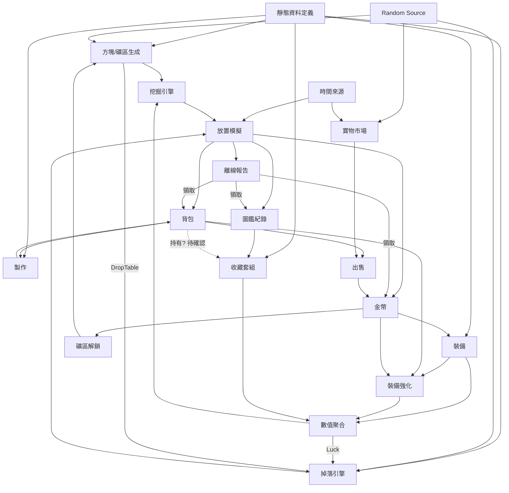

# 《挖礦探險隊》GDD 系統分析報告

| 版本 | 日期 | 內容 |
|---|---|---|
| v1.0 | 2026-11-13 | 初版分析（見附錄 A） |
| v1.1 | 2026-11-13 | 記錄決策 D1–D6；問題狀態總表；三份文件衝突檢查 |
| v1.2 | 2026-11-13 | 記錄決策 D7–D10；GDD 更新至 v1.1；新增 `scripts/balance-sim.ts`；7–14 天重新驗證；後期節奏 UI/UX 方案 |

相關文件：`docs/GDD.md` v1.1、`docs/GBS.md` v1.1、`docs/TECHNICAL_SPEC.md` v1.1、`scripts/balance-sim.ts`

---

## 1. 已確認決策

| # | 決策 | 內容 | 落實位置 |
|---|---|---|---|
| **D1** | 深度模型 | 1m = 10 方塊；0–300m 共 3,000 方塊；三個礦區各 1,000；可自由返回已解鎖淺層礦區；返回不重置最大深度 | GDD §3.2–3.3、GBS §1–2 |
| **D2** | Luck 計算 | `Final = Base × (1 + Luck)`，正規化使總和 100%；分層定義觸發、稀有度、物品表 | GBS §7 |
| **D3** | 收藏套組 | 圖鑑永久保留；必須實際持有全部才啟動；出售一件即失效；可重新取得 | GDD §4.4、GBS §9 |
| **D4** | 伺服器權威 | MVP 就由伺服器計算挖掘、掉落、入帳、離線時間；報告不可重複領取；Client 只負責呈現；優先 Supabase Database / Edge Function | GDD §7.5、§9.4、TECH §2–3 |
| **D5** | Power 不足 | 方塊有最低 Power；不足時停止、提示、引導 Workshop；離線也停止，保留已完成成果 | GDD §3.2、GBS §4.2 |
| **D6** | 遊玩時間 | 0–300m 目標 7–14 天；新手礦坑 1–2 天、水晶洞窟 2–4 天、古代遺跡 4–8 天 | GBS §16、§18 |
| **D7** | 混合式掉落 | Common 每方塊判定；Rare 每方塊依 Drop Table；Epic / Legendary 時間型；金幣由特定方塊或獨立判定；Luck 影響稀有物品且總和正確 | GDD §4.1、GBS §7 |
| **D8** | 回訪 | 可返回所有已解鎖礦區；使用最深處的硬度與 Power 要求；普通礦物依原始表；寶物較低倍率；不應比前進更有利 | GDD §3.3、GBS §2.3、§14.4 |
| **D9** | 離線上限 | 12 小時；效率 100%；超過不產生收益；不因領取頻率產生額外倍率 | GDD §7.1、GBS §15、TECH §7 |
| **D10** | 十字鎬與解鎖 | 初始只有木製；依序購買；需要金幣與素材；挖到底部並付費才能進入下一區；移除選擇初始十字鎬 | GDD §3.1、§6.1、GBS §10、§12 |

---

## 2. 問題狀態總表

✅ 已決策　📝 提案（等你審核）　❓ 尚未定義

### 2.1 本次狀態有變更的項目

| ID | 問題 | v1.1 狀態 | v1.2 狀態 |
|---|---|---|---|
| C-1 | 初始十字鎬 | 📝 P21 | ✅ D10 |
| D-1 | 機率判定單位 | 📝 P10（全部時間制） | ✅ D7（混合式）；P10 作廢 |
| Q-1 | 十字鎬取得方式 | 📝 P21 | ✅ D10 |
| Q-2 | 是否依序 | 📝 P21 | ✅ D10 |
| U-1 | 解鎖條件 | 📝 P23 | ✅ D10 |
| U-2 | 到底部未解鎖 | 📝 P23 | ✅ D10（無法進入，前線停止） |
| O-5 | 超過上限的時間 | 📝 P29 | ✅ D9 |
| B-8 | 離線上限與輕度玩家 | ⚠️ | ✅ D9；輕度玩家 11.5 天 |
| M-10 / P2 | 回訪規則 | 📝 P2 | ✅ D8（硬度、Power、礦物表、寶物倍率）；📝 P2 無限循環、P34 金幣倍率、P35 前線礦區不算回訪 |
| D-7 | 保底 | ❓ | ✅ MVP 不實作；風險分析見 GBS §20 |

### 2.2 其他項目

其他項目維持 v1.1 的狀態（完整表格見 git 歷史 commit efa42ea 的 §2；原始問題說明見附錄 A）。仍然是 ❓ 的項目：C-2 外觀、C-3 名稱規則、C-4 訪客模式、M-12 重置 / 重新下潛、D-8 Legendary 特殊加成、D-9 背包容量、E-7 大數字顯示、UI-3 Header 內容。

---

## 3. 待確認決策

### 3.1 影響數值或規則（建議優先確認）

| 優先 | 項目 | 提案 | 不確認的影響 |
|---|---|---|---|
| 1 | **Hardness 整體 ×1.2**（GBS §19 A） | 讓重度 / 一般玩家從約 6.2 天變成約 7.1 天 | 維持 ×1.0：重度與一般玩家低於 7 天下限 |
| 2 | **回訪金幣 ×0.5**（P34） | D8 沒有規定金幣；不加的話，黃金 190–200m 回訪 zone1 = 前線的 125% | D8「不應比前進更有利」不成立 |
| 3 | **金幣金額依門檻段遞增**（P36） | 20 / 20 / 150 / 330 / 1,100 / 1,400 | 和 P34 一起把回訪比例壓到 86% |
| 4 | **回訪寶物倍率 0.5**（D8 的數值） | 補齊 1 種缺少的 Epic：zone1 約 16 小時 | 倍率越低，補收藏越慢 |
| 5 | **前線所在礦區不算回訪**（P35） | 只能回訪比前線淺的礦區 | 若允許，前線礦區的「回訪」等於在最深處重複挖 |
| 6 | 每方塊必有 1 個基礎產出（P8） | 第一層 | 經濟模型需重算 |
| 7 | 寶物只有 Epic / Legendary（P13） | 方塊礦物 Common、寶石 Rare | 與 GDD `Artifact.rarity` 衝突 |
| 8 | 未領取報告阻擋其他操作（P30） | 必須先領取 | 若允許累積，需定義合併規則 |
| 9 | 十字鎬其餘規則（P21） | 購買後自動裝備、可切換、保留等級、不可出售 | — |
| 10 | 伺服器架構（T1、T2） | Edge Function 計算 + RPC 提交；monorepo | — |
| 11 | **防止卡死**（P38） | zone1 50m 前沒有可回訪礦區；把石頭賣光會永久卡死。建議限制出售或允許重挖已挖深度帶 | 玩家誤操作時無法繼續遊戲 |

### 3.2 內容與細節

| 項目 | 說明 |
|---|---|
| P15 | 精煉水晶的「水晶」= 紫水晶 |
| P9 | 各礦區方塊組成（GDD §3.3 未列石頭、鐵礦、銀礦的分布） |
| P17 | zone1、zone2 寶物與套組名稱（暫定） |
| P18 | Legendary 特殊加成 |
| P24–P26 | 市場倍率、更新時間、7 天走勢 |
| P28 | 在線 / 離線判定門檻 300 秒 |
| P33 | 玩家類型的登入時間定義（GBS §16.3），影響天數換算 |
| D-9 | 背包容量 |
| 保底方向 | GBS §20 列出的四個方向，未來版本是否採用 |
| §7 UI/UX | 後期節奏方案的優先順序 |
| C-2、C-3、C-4、M-12、UI-3、T3–T13 | 同 v1.1 |

---

## 4. 需要審核的數值

| 數值 | 位置 | 說明 |
|---|---|---|
| Hardness 表（以及是否 ×1.2） | GBS §5、§19 A | 決定遊玩天數 |
| 第二層：BundleChance 15%、RareBase 2.5 / 3.5 / 5% | GBS §7.2 | 普通與稀有礦物產量 |
| 第三層：金幣 10%、CoinAvg 各門檻段 | GBS §7.3 | 主要收入來源 |
| 第四層：TreasurePerHour 0.35 / 0.25 / 0.175、Epic : Legendary = 9 : 1 | GBS §7.4 | 寶物產量 |
| 回訪倍率：寶物 ×0.5、金幣 ×0.5 | GBS §2.3 | 回訪收益 |
| 十字鎬價格、強化成本、解鎖費用 | GBS §10、§12 | v1.1 未修改 |
| 寶物 Base Value、套組加成 | GBS §8.3、§9.2 | v1.1 未修改 |

---

## 5. 文件衝突檢查

### 5.1 GDD v1.0 → v1.1 已修正

| # | GDD 原內容 | v1.1 |
|---|---|---|
| 1 | §4.4 套組「永久加成」 | 改為持有期間生效（D3） |
| 2 | §7.5、§9.4「正式版本」才由伺服器負責 | MVP 即由伺服器負責（D4） |
| 3 | §3.2 Power 不足以突破硬度 | 新增 RequiredPower 屬性與停止規則（D5） |
| 4 | §4.1 單一機率表 | 改為混合式掉落（D7） |
| 6 | §3.1、§2.1 選擇初始十字鎬 | 初始只有木製（D10） |
| 7 | §5.1「製作裝備」 | 改為購買需金幣與素材（D10） |
| — | §7.1、§7.2、§13 的 8 小時 | 改為 12 小時（D9） |
| — | §3.3 礦區 | 加入 1,000 方塊、解鎖條件、回訪規則（D1、D8、D10） |
| 12 | §4.2「立即進入背包」 | 加註伺服器延遲 |
| 14 | §14 時程 | 加註需重新估算 |
| 15 | §11 離線結算 P1 | 改為 P0 |

### 5.2 GDD v1.1 仍待確認（只加註，未改規則）

| # | 內容 | 相關提案 |
|---|---|---|
| 5 | §4.3 `Artifact` 介面 | TECH §8.1 的定義與實例分離 |
| 8 | §6.3 精煉水晶的「水晶」 | P15 |
| 9 | §3.3 主要資源表 | P9 |
| 10 | §8.2 單頁 vs §9.3 多頁路由 | T10 |
| 11 | §9.3 專案結構 | T2 |
| 13 | §4.1 Legendary 特殊加成 | P18 |

### 5.3 GBS v1.1 與 TECHNICAL_SPEC v1.1 交叉檢查

| 項目 | GBS | TECH | 結果 |
|---|---|---|---|
| 離線上限 | §15：12 小時 | §7.2：12h；§14 測試 11 / 12 / 16 小時 | ✅ |
| 領取頻率不影響收益 | §15 | §7.3；§14.5 測試 | ✅ |
| 四層掉落順序 | §4.3、§7 | §6.2 亂數消耗順序 | ✅ |
| 四層機率公式 | §7.2–7.4 | §5 ppm 公式 | ✅（含單位驗算） |
| 回訪硬度、Power、礦物表 | §2.3 | §14.1 測試、`mining-select` | ✅ |
| 回訪寶物 ×0.5、金幣 ×0.5 | §2.3 | §5、§14.1 | ✅ |
| 可回訪的礦區 | §2.3（P35） | `mining-select` | ✅ |
| 金幣依門檻段 | §7.3 | §5 `coinAvgBySegment` | ✅ |
| 初始木製、依序購買 | §10.2 | `character-create`、`pickaxe-buy` | ✅ |
| 解鎖需到底部並付費 | §12 | `zone-unlock`、§14.1 | ✅ |
| 平衡模擬腳本 | §14、§18 | §14.4 | ✅ |
| 腳本資料與 GBS 一致 | — | `scripts/balance-sim.ts` §2 | ✅ 已逐項核對；引擎完成後改為匯入，避免兩份資料 |

沒有發現規則衝突。

---

## 6. 模擬結果摘要

### 6.1 138.1 小時有沒有改變

**有，變成平均 132.8 小時**（持續在線，1,000 次 Monte Carlo；中位數 131.9、P10 127.8、P90 136.7）。原因：

1. **金幣改為每方塊判定（D7）**：v1.0 的金幣袋是時間制，前期方塊快、金幣少；改為每方塊後前期金幣來得早，石製十字鎬從 24m 提前到 7m，zone1 從 19.5 縮短到 17.9 小時。
2. **Monte Carlo 取代期望值**：v1.0 是單一期望值路徑，v1.1 包含隨機波動與卡關時的回訪。
3. D9 的 12 小時上限**不影響**持續在線的數字，只影響各玩家類型的天數。

### 6.2 各礦區平均收益與完成時間（持續在線）

| 礦區 | 平均收入 | 平均完成時數 | 中位數 | P10 | P90 |
|---|---:|---:|---:|---:|---:|
| zone1 | 4,459 | 17.9 | 17.8 | 16.8 | 18.9 |
| zone2 | 42,407 | 38.3 | 38.1 | 35.7 | 41.1 |
| zone3 | 202,522 | 76.6 | 75.9 | 74.2 | 78.1 |

### 6.3 不同玩家類型（天）

| 類型 | 平均 | 中位數 | P10 | P90 | Hardness ×1.2 時平均 |
|---|---:|---:|---:|---:|---:|
| 重度（每天 4 次） | 6.2 | 6.2 | 5.6 | 6.7 | 7.2 |
| 一般（每天 2 次） | 6.2 | 6.3 | 5.8 | 6.4 | 7.1 |
| 輕度（每天 1 次） | 11.5 | 11.2 | 11.0 | 12.2 | 13.3 |

D9 之後，每天登入 2 次已接近全天挖掘，所以重度與一般玩家差不多。

---

## 7. 後期節奏 UI / UX 方案（不修改核心數值）

### 7.1 問題

後期每方塊約 5.5 分鐘（若採用 ×1.2 則約 6.6 分鐘）；zone3 每小時寶物期望 0.2 件。一次 10 分鐘的在線時間大約只看到 2 個方塊完成、0.03 件寶物。畫面若只有一條慢慢前進的進度條，玩家會覺得「沒事發生」。

### 7.2 方案（皆只影響呈現）

| 優先 | 方案 | 說明 | 依據 |
|---|---|---|---|
| 1 | **揮鎬分段與裂痕階段** | 每 2–4 秒一次揮鎬動畫與音效；方塊依進度顯示 4 段裂痕；每次揮鎬跳出小數字（本次工作量） | 工作量是連續累積的，分段只是切開顯示 |
| 2 | **剩餘時間與下一個目標** | 顯示「約 4:32 後挖開」；常駐「下一個目標」卡片：下一件可買裝備或強化的金幣 / 素材進度條 | 給在線時間一個明確的進展感 |
| 3 | **本方塊寶物機會指示** | 方塊挖得越久，「寶物感應」越亮，對應第四層 Chance 隨挖掘秒數上升 | 這是真實的機率變化，不是假的累積；不顯示精確百分比可避免玩家誤解 |
| 4 | **深度里程碑** | 每 10m 一次小提示（新深度帶、硬度上升）；背景依深度帶改變色調與環境物件 | 3,000 方塊被切成 30 個可感知的階段 |
| 5 | **離線預測** | 離開前顯示「接下來 12 小時預計挖到 X m」「約 Y 小時後會遇到門檻，建議先升級」 | 同時減少 D5 造成的閒置（GBS §19 C） |
| 6 | **在線時有事可做** | Recent Loot 可直接出售；市場 7 天走勢；圖鑑缺少的寶物提示「可在 zone1 回訪取得」 | 讓在線時間用在決策，而不是盯著進度條 |
| 7 | **環境生命感** | 礦工待機小動作、燈光閃爍、蝙蝠、落石粒子；Common 掉落的小跳動畫 | CSS Sprite 即可完成（GDD §8.1） |
| 8 | **瀏覽器通知（選用）** | 離線上限將到、遇到門檻、報告可領取 | 需 Service Worker，建議 Phase 4 之後 |

### 7.3 不建議的做法

- 在線時提高掉落率：違反 D9「不因領取頻率產生額外倍率」的精神，也會讓在線與離線不一致。
- 假的「保底進度條」：MVP 沒有保底，顯示會誤導玩家。

### 7.4 若要從數值解決（需要你決定）

- 增加方塊數（改 D1），或降低後期 Hardness（會縮短總天數，與 §6.3 衝突）。
- 這兩者都會改動核心平衡，本版不採用。

---

## 8. 下一步

1. 你確認 §3 的待確認決策（特別是 Hardness ×1.2、P34、P35）與 §4 的數值。
2. 我依回覆更新 GBS、TECHNICAL_SPEC、`scripts/balance-sim.ts`，重新跑模擬。
3. 規格定案後，才開始實作（TECH §16 階段 1）。

---

## 附錄 A：v1.0 原始分析

以下保留 v1.0 的分析內容，方便追溯問題編號。問題的最新狀態以本文件 §2 為準；v1.1 的完整狀態表見 git 歷史（commit efa42ea）。

### A1. 核心系統與依賴關係

#### 1.1 系統清單

| 層級 | 系統 | 職責 | GDD 章節 |
|---|---|---|---|
| 基礎 | 靜態資料定義 | 礦物、礦區、方塊、裝備、寶物、配方、套組 | §3.3, §4, §6 |
| 基礎 | Random Source | 可注入亂數 | §9.4 |
| 基礎 | 時間來源 | 伺服器時間、離線時長、市場更新週期 | §5.2, §7.5 |
| 核心 | 角色 | 建立角色、外觀、名稱 | §3.1 |
| 核心 | 數值聚合 | 十字鎬基礎值 + 強化等級 + 套組加成 → 最終 Power / Speed / Luck | §3.2, §4.4, §6 |
| 核心 | 方塊 / 礦區生成 | 深度 → 礦區 → Hardness / OreType / DropTable | §3.2, §3.3 |
| 核心 | 挖掘引擎 | 硬度門檻判定、挖掘時間、進度 | §3.2 |
| 核心 | 掉落引擎 | 稀有度判定（受 Luck 影響）、物品判定、金幣掉落 | §4.1 |
| 核心 | 放置模擬 | 給定時間區間，推進挖掘與掉落 | §7 |
| 資源 | 背包 | 可堆疊礦物 / 素材、寶物實例 | §8.3 |
| 資源 | 金幣經濟 | 收入（出售、掉落）、支出（購買、升級、製作、解鎖） | §5.1 |
| 成長 | 裝備（購買 / 切換） | 十字鎬取得與裝備 | §6.1 |
| 成長 | 裝備強化 | Lv.1–5 | §6.2 |
| 成長 | 製作 | 素材轉換 | §6.3 |
| 成長 | 礦區解鎖 | 進入更深礦區 | §3.3, §5.1 |
| 收藏 | 圖鑑紀錄 | 發現紀錄，獨立於持有 | §4.3 |
| 收藏 | 收藏套組 | 完成後永久加成 | §4.4 |
| 收藏 | 寶物市場 | Market Multiplier、24h 更新 | §5.2 |
| 放置 | 離線結算 | 時長計算、上限、報告產生 | §7.1–7.2 |
| 放置 | 離線報告領取 | 一次入帳、防重複領取 | §7.3–7.5 |
| 呈現 | 掉落呈現 | Recent Loot、分級動畫 | §4.2, §7.4 |
| 平台 | 認證 / 持久化 / 同步 | Supabase Auth + PostgreSQL | §9.1 |

#### 1.2 依賴圖

#### 1.3 關鍵依賴觀察

1. **數值聚合是樞紐。** 裝備、強化、套組三個來源都會改 Power / Speed / Luck，挖掘和掉落兩個引擎都讀它。它應該是一個獨立的純函式，疊加規則（加法或乘法、先後順序）要在 GBS 裡明確定義。
2. **存在一條回饋迴圈：** 掉落 → 圖鑑 → 套組 → Luck → 掉落。這是設計上刻意的，但模擬時要注意：在一段放置模擬（例如離線 8h）中途完成套組時，加成是當下就生效，還是領取報告後才生效？
3. **離線結算不應該是獨立系統。** 離線和在線都是「推進一段時間的挖掘模擬」，差別只在時間區間和呈現方式。如果離線用另一套近似演算法，就很難滿足「與在線模式相同的掉落規則」（§7.1）。
4. **製作 ↔ 背包 ↔ 強化** 構成素材流。目前製作產物（鐵錠、強化石、精煉水晶）沒有任何定義好的消耗端，這條鏈是斷的（見 §2.6）。
5. **市場是唯一依賴「日曆時間」的系統**，和挖掘用的「經過時間」性質不同，時間基準要分開定義。

---

### A2. 尚未定義清楚的規則

依系統分類。每一項都是寫程式前必須有答案的問題。

#### 2.1 角色

| # | 問題 |
|---|---|
| C-1 | 「選擇初始十字鎬」有哪些選項？只能選木製，還是可以選更高等級？（可選就會影響開局平衡。） |
| C-2 | 外觀選項數量；外觀是否純裝飾（不影響數值）？ |
| C-3 | 名稱規則：長度、字元集、是否需唯一、能否改名、是否要過濾不當字詞。 |
| C-4 | 一定要登入才能玩，還是有訪客模式？訪客資料能否綁定帳號？ |

#### 2.2 深度與方塊模型（最高優先）

| # | 問題 |
|---|---|
| M-1 | **1 格方塊等於多少深度？** 如果 1 格 = 1m，MVP 總共只有 300 個方塊。 |
| M-2 | 地形是單一垂直柱（只往下），還是有橫向的格子地圖？ |
| M-3 | 方塊內容（OreType、Hardness）是預先生成（固定種子地圖），還是挖到時才決定？每位玩家的地圖是否相同？ |
| M-4 | 每個方塊一定有掉落嗎？一次掉幾個？OreType 和 DropTable 的關係是什麼（方塊類型決定掉落，還是掉落表與方塊類型無關）？ |
| M-5 | Hardness 的數值範圍與隨深度的成長曲線。 |
| M-6 | 挖掘時間的單位（秒？）。 |
| M-7 | 「Power 不足以突破」的判定是 `Power ≥ Hardness`、`Power > Hardness`，還是其他門檻函數？ |
| M-8 | **Power 不足時會發生什麼？** 停止挖掘、跳過該方塊、在原深度循環挖掘，還是有其他行為？ |
| M-9 | 到達 300m 之後會怎樣（MVP 的終點）？ |
| M-10 | 能否回到淺層礦區？核心循環寫「進入礦區」「解鎖新礦區」，像是「選礦區」的模型；§3.2 寫「逐格向下」，像是單一連續深度。兩者需要擇一，或定義兩者如何並存。 |
| M-11 | 如果不能回淺層，製作要用的淺層素材（石頭、煤炭）在後期從哪裡來？ |
| M-12 | 是否有「重置 / 重新下潛」的機制？ |

#### 2.3 掉落

| # | 問題 |
|---|---|
| D-1 | 75 / 20 / 4.5 / 0.5% 的判定單位是「每個方塊」、「每次掉落事件」，還是「每單位時間」？ |
| D-2 | **Luck 如何作用？** 是對稀有以上機率做百分點加法、乘法、權重調整，還是其他方式？總和超過 100% 時怎麼重新分配？ |
| D-3 | 稀有度分類與物品類型的對應：§4.1 的 Rare 是「稀有礦物、水晶」，但 `Artifact.rarity` 也包含 `"rare"`。Rare 掉落到底是礦物還是寶物？礦物本身有稀有度嗎？ |
| D-4 | 各礦區的掉落表內容（物品清單與權重）。 |
| D-5 | 金幣掉落的機率與數量。 |
| D-6 | Legendary 是否唯一（全遊戲只能取得一次）？重複寶物怎麼處理？ |
| D-7 | 是否有保底（pity）機制？ |
| D-8 | §4.1 Legendary 寫「特殊加成」：是持有時生效、收藏時生效，還是另有定義？ |
| D-9 | 背包是否有容量上限？滿了之後掉落怎麼處理？ |

#### 2.4 寶物與收藏

| # | 問題 |
|---|---|
| A-1 | **「收藏」是什麼操作？** 持有就算收藏、需要放進收藏館（鎖定不能賣），還是只要發現過就算？ |
| A-2 | **套組完成條件：** 要「曾經發現過」還是「目前持有」？出售後套組加成是否失效？ |
| A-3 | 圖鑑進度依「發現」還是「收藏」計算？ |
| A-4 | `Artifact` 介面把「寶物定義」（name、baseValue）和「取得實例」（discoveredAt、depth）放在一起。寶物是每次掉落都產生一個實例（可重複），還是每種只有一個？ |
| A-5 | `isCollected` 的語意和 `CollectionRecord` 重疊，需要釐清兩者各自負責什麼。 |
| A-6 | 「首次發現」的判定時機：離線模擬期間發現的寶物，是在模擬當下記錄，還是領取報告時才記錄？ |
| A-7 | 套組加成的疊加方式：「Luck +2%」是 Luck 數值加 2，還是 Luck ×1.02？「挖掘速度 +3%」作用在 Speed 還是最終挖掘時間？ |
| A-8 | MVP 有幾件寶物、幾個套組？ |

#### 2.5 市場與經濟

| # | 問題 |
|---|---|
| E-1 | Market Multiplier 的範圍與生成方式（每日獨立亂數、隨機漫步、均值回歸……）。 |
| E-2 | 是每件寶物各自波動，還是整個市場共用一個倍率？ |
| E-3 | 「24 小時更新」的基準時間：UTC 00:00、台灣時間 00:00，還是每位玩家各自計時？ |
| E-4 | 一般礦物的售價固定，還是也會波動？ |
| E-5 | 玩家能否看到歷史價格或價格趨勢？（沒有任何資訊的話，「選擇出售時機」等於純運氣，「投資」支柱就沒有決策深度。） |
| E-6 | 各物品的售價、裝備價格、升級成本、礦區解鎖費用。 |
| E-7 | 金幣有沒有上限？要不要處理大數字顯示？ |

#### 2.6 裝備與製作

| # | 問題 |
|---|---|
| Q-1 | 十字鎬的取得方式：購買、製作，還是兩者都有？（§5.1 寫「購買十字鎬」和「製作裝備」，但 §6.3 的配方裡沒有任何裝備。） |
| Q-2 | 是否要依序解鎖（必須先有鐵製才能買黃金）？ |
| Q-3 | 能否同時擁有多把、自由切換？舊十字鎬能否出售？ |
| Q-4 | Lv.1–5 每級的數值增幅與成本。 |
| Q-5 | 換新十字鎬後，舊十字鎬的強化等級怎麼處理？ |
| Q-6 | 低階滿級和高階 Lv.1 的強弱關係（決定升級還是換裝的取捨）。 |
| Q-7 | **製作產物的用途**：鐵錠、強化石、精煉水晶要用在哪裡？目前沒有任何消耗端。 |
| Q-8 | 配方中的「水晶」是指哪種礦物？礦物清單裡只有紫水晶、藍寶石，沒有「水晶」。 |
| Q-9 | Luck 0%–12% 的單位意義（與 D-2 一起定義）。 |

#### 2.7 礦區解鎖

| # | 問題 |
|---|---|
| U-1 | 解鎖條件：挖到該深度、支付金幣、Power 達標，還是組合條件？ |
| U-2 | 到達礦區底部但尚未解鎖下一區時，挖掘行為是什麼？ |

#### 2.8 離線

| # | 問題 |
|---|---|
| O-1 | **「離線」的定義**：關閉分頁、切到背景分頁、裝置休眠？瀏覽器會限制背景分頁的計時器，這時算在線還是離線？ |
| O-2 | 離線起算點：最後一次存檔、最後一次心跳，還是關閉事件？（關閉事件在瀏覽器中不可靠。） |
| O-3 | 未領取報告時：角色還會繼續挖嗎？再次離線時，報告會累積、合併，還是覆蓋？ |
| O-4 | 離線期間遇到 Power 不足（M-8）、背包已滿（D-9）、跨越礦區邊界（U-2）時的行為。 |
| O-5 | 8 小時上限之外的時間是直接捨棄，還是有其他處理？ |
| O-6 | 離線期間跨越市場更新時間點時，報告裡的寶物價值用哪一個價格？ |
| O-7 | 報告是否有領取期限？ |

#### 2.9 UI

| # | 問題 |
|---|---|
| UI-1 | §8.2 寫「單頁 Dashboard」，但 §9.3 有 `app/mining`、`app/inventory` 等獨立路由。是單頁切換 Tab，還是多頁路由？（這會影響挖掘迴圈放在哪裡，見 T-6。） |
| UI-2 | 在線時連續掉落多個 Epic / Legendary 時，動畫要排隊還是合併？ |
| UI-3 | Header 為什麼只顯示幸運值？Power / Speed 要在哪裡顯示？ |

---

### A3. 技術風險

#### T-1　權威模型和 MVP 範圍矛盾（高）

- GDD §7.5 和 §9.4 寫「**正式版本 / 正式環境**」才由伺服器負責結算。
- 但 §13 的 **MVP 驗收條件**要求「不會因客戶端修改時間而取得額外收益」、「不會因重複請求產生重複獎勵」。
- 如果在線掉落在客戶端計算，即使離線改由伺服器處理，玩家還是能竄改在線掉落。真正的防作弊需要**挖掘結果全部由伺服器權威**。
- 這會大幅影響架構和 §14 的時程估計（11–17 天看起來沒有涵蓋伺服器權威的工作量）。

**需要決策**：MVP 採用哪一種模型？

| 選項 | 說明 | 代價 |
|---|---|---|
| A. 客戶端權威 | 存檔信任客戶端 | 最快；不符合 §13 驗收條件 |
| B. 伺服器結算，客戶端預覽 | 伺服器保存 `(state, lastSettledAt, seed)`，以伺服器時間做確定性模擬；客戶端用同一套引擎即時顯示，同步時以伺服器結果為準 | 需要共用引擎與確定性亂數；工作量中等 |
| C. 每次掉落都呼叫 API | 伺服器逐次判定 | 請求量大，Vercel / Supabase 成本與延遲都高，不建議 |

選項 B 符合 §9.2「引擎純 TS」的原則，並且讓在線和離線共用同一套模擬，但仍需你確認。

#### T-2　確定性亂數（高）

- GDD 已要求「可注入的 Random Source」，但如果要讓伺服器重現 / 驗證結果，還需要：**可序列化狀態的 seeded PRNG**、**種子的推導規則**（例如依玩家與方塊索引），以及**每次判定消耗亂數的固定順序**。
- 任何會改變亂數消耗順序的修改（例如掉落表新增一項），都會讓既有的種子結果改變，需要有版本管理。

#### T-3　「不逐秒模擬」不等於「需要統計近似」（中）

- 挖掘本身是「方塊事件」，可以逐方塊模擬，不必逐秒。8 小時內就算有數萬個方塊，逐方塊模擬在伺服器上也只需要毫秒等級。
- 統計近似（例如直接用期望值算出掉落數）雖然更快，但無法處理 Power 門檻、礦區邊界、套組中途生效這類**離散狀態變化**，也會讓在線和離線結果不一致。
- 建議：先以逐方塊事件模擬為基準，等效能真的有問題再考慮優化。

#### T-4　防重複領取與交易一致性（中）

- 報告需要唯一 ID，資料庫加唯一約束，領取必須在**單一交易**中完成（標記已領取 + 入帳）。
- 出售、升級、製作同樣有重複送出的風險，也需要冪等處理（idempotency key 或樂觀鎖 / 版本號）。
- Supabase 的實作方式（Postgres RPC 函式 vs Next.js Route Handler + service role）要在 TECHNICAL_SPEC 決定。

#### T-5　多分頁 / 多裝置併發（中）

- 同一帳號同時開兩個分頁或兩台裝置：兩邊都在模擬、都在存檔，會互相覆蓋或重複計算。
- 需要規則：單一作用中工作階段、狀態版本號衝突偵測，或以伺服器結算為唯一真相（選項 B 可以自然解決）。

#### T-6　背景分頁與挖掘迴圈（中）

- 瀏覽器會限制背景分頁的 `setInterval` / `requestAnimationFrame`，在線迴圈必須用「經過時間差」推進，不能用「tick 次數」。
- 如果採多頁路由（UI-1），挖掘迴圈不能寫在頁面元件裡，要放在 store 或 provider 層，否則切換頁面時挖掘會中斷。

#### T-7　靜態定義 vs 實例資料（中）

- `Artifact.currentValue` 存在實例上會過期（市場每 24h 變動）。應該在讀取時依「定義 + 當日倍率」計算，不應存進資料庫。
- 靜態資料（礦物、配方等）應該以 ID 引用，存檔只存 ID 和數量，方便日後調整平衡數值。

#### T-8　存檔版本與資料遷移（中）

- 平衡數值和資料結構一定會改。存檔需要 `schemaVersion`，並要有遷移策略；尤其已發放的寶物實例、已完成的套組，在定義變更後如何處理。

#### T-9　市場價格的可預測性（低～中）

- 如果價格用「日期種子」生成，而種子演算法在客戶端可見，玩家就能預測未來價格。價格生成應該只在伺服器端執行，或接受這個風險。

#### T-10　時程低估（風險說明）

- §14 估計 11–17 天，但以下項目看起來沒有完整算進去：伺服器權威結算、冪等 API、Supabase RLS、存檔同步、確定性模擬測試。建議在 TECHNICAL_SPEC 確定後重新估計。

---

### A4. 遊戲平衡風險

以下計算只使用 GDD 已有的數值；需要假設的地方會明確標出。

#### B-1　Luck 語意造成數量級差異

以鑽石十字鎬 Luck 12%、Legendary 基礎 0.5% 為例：

| Luck 解讀方式 | Legendary 機率 |
|---|---:|
| 百分點加法（0.5 + 12） | 12.5% |
| 乘法（0.5 × 1.12） | 0.56% |

兩者相差約 22 倍。這個定義不確定，掉落相關的數值都無法驗證。

#### B-2　掉落率和方塊總數必須一起設計

- 如果 1 格 = 1m（M-1），MVP 共 300 格，以基礎機率計算：整個 MVP 期望取得約 **1.5 件 Legendary、13.5 件 Epic**。而且方塊挖完就沒了，收藏可能根本無法完成。
- 反過來，如果方塊很多（例如一晚離線挖 1,000 格，此數字僅為假設），每晚期望會有 5 件 Legendary、45 件 Epic，稀有度就沒有意義了。
- 結論：掉落率必須用「**目標取得頻率**」（例如平均每 N 小時一件 Epic）反推，而不是先訂每方塊的機率。
- 另外，Rare 以上合計 25% 本身就偏高，每 4 格就有一次稀有掉落，「驚喜感」會被稀釋。

#### B-3　Power 同時是門檻和速度因子

- 公式 `Time = Hardness / (Power × Speed)` 中，同一方塊的速度比：木製 `2 × 1.0 = 2`，鑽石 `30 × 2.2 = 66`，**快 33 倍**。
- 成長感很強烈（符合原則 2），但也代表換一階裝備後，淺層方塊瞬間就能挖完，後段的 Hardness 曲線必須陡峭到能跟上。
- Power 同時是硬門檻，代表每一階裝備對應一段「可挖範圍」，硬度曲線的設計會直接決定玩家什麼時候卡關。

#### B-4　放置遊戲的卡死狀態

- 遇到挖不動的方塊時，如果角色就停下來，離線 8 小時的收益就是 0。這會直接打擊「離線也有樂趣」（原則 5）。
- M-8 的規則一定要避免「不可見的零產出」，至少在 UI 上要預先警告。

#### B-5　「投資」支柱缺乏決策依據

- 價格只在合理範圍內波動，加上收藏沒有持有成本，最佳策略就是「一直留著，等高價再賣」。
- 如果玩家看不到任何趨勢資訊（E-5），出售時機只是在賭運氣。
- 和套組的關係是關鍵（A-2）：
  - 套組看「持有」：出售會失去加成，形成「賣或留」的取捨，**投資支柱才有張力**。
  - 套組看「發現」：發現後馬上賣掉也沒有損失，市場只剩「等高價」一種策略。

#### B-6　素材鏈斷裂

- 製作產物沒有消耗端（Q-7），製作系統等於沒有存在意義。
- 如果不能回淺層（M-10），後期需要淺層素材時會產生無法取得的死鎖。

#### B-7　經濟終局

- 300m 之後（M-9）、全裝備滿級後，金幣就沒有消耗管道，市場和收藏是唯一的長期目標。MVP 的內容長度需要先訂下目標（例如預期遊玩天數），才能反推所有成本。

#### B-8　離線 100% 效率

- 離線和在線效率相同，玩家沒有在線的動機。這是放置遊戲常見的設計選擇，本身不是錯，但應該確認這是刻意的。加上 8h 上限，每日最佳節奏約是「一天上線 3 次」，可以依此反推進度速度。

---

### A5. 建議開發順序

原則：**先把規則固定成可測試的純函式，再接 UI，最後接伺服器**；但權威模型（T-1）要在第一行程式碼之前決定，因為它會影響引擎的介面設計。

| 階段 | 內容 | 前置條件 | 產出 |
|---|---|---|---|
| **0. 規格確認** | 回答 §6 的決策點；完成 GBS 與 TECHNICAL_SPEC | 本報告 | 兩份規格文件 |
| **1. 引擎基礎** | 資料 schema 與靜態資料、seeded PRNG、數值聚合、方塊生成、挖掘時間 / 門檻、掉落判定 | GBS 數值表 | 純 TS + Vitest |
| **2. 模擬核心** | `simulate(state, fromTime, toTime, rng)`：逐方塊推進，在線 / 離線共用 | 階段 1 | 確定性測試、平衡模擬腳本 |
| **3. 最小可玩版** | 角色建立、主畫面、挖掘進度、Recent Loot、本機存檔 | 階段 2 | 可玩原型 |
| **4. 資源與成長** | 背包、出售、十字鎬購買 / 切換、強化、礦區解鎖 | 階段 3 | 完整成長循環 |
| **5. 收藏** | 圖鑑紀錄（與持有分離）、寶物實例、首次發現 | 階段 4、A-1〜A-4 | 收藏循環 |
| **6. 伺服器化** | Supabase Auth、資料表與 RLS、伺服器結算、冪等 API、版本號 | 階段 2、TECHNICAL_SPEC | 防作弊 |
| **7. 離線報告** | 報告產生、唯一 ID、領取交易、分級揭曉動畫 | 階段 6 | 放置循環 |
| **8. P1 系統** | 製作、市場價格、收藏套組 | 階段 5、6 | 長期目標 |
| **9. 優化與發布** | 動畫音效、RWD、平衡調整、作弊與重複領取測試、Beta | 全部 | 發布 |

和 GDD 原本規劃的差異與理由：

- **模擬核心提前到階段 2**：GDD 把離線放在 Phase 3，但離線和在線應該共用模擬（§1.3 第 3 點）。先做出模擬，離線報告之後只是呈現層的工作。
- **伺服器化獨立成一階段，並排在離線之前**：離線防作弊依賴伺服器時間，順序不能顛倒。如果 T-1 選擇選項 A（MVP 先不做伺服器權威），階段 6 可以縮減為「只做存檔同步」，但需要同步修改 §13 驗收條件。
- **優先級對齊**：GDD §11 把「寶物收藏」列為 P0，但「收藏圖鑑」排在 Phase 3；「離線結算」列 P1，但 §7.1 稱它是「重要功能」。建議確認後統一。

---

### A7. 後續文件應補充的內容

> 註：本報告將 **GBS** 理解為「遊戲規則與平衡規格（Game Balance / Behavior Spec）」，也就是把 GDD 的設計意圖轉成可實作、可驗證的規則與數值。如果 GBS 指的是別的文件，請告訴我。

#### 7.1 GBS 必須補充

1. **名詞與單位定義**：格、深度、秒、Luck、百分比加成的語意。
2. **深度與方塊模型**：格與深度的換算、地圖生成規則、是否固定種子。
3. **礦區表**：深度範圍、Hardness 曲線（公式或分段表）、解鎖條件、到達底部的行為。
4. **物品總表**：每種礦物 / 素材 / 寶物的 ID、名稱、類型、稀有度、產出礦區、售價或 Base Value、是否可堆疊、是否唯一。
5. **掉落規則**：判定單位、判定流程（先判稀有度再判物品，或其他）、各礦區掉落表、金幣掉落、Luck 公式與正規化方式、保底（如有）。
6. **數值聚合公式**：基礎值、強化、套組、Legendary 特殊加成的疊加順序與方式。
7. **挖掘規則**：門檻判定、Power 不足的行為、時間公式的單位。
8. **裝備表**：取得方式、價格、解鎖順序、Lv.1–5 增幅與成本、換裝規則。
9. **製作表**：配方、產物、產物用途。
10. **收藏規則**：發現 / 持有 / 收藏的定義、圖鑑計算方式、首次發現判定時機、重複寶物處理。
11. **套組表**：成員、完成條件、加成內容與生效時機、失效條件。
12. **市場規則**：倍率範圍（各寶物）、生成方式、更新基準時間、資訊揭露。
13. **離線規則**：離線定義、起算點、上限、未領取報告處理、邊界狀況（卡關、背包滿、跨礦區、跨市場更新）。
14. **節奏目標**：各礦區預計到達時間、每階裝備取得時間、各稀有度目標取得頻率、MVP 總時長。這是所有數值的反推依據。
15. **平衡驗證方法**：用模擬腳本跑出的分佈要符合哪些目標區間。

#### 7.2 TECHNICAL_SPEC 必須補充

1. **權威模型**：選定方案、客戶端與伺服器各自的職責、信任邊界。
2. **系統架構**：`game-engine` 如何被客戶端和伺服器共用、模組邊界、依賴方向（引擎不依賴 React / Zustand / Next.js）。
3. **引擎 API**：各函式的輸入輸出型別（從 §9.4 的函式清單細化），全部是純函式。
4. **確定性亂數**：PRNG 演算法、種子推導規則、亂數消耗順序、版本管理。
5. **模擬演算法**：逐方塊事件推進的流程、中途狀態變化（套組完成、礦區邊界）的處理、效能上限。
6. **資料模型**：靜態定義與玩家實例分離；資料表（players、mining_state、inventory_items、artifact_instances、collection_records、equipment、offline_reports 等）、欄位、約束、索引。
7. **時間處理**：伺服器時間為準、時區、市場日界線、客戶端時間只用於顯示。
8. **API 設計**：建立角色、同步 / 結算、領取報告、出售、購買、強化、製作、解鎖，各自的請求 / 回應格式與錯誤碼。
9. **一致性與冪等**：交易邊界、idempotency key、樂觀鎖 / 狀態版本號、重複請求的處理。
10. **安全**：Supabase RLS 政策、service role 的使用範圍、哪些表客戶端只能讀。
11. **併發**：多分頁 / 多裝置策略。
12. **客戶端狀態**：Zustand store 結構、挖掘迴圈的位置與時間差推進、背景分頁處理、與伺服器狀態的對帳。
13. **存檔與遷移**：`schemaVersion`、平衡數值變更時的遷移策略。
14. **呈現層**：掉落事件到動畫的佇列機制、Legendary 動畫期間是否暫停其他呈現。
15. **測試策略**：引擎單元測試（固定種子）、確定性回歸測試、平衡模擬腳本、API 冪等測試、時間竄改測試。
16. **路由與 UI 結構**：單頁 vs 多頁的最終決定（UI-1）。
17. **部署與環境**：Vercel / Supabase 環境變數、開發 / 預覽 / 正式環境的劃分。

---

