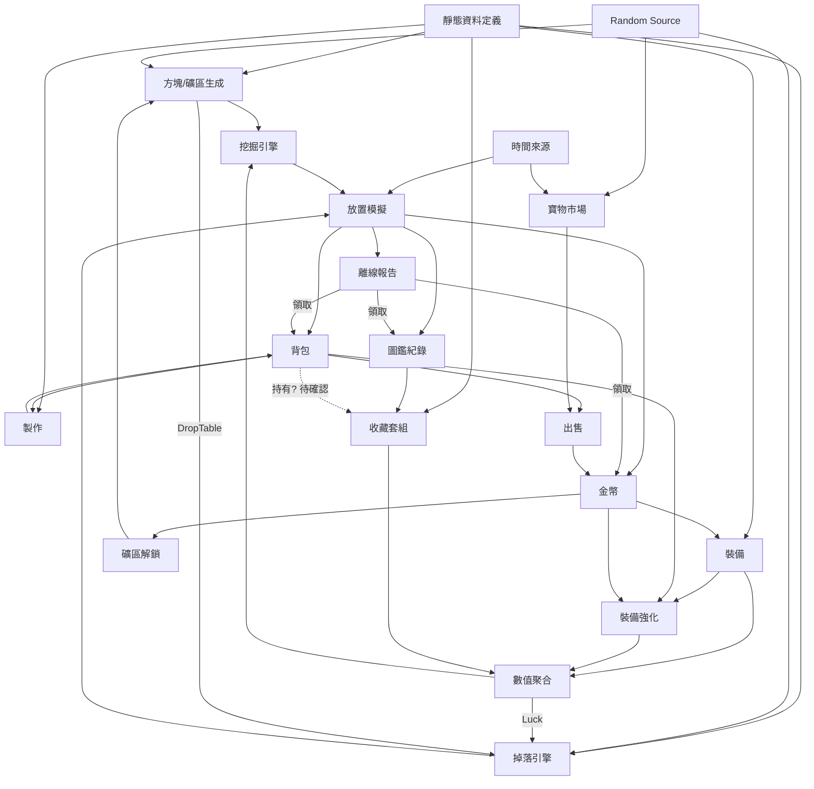

# 《挖礦探險隊》GDD 系統分析報告

| 版本 | 日期 | 內容 |
|---|---|---|
| v1.0 | 2026-11-13 | 初版分析（見附錄 A） |
| v1.1 | 2026-11-13 | 標記已確認決策 D1–D6；問題狀態總表；待確認清單；三份文件衝突檢查 |

相關文件：`docs/GDD.md`、`docs/GBS.md`、`docs/TECHNICAL_SPEC.md`

---

## 1. 已確認決策

| # | 決策 | 內容 | 落實位置 |
|---|---|---|---|
| **D1** | 深度模型 | 1m = 10 方塊；0–300m 共 3,000 方塊；三個礦區各 1,000 方塊；可自由返回已解鎖的淺層礦區；返回不重置最大深度 | GBS §1–2 |
| **D2** | Luck 計算 | `Final = Base × (1 + Luck)`，正規化使總和 100%；分三層定義：方塊是否觸發掉落、稀有度判定、物品掉落表 | GBS §7 |
| **D3** | 收藏套組 | 圖鑑紀錄永久保留；套組必須實際持有所有寶物才啟動；出售其中一件即失效；寶物可重新取得 | GBS §9 |
| **D4** | 伺服器權威 | MVP 就由伺服器計算挖掘、掉落、入帳、離線時間；報告不可重複領取；Client 只負責呈現；優先評估 Supabase Database / Edge Function | TECHNICAL_SPEC §2–3、§7、§10 |
| **D5** | Power 不足 | 方塊有最低 Power 要求；不足時停止挖掘、提示、引導至 Workshop；離線遇到也停止結算，已完成成果保留 | GBS §4.2 |
| **D6** | 遊玩時間 | 0–300m 目標 7–14 天（含離線）；新手礦坑 1–2 天、水晶洞窟 2–4 天、古代遺跡 4–8 天；數值需反推 | GBS §16 |

---

## 2. v1.0 問題狀態總表

狀態說明：

- ✅ **已決策**：由 D1–D6 或 GDD 確定。
- 📝 **提案**：GBS / TECHNICAL_SPEC 已寫出具體規則，**等你審核**。
- ❓ **待確認**：尚未定義，GBS 沒有替它做決定。

### 2.1 角色

| ID | 問題 | 狀態 | 位置 |
|---|---|---|---|
| C-1 | 初始十字鎬選項 | 📝 只有木製 Lv1 | GBS §10.2（P21） |
| C-2 | 外觀選項 | ❓ | — |
| C-3 | 名稱規則 | ❓ | — |
| C-4 | 訪客模式 | ❓ 技術規格暫定「必須登入」 | TECH §17 |

### 2.2 深度與方塊

| ID | 問題 | 狀態 | 位置 |
|---|---|---|---|
| M-1 | 1 格等於多少深度 | ✅ D1 | GBS §1 |
| M-2 | 單柱或格子地圖 | ✅ 依 GDD 逐格向下（單一垂直柱） | GBS §2.2 |
| M-3 | 方塊內容何時決定 | 📝 Hardness 依深度帶固定；OreType 在方塊完成時由伺服器決定 | GBS §4.3（P7）、§5 |
| M-4 | 每方塊是否必有掉落 | 📝 必有 1 個基礎產出 + 時間制額外掉落 | GBS §6（P8）、§7.1（P10） |
| M-5 | Hardness 曲線 | 📝 30 個深度帶數值表 | GBS §5 |
| M-6 | 時間單位 | ✅ 秒 | GBS §1 |
| M-7 | 門檻比較方式 | 📝 `≥` | GBS §4.2（P6） |
| M-8 | Power 不足的行為 | ✅ D5 | GBS §4.2 |
| M-9 | 300m 之後 | 📝 主線結束，可繼續回訪 | GBS §2.2（P1） |
| M-10 | 能否回淺層 | ✅ D1 | GBS §2.3 |
| M-11 | 後期淺層素材來源 | ✅ D1 可回訪；📝 各區都有石頭 | GBS §6.1 |
| M-12 | 重置 / 重新下潛 | ❓ MVP 未定義 | — |

### 2.3 掉落

| ID | 問題 | 狀態 | 位置 |
|---|---|---|---|
| D-1 | 機率判定單位 | ✅ D2 三層；📝 觸發改為「每小時次數」 | GBS §7.1（P10） |
| D-2 | Luck 作用方式 | ✅ D2 | GBS §7.2 |
| D-3 | 礦物與寶物的稀有度分類 | 📝 方塊礦物為 Common、寶石為 Rare、寶物只有 Epic / Legendary | GBS §8.1（P13）、§8.3 |
| D-4 | 各礦區掉落表 | 📝 | GBS §7.3 |
| D-5 | 金幣掉落 | 📝 Common 的金幣袋 | GBS §7.3 |
| D-6 | Legendary 是否唯一 | ✅ D3 可重新取得 | GBS §8.3 |
| D-7 | 保底機制 | ❓ 建議新手保底 | GBS §19 D |
| D-8 | Legendary 特殊加成 | ❓ MVP 暫不定義 | GBS §8.3（P18） |
| D-9 | 背包容量 | ❓ GBS 沒有設上限 | — |

### 2.4 寶物與收藏

| ID | 問題 | 狀態 | 位置 |
|---|---|---|---|
| A-1 | 「收藏」的語意 | ✅ D3 持有 | GBS §9 |
| A-2 | 套組完成條件 | ✅ D3 | GBS §9.2 |
| A-3 | 圖鑑進度計算 | 📝 已發現種類 / 12 | GBS §9.1（P19） |
| A-4 | 寶物定義與實例 | ✅ D3 可重複；📝 定義與實例分離 | TECH §8.1 |
| A-5 | `isCollected` 語意 | 📝 移除，由實例與圖鑑紀錄取代 | TECH §8.1 |
| A-6 | 首次發現的判定時機 | 📝 結算時寫入 | GBS §15（P31） |
| A-7 | 套組加成疊加 | 📝 Speed 相加後乘；Luck 直接加 | GBS §3.1（P4） |
| A-8 | 寶物與套組數量 | 📝 12 件、3 套；zone1–2 名稱暫定 | GBS §8.3（P17） |

### 2.5 市場與經濟

| ID | 問題 | 狀態 | 位置 |
|---|---|---|---|
| E-1 | 倍率生成方式 | 📝 有上下限的均值回歸隨機漫步 | GBS §13.2（P24） |
| E-2 | 各自或共用倍率 | 📝 每件寶物各自 | GBS §13.1（P24） |
| E-3 | 更新基準時間 | 📝 Asia/Taipei 00:00 | GBS §13.1（P25） |
| E-4 | 礦物是否波動 | 📝 固定售價 | GBS §8.1（P14） |
| E-5 | 價格資訊揭露 | 📝 今日 + 7 天走勢 | GBS §13.3（P26） |
| E-6 | 各項價格與成本 | 📝 | GBS §8、§10、§12 |
| E-7 | 金幣上限 | 📝 無上限，資料庫用 bigint；大數字顯示格式 ❓ | TECH §8.2 |

### 2.6 裝備與製作

| ID | 問題 | 狀態 | 位置 |
|---|---|---|---|
| Q-1 | 十字鎬取得方式 | 📝 金幣 + 素材購買 | GBS §10.2（P21） |
| Q-2 | 是否依序解鎖 | 📝 是 | GBS §10.2（P21） |
| Q-3 | 多把切換、能否出售 | 📝 可切換、不可出售 | GBS §10.2（P21） |
| Q-4 | 每級增幅與成本 | 📝 | GBS §10.3 |
| Q-5 | 換裝後舊等級 | 📝 各自保留 | GBS §10.2（P21） |
| Q-6 | 升級與換裝的取捨 | 📝 | GBS §10.5 |
| Q-7 | 製作產物用途 | 📝 用於購買十字鎬與強化 | GBS §8.2 |
| Q-8 | 配方中的「水晶」 | 📝 紫水晶 | GBS §8.2（P15） |
| Q-9 | Luck 單位 | ✅ D2 | GBS §1 |

### 2.7 礦區解鎖、離線、UI

| ID | 問題 | 狀態 | 位置 |
|---|---|---|---|
| U-1 | 解鎖條件 | 📝 挖到底部 + 金幣 | GBS §12（P23） |
| U-2 | 到底部未解鎖時 | 📝 停止挖掘 | GBS §12（P23） |
| O-1 | 「離線」的定義 | 📝 距離上次結算超過 300 秒 | GBS §15（P28） |
| O-2 | 離線起算點 | 📝 上次結算時間 | TECH §7.2 |
| O-3 | 未領取報告的處理 | 📝 必須先領取才能繼續 | GBS §15（P30） |
| O-4 | 離線邊界狀況 | ✅ D5；📝 未解鎖邊界也停止；背包滿 ❓（D-9） | GBS §15 |
| O-5 | 超過 8 小時的時間 | 📝 捨棄 | GBS §15（P29） |
| O-6 | 跨市場更新時的價格 | 📝 以領取當下價格顯示 | GBS §15（P32） |
| O-7 | 報告期限 | 📝 無 | GBS §15（P30） |
| UI-1 | 單頁或多頁 | 📝 單頁 Tab | TECH §12.4（T10） |
| UI-2 | 多個 Epic / Legendary 動畫 | 📝 排隊 | TECH §12.5 |
| UI-3 | Header 顯示內容 | ❓ | — |

### 2.8 技術與平衡風險

| ID | 風險 | 狀態 |
|---|---|---|
| T-1 | 權威模型 | ✅ D4 → TECH §2、§3.2 |
| T-2 | 確定性亂數 | 📝 TECH §6 |
| T-3 | 模擬方式 | 📝 逐方塊工作量推進，TECH §7 |
| T-4 | 防重複領取與交易 | 📝 TECH §10.4 |
| T-5 | 多分頁 / 多裝置 | 📝 樂觀鎖，TECH §13 |
| T-6 | 背景分頁 | 📝 TECH §12.3 |
| T-7 | 定義與實例分離 | 📝 TECH §8.1 |
| T-8 | 存檔版本 | 📝 TECH §4、§13 |
| T-9 | 市場可預測性 | 📝 伺服器密鑰，TECH §6.3 |
| T-10 | 時程低估 | ⚠️ 見 §5 衝突 #14 |
| B-1 | Luck 數量級 | ✅ D2 |
| B-2 | 掉落率與方塊數 | 📝 改為時間制觸發，GBS §7.1、§17 |
| B-3 | Power 平方效應 | 📝 GBS §5 曲線已吸收 |
| B-4 | 卡死狀態 | ✅ D5；⚠️ 離線浪費時間，GBS §19 C |
| B-5 | 投資支柱 | ✅ D3 形成取捨；📝 均值回歸 + 7 天走勢 |
| B-6 | 素材鏈斷裂 | 📝 GBS §8.2 |
| B-7 | 經濟終局 | 📝 鑽石 Lv5 與收藏作為長期目標，GBS §14.3 |
| B-8 | 離線 100% | ✅ GDD；⚠️ 輕度玩家天數，GBS §19 A |

---

## 3. 待確認決策

### 3.1 會影響數值或架構（建議優先確認）

| 優先 | 項目 | 提案內容 | 不採用的影響 |
|---|---|---|---|
| 1 | **掉落觸發改為時間制**（P10） | 每小時觸發次數固定，與裝備速度無關 | 改回每方塊固定機率，需要另設防洗寶機制，§17 掉落統計全部重算 |
| 2 | **回訪方塊規則**（P2） | 無限循環；Hardness / RequiredPower 固定為該礦區底部的值 | 若用礦區頂部硬度，回訪 zone1 每小時約 74,000 金幣（前線的 34 倍） |
| 3 | **離線上限 8 小時**（GBS §19 A） | 維持 8 小時，或改為 12 小時 | 8 小時：每天上線 1 次的玩家需約 16 天 |
| 4 | **離線時遇到門檻自動回訪**（GBS §19 C） | 會修改決策 D5 | 維持 D5：輕度玩家每個門檻最多浪費 8 小時 |
| 5 | 每方塊必有基礎產出（P8） | 每方塊 1 個礦物 | 經濟模型需重算 |
| 6 | 十字鎬取得方式（P21） | 金幣 + 素材購買、依序、初始只有木製 | 與 GDD「選擇初始十字鎬」衝突 |
| 7 | 礦區解鎖（P23） | 挖到底部 + 付費；未付費時停止 | 若不收費，zone 收支需重算 |
| 8 | 稀有度分類（P13） | 寶物只有 Epic / Legendary | 與 GDD `Artifact.rarity` 衝突 |
| 9 | 未領取報告阻擋其他操作（P30） | 必須先領取 | 若允許累積報告，需定義合併規則 |
| 10 | 伺服器架構（T1、T2） | Edge Function 計算 + RPC 提交；monorepo | 若改用 Next.js Route Handler，部署架構不同 |

### 3.2 內容與細節

| 項目 | 說明 |
|---|---|
| P17 | zone1、zone2 的寶物與套組名稱（目前暫定） |
| P18 | Legendary 的「特殊加成」 |
| P24–P26 | 市場倍率範圍、更新時間、資訊揭露 |
| P28 | 在線 / 離線判定門檻（300 秒） |
| D-7 / GBS §19 D | 保底機制、新手保底 |
| D-9 | 背包容量 |
| GBS §19 B | 在線節奏：揮鎬分段動畫、預估時間提示 |
| C-2、C-3、C-4 | 外觀、名稱規則、訪客模式 |
| M-12 | 重置 / 重新下潛 |
| UI-3 | Header 顯示內容 |
| T3–T13 | 技術細節（TECH §17） |

---

## 4. 需要審核的數值

所有數值都在 `GBS.md`，以下是最關鍵、最值得你看的：

| 數值 | 位置 | 為什麼重要 |
|---|---|---|
| 30 個深度帶的 Hardness | GBS §5 | 直接決定每一段的時數 |
| RequiredPower 門檻（4 / 9 / 16 / 27 / 36） | GBS §5.1 | 決定何時必須換裝 |
| LootRate（7 / 5 / 3.5 次／小時） | GBS §7.1 | 決定寶物取得頻率 |
| 十字鎬購買成本 | GBS §10.2 | 決定換裝時間點 |
| 強化成本（UpgradeBase、×1.8） | GBS §10.3 | 決定每段中的成長感 |
| 礦物售價、金幣袋金額 | GBS §8.1、§7.3 | 決定收入 |
| 寶物 Base Value | GBS §8.3 | 決定出售寶物能加速多少（GBS §16.4） |
| 套組加成 | GBS §9.3 | zone1、zone2 套組為提案 |
| 市場倍率範圍 | GBS §13.2 | 決定投資玩法的報酬 |
| 玩家類型的每日有效時數 | GBS §16.3 | 天數換算的假設 |

驗算結果：參考玩家主線 **138.1 小時**（zone1 19.5 h / zone2 38.9 h / zone3 79.6 h），裝備都能在門檻前買到，不會卡關。

---

## 5. 三份文件衝突檢查

### 5.1 GDD 與 GBS / TECHNICAL_SPEC 的衝突

建議確認後將 GDD 更新為 v1.1。

| # | GDD 內容 | 新規格 | 來源 | 建議 |
|---|---|---|---|---|
| 1 | §4.4「套組效果為永久加成」 | 持有期間生效，出售即失效 | D3 | 改寫 GDD |
| 2 | §7.5、§9.4「正式版本 / 正式環境」才由伺服器負責 | MVP 就由伺服器負責 | D4 | 改寫 GDD |
| 3 | §3.2「Power 不足以突破方塊硬度」 | 方塊另有 RequiredPower，Hardness 只影響時間 | D5 | GDD §3.2 屬性表加入 RequiredPower |
| 4 | §4.1 單層掉落機率 | 基礎產出 + 三層掉落；觸發改為時間制 | D2、P8、P10 | 改寫 GDD §4.1 |
| 5 | §4.3 `Artifact` 介面（含 `currentValue`、`isCollected`、`rarity: "rare"`） | 定義與實例分離；不存 currentValue；寶物無 rare | P13、TECH §8.1 | 以 TECH 為準 |
| 6 | §3.1、§2.1「選擇初始十字鎬」 | 初始只有木製 | P21 | 待你確認 |
| 7 | §5.1「購買十字鎬」與「製作裝備」並列 | 合併為「金幣 + 素材購買」 | P21 | 待你確認 |
| 8 | §6.3「精煉水晶 = 水晶 ×3」 | 紫水晶 ×3 | P15 | 待你確認 |
| 9 | §3.3「主要資源」表 | 所有礦區都有石頭；zone2 有鐵礦；zone3 有銀礦；寶石只從掉落取得 | P9 | 待你確認 |
| 10 | §8.2 單頁 Dashboard vs §9.3 多頁路由 | 單頁 Tab | T10 | 待你確認 |
| 11 | §9.3 `src/game-engine` | `packages/game-engine`（monorepo） | T2 | 待你確認 |
| 12 | §4.2「掉落後立即進入背包」 | 伺服器結算後才入帳，畫面上有數秒延遲 | D4 | GDD 加註說明 |
| 13 | §4.1 Legendary「特殊加成」 | MVP 未定義 | P18 | 待你確認 |
| 14 | §14 時程 11–17 天 | 伺服器權威、RLS、冪等、確定性測試未計入 | D4 | 規格確認後重新估算 |
| 15 | §11 離線結算 P1、§10 排在 Phase 3 | 在線與離線共用結算，必須在核心階段完成 | D4、TECH §7 | 調整優先級 |

### 5.2 GBS 與 TECHNICAL_SPEC 交叉檢查

| 項目 | GBS | TECH | 結果 |
|---|---|---|---|
| 在線 / 離線門檻 | §15：300 秒 | §7.2：300,000 ms | ✅ 一致 |
| 方塊結算順序 | §4.3 | §6.2 亂數消耗順序 | ✅ 一致 |
| 觸發機率輸入 | §7.1：實際挖掘秒數 | §7.2：`blockMs` 累積 | ✅ 一致 |
| 套組生效時機 | §9.4：在線下一方塊；離線領取後 | §7.3 | ✅ 一致 |
| 切換礦區 | §2.4：進度歸零 | `mining-select` | ✅ 一致 |
| 市場更新時間 | §13.1：Asia/Taipei 00:00 | §9：UTC 16:00 | ✅ 一致 |
| 鑽石 Lv3 = 36 的門檻 | §5.1 要求整數計算 | §5：`power10` 定點數 | ✅ 一致 |
| 回訪方塊的 RequiredPower | 初稿漏掉 | — | 🔧 **已修正**：GBS §2.3 補上 |
| 寶物實例與圖鑑 | §9.1 | §8.1–8.2 | ✅ 一致 |
| 報告未領取的阻擋 | §15 | §7.2、§10.1 | ✅ 一致 |

---

## 6. 7–14 天目標驗證結論

詳細內容見 `GBS.md` §19，摘要如下：

| # | 問題 | 嚴重度 | 建議 |
|---|---|---|---|
| A | 每天上線 1 次的玩家需約 16 天 | 高 | 離線上限改為 12 小時（輕度約 11 天、重度約 7 天），或將目標族群定義為每天上線 2 次以上 |
| B | 在線節奏偏慢（後期約 5 分鐘一個方塊） | 中 | 揮鎬分段動畫、預估時間提示；若要更多掉落需改 D1 |
| C | 離線遇到門檻浪費時間 | 中 | 預估門檻提示；或自動回訪（會改 D5） |
| D | 新手首次掉落較晚 | 低 | 新手保底 |
| E | 重度玩家出售所有寶物約 6.3 天 | 低 | 接受，或降低寶物價值 30% |

---

## 7. 下一步

1. 你審核 §3 的待確認決策與 §4 的數值。
2. 我依你的回覆更新 GBS、TECHNICAL_SPEC，並把 GDD 更新為 v1.1（§5.1）。
3. 規格定案後，才開始實作（TECH §16 階段 1）。

---

## 附錄 A：v1.0 原始分析

以下保留 v1.0 的分析內容，方便追溯問題編號。問題的最新狀態以本文件 §2 為準。

### A1. 核心系統與依賴關係

#### 1.1 系統清單

| 層級 | 系統 | 職責 | GDD 章節 |
|---|---|---|---|
| 基礎 | 靜態資料定義 | 礦物、礦區、方塊、裝備、寶物、配方、套組 | §3.3, §4, §6 |
| 基礎 | Random Source | 可注入亂數 | §9.4 |
| 基礎 | 時間來源 | 伺服器時間、離線時長、市場更新週期 | §5.2, §7.5 |
| 核心 | 角色 | 建立角色、外觀、名稱 | §3.1 |
| 核心 | 數值聚合 | 十字鎬基礎值 + 強化等級 + 套組加成 → 最終 Power / Speed / Luck | §3.2, §4.4, §6 |
| 核心 | 方塊 / 礦區生成 | 深度 → 礦區 → Hardness / OreType / DropTable | §3.2, §3.3 |
| 核心 | 挖掘引擎 | 硬度門檻判定、挖掘時間、進度 | §3.2 |
| 核心 | 掉落引擎 | 稀有度判定（受 Luck 影響）、物品判定、金幣掉落 | §4.1 |
| 核心 | 放置模擬 | 給定時間區間，推進挖掘與掉落 | §7 |
| 資源 | 背包 | 可堆疊礦物 / 素材、寶物實例 | §8.3 |
| 資源 | 金幣經濟 | 收入（出售、掉落）、支出（購買、升級、製作、解鎖） | §5.1 |
| 成長 | 裝備（購買 / 切換） | 十字鎬取得與裝備 | §6.1 |
| 成長 | 裝備強化 | Lv.1–5 | §6.2 |
| 成長 | 製作 | 素材轉換 | §6.3 |
| 成長 | 礦區解鎖 | 進入更深礦區 | §3.3, §5.1 |
| 收藏 | 圖鑑紀錄 | 發現紀錄，獨立於持有 | §4.3 |
| 收藏 | 收藏套組 | 完成後永久加成 | §4.4 |
| 收藏 | 寶物市場 | Market Multiplier、24h 更新 | §5.2 |
| 放置 | 離線結算 | 時長計算、上限、報告產生 | §7.1–7.2 |
| 放置 | 離線報告領取 | 一次入帳、防重複領取 | §7.3–7.5 |
| 呈現 | 掉落呈現 | Recent Loot、分級動畫 | §4.2, §7.4 |
| 平台 | 認證 / 持久化 / 同步 | Supabase Auth + PostgreSQL | §9.1 |

#### 1.2 依賴圖

#### 1.3 關鍵依賴觀察

1. **數值聚合是樞紐。** 裝備、強化、套組三個來源都會改 Power / Speed / Luck，挖掘和掉落兩個引擎都讀它。它應該是一個獨立的純函式，疊加規則（加法或乘法、先後順序）要在 GBS 裡明確定義。
2. **存在一條回饋迴圈：** 掉落 → 圖鑑 → 套組 → Luck → 掉落。這是設計上刻意的，但模擬時要注意：在一段放置模擬（例如離線 8h）中途完成套組時，加成是當下就生效，還是領取報告後才生效？
3. **離線結算不應該是獨立系統。** 離線和在線都是「推進一段時間的挖掘模擬」，差別只在時間區間和呈現方式。如果離線用另一套近似演算法，就很難滿足「與在線模式相同的掉落規則」（§7.1）。
4. **製作 ↔ 背包 ↔ 強化** 構成素材流。目前製作產物（鐵錠、強化石、精煉水晶）沒有任何定義好的消耗端，這條鏈是斷的（見 §2.6）。
5. **市場是唯一依賴「日曆時間」的系統**，和挖掘用的「經過時間」性質不同，時間基準要分開定義。

---

### A2. 尚未定義清楚的規則

依系統分類。每一項都是寫程式前必須有答案的問題。

#### 2.1 角色

| # | 問題 |
|---|---|
| C-1 | 「選擇初始十字鎬」有哪些選項？只能選木製，還是可以選更高等級？（可選就會影響開局平衡。） |
| C-2 | 外觀選項數量；外觀是否純裝飾（不影響數值）？ |
| C-3 | 名稱規則：長度、字元集、是否需唯一、能否改名、是否要過濾不當字詞。 |
| C-4 | 一定要登入才能玩，還是有訪客模式？訪客資料能否綁定帳號？ |

#### 2.2 深度與方塊模型（最高優先）

| # | 問題 |
|---|---|
| M-1 | **1 格方塊等於多少深度？** 如果 1 格 = 1m，MVP 總共只有 300 個方塊。 |
| M-2 | 地形是單一垂直柱（只往下），還是有橫向的格子地圖？ |
| M-3 | 方塊內容（OreType、Hardness）是預先生成（固定種子地圖），還是挖到時才決定？每位玩家的地圖是否相同？ |
| M-4 | 每個方塊一定有掉落嗎？一次掉幾個？OreType 和 DropTable 的關係是什麼（方塊類型決定掉落，還是掉落表與方塊類型無關）？ |
| M-5 | Hardness 的數值範圍與隨深度的成長曲線。 |
| M-6 | 挖掘時間的單位（秒？）。 |
| M-7 | 「Power 不足以突破」的判定是 `Power ≥ Hardness`、`Power > Hardness`，還是其他門檻函數？ |
| M-8 | **Power 不足時會發生什麼？** 停止挖掘、跳過該方塊、在原深度循環挖掘，還是有其他行為？ |
| M-9 | 到達 300m 之後會怎樣（MVP 的終點）？ |
| M-10 | 能否回到淺層礦區？核心循環寫「進入礦區」「解鎖新礦區」，像是「選礦區」的模型；§3.2 寫「逐格向下」，像是單一連續深度。兩者需要擇一，或定義兩者如何並存。 |
| M-11 | 如果不能回淺層，製作要用的淺層素材（石頭、煤炭）在後期從哪裡來？ |
| M-12 | 是否有「重置 / 重新下潛」的機制？ |

#### 2.3 掉落

| # | 問題 |
|---|---|
| D-1 | 75 / 20 / 4.5 / 0.5% 的判定單位是「每個方塊」、「每次掉落事件」，還是「每單位時間」？ |
| D-2 | **Luck 如何作用？** 是對稀有以上機率做百分點加法、乘法、權重調整，還是其他方式？總和超過 100% 時怎麼重新分配？ |
| D-3 | 稀有度分類與物品類型的對應：§4.1 的 Rare 是「稀有礦物、水晶」，但 `Artifact.rarity` 也包含 `"rare"`。Rare 掉落到底是礦物還是寶物？礦物本身有稀有度嗎？ |
| D-4 | 各礦區的掉落表內容（物品清單與權重）。 |
| D-5 | 金幣掉落的機率與數量。 |
| D-6 | Legendary 是否唯一（全遊戲只能取得一次）？重複寶物怎麼處理？ |
| D-7 | 是否有保底（pity）機制？ |
| D-8 | §4.1 Legendary 寫「特殊加成」：是持有時生效、收藏時生效，還是另有定義？ |
| D-9 | 背包是否有容量上限？滿了之後掉落怎麼處理？ |

#### 2.4 寶物與收藏

| # | 問題 |
|---|---|
| A-1 | **「收藏」是什麼操作？** 持有就算收藏、需要放進收藏館（鎖定不能賣），還是只要發現過就算？ |
| A-2 | **套組完成條件：** 要「曾經發現過」還是「目前持有」？出售後套組加成是否失效？ |
| A-3 | 圖鑑進度依「發現」還是「收藏」計算？ |
| A-4 | `Artifact` 介面把「寶物定義」（name、baseValue）和「取得實例」（discoveredAt、depth）放在一起。寶物是每次掉落都產生一個實例（可重複），還是每種只有一個？ |
| A-5 | `isCollected` 的語意和 `CollectionRecord` 重疊，需要釐清兩者各自負責什麼。 |
| A-6 | 「首次發現」的判定時機：離線模擬期間發現的寶物，是在模擬當下記錄，還是領取報告時才記錄？ |
| A-7 | 套組加成的疊加方式：「Luck +2%」是 Luck 數值加 2，還是 Luck ×1.02？「挖掘速度 +3%」作用在 Speed 還是最終挖掘時間？ |
| A-8 | MVP 有幾件寶物、幾個套組？ |

#### 2.5 市場與經濟

| # | 問題 |
|---|---|
| E-1 | Market Multiplier 的範圍與生成方式（每日獨立亂數、隨機漫步、均值回歸……）。 |
| E-2 | 是每件寶物各自波動，還是整個市場共用一個倍率？ |
| E-3 | 「24 小時更新」的基準時間：UTC 00:00、台灣時間 00:00，還是每位玩家各自計時？ |
| E-4 | 一般礦物的售價固定，還是也會波動？ |
| E-5 | 玩家能否看到歷史價格或價格趨勢？（沒有任何資訊的話，「選擇出售時機」等於純運氣，「投資」支柱就沒有決策深度。） |
| E-6 | 各物品的售價、裝備價格、升級成本、礦區解鎖費用。 |
| E-7 | 金幣有沒有上限？要不要處理大數字顯示？ |

#### 2.6 裝備與製作

| # | 問題 |
|---|---|
| Q-1 | 十字鎬的取得方式：購買、製作，還是兩者都有？（§5.1 寫「購買十字鎬」和「製作裝備」，但 §6.3 的配方裡沒有任何裝備。） |
| Q-2 | 是否要依序解鎖（必須先有鐵製才能買黃金）？ |
| Q-3 | 能否同時擁有多把、自由切換？舊十字鎬能否出售？ |
| Q-4 | Lv.1–5 每級的數值增幅與成本。 |
| Q-5 | 換新十字鎬後，舊十字鎬的強化等級怎麼處理？ |
| Q-6 | 低階滿級和高階 Lv.1 的強弱關係（決定升級還是換裝的取捨）。 |
| Q-7 | **製作產物的用途**：鐵錠、強化石、精煉水晶要用在哪裡？目前沒有任何消耗端。 |
| Q-8 | 配方中的「水晶」是指哪種礦物？礦物清單裡只有紫水晶、藍寶石，沒有「水晶」。 |
| Q-9 | Luck 0%–12% 的單位意義（與 D-2 一起定義）。 |

#### 2.7 礦區解鎖

| # | 問題 |
|---|---|
| U-1 | 解鎖條件：挖到該深度、支付金幣、Power 達標，還是組合條件？ |
| U-2 | 到達礦區底部但尚未解鎖下一區時，挖掘行為是什麼？ |

#### 2.8 離線

| # | 問題 |
|---|---|
| O-1 | **「離線」的定義**：關閉分頁、切到背景分頁、裝置休眠？瀏覽器會限制背景分頁的計時器，這時算在線還是離線？ |
| O-2 | 離線起算點：最後一次存檔、最後一次心跳，還是關閉事件？（關閉事件在瀏覽器中不可靠。） |
| O-3 | 未領取報告時：角色還會繼續挖嗎？再次離線時，報告會累積、合併，還是覆蓋？ |
| O-4 | 離線期間遇到 Power 不足（M-8）、背包已滿（D-9）、跨越礦區邊界（U-2）時的行為。 |
| O-5 | 8 小時上限之外的時間是直接捨棄，還是有其他處理？ |
| O-6 | 離線期間跨越市場更新時間點時，報告裡的寶物價值用哪一個價格？ |
| O-7 | 報告是否有領取期限？ |

#### 2.9 UI

| # | 問題 |
|---|---|
| UI-1 | §8.2 寫「單頁 Dashboard」，但 §9.3 有 `app/mining`、`app/inventory` 等獨立路由。是單頁切換 Tab，還是多頁路由？（這會影響挖掘迴圈放在哪裡，見 T-6。） |
| UI-2 | 在線時連續掉落多個 Epic / Legendary 時，動畫要排隊還是合併？ |
| UI-3 | Header 為什麼只顯示幸運值？Power / Speed 要在哪裡顯示？ |

---

### A3. 技術風險

#### T-1　權威模型和 MVP 範圍矛盾（高）

- GDD §7.5 和 §9.4 寫「**正式版本 / 正式環境**」才由伺服器負責結算。
- 但 §13 的 **MVP 驗收條件**要求「不會因客戶端修改時間而取得額外收益」、「不會因重複請求產生重複獎勵」。
- 如果在線掉落在客戶端計算，即使離線改由伺服器處理，玩家還是能竄改在線掉落。真正的防作弊需要**挖掘結果全部由伺服器權威**。
- 這會大幅影響架構和 §14 的時程估計（11–17 天看起來沒有涵蓋伺服器權威的工作量）。

**需要決策**：MVP 採用哪一種模型？

| 選項 | 說明 | 代價 |
|---|---|---|
| A. 客戶端權威 | 存檔信任客戶端 | 最快；不符合 §13 驗收條件 |
| B. 伺服器結算，客戶端預覽 | 伺服器保存 `(state, lastSettledAt, seed)`，以伺服器時間做確定性模擬；客戶端用同一套引擎即時顯示，同步時以伺服器結果為準 | 需要共用引擎與確定性亂數；工作量中等 |
| C. 每次掉落都呼叫 API | 伺服器逐次判定 | 請求量大，Vercel / Supabase 成本與延遲都高，不建議 |

選項 B 符合 §9.2「引擎純 TS」的原則，並且讓在線和離線共用同一套模擬，但仍需你確認。

#### T-2　確定性亂數（高）

- GDD 已要求「可注入的 Random Source」，但如果要讓伺服器重現 / 驗證結果，還需要：**可序列化狀態的 seeded PRNG**、**種子的推導規則**（例如依玩家與方塊索引），以及**每次判定消耗亂數的固定順序**。
- 任何會改變亂數消耗順序的修改（例如掉落表新增一項），都會讓既有的種子結果改變，需要有版本管理。

#### T-3　「不逐秒模擬」不等於「需要統計近似」（中）

- 挖掘本身是「方塊事件」，可以逐方塊模擬，不必逐秒。8 小時內就算有數萬個方塊，逐方塊模擬在伺服器上也只需要毫秒等級。
- 統計近似（例如直接用期望值算出掉落數）雖然更快，但無法處理 Power 門檻、礦區邊界、套組中途生效這類**離散狀態變化**，也會讓在線和離線結果不一致。
- 建議：先以逐方塊事件模擬為基準，等效能真的有問題再考慮優化。

#### T-4　防重複領取與交易一致性（中）

- 報告需要唯一 ID，資料庫加唯一約束，領取必須在**單一交易**中完成（標記已領取 + 入帳）。
- 出售、升級、製作同樣有重複送出的風險，也需要冪等處理（idempotency key 或樂觀鎖 / 版本號）。
- Supabase 的實作方式（Postgres RPC 函式 vs Next.js Route Handler + service role）要在 TECHNICAL_SPEC 決定。

#### T-5　多分頁 / 多裝置併發（中）

- 同一帳號同時開兩個分頁或兩台裝置：兩邊都在模擬、都在存檔，會互相覆蓋或重複計算。
- 需要規則：單一作用中工作階段、狀態版本號衝突偵測，或以伺服器結算為唯一真相（選項 B 可以自然解決）。

#### T-6　背景分頁與挖掘迴圈（中）

- 瀏覽器會限制背景分頁的 `setInterval` / `requestAnimationFrame`，在線迴圈必須用「經過時間差」推進，不能用「tick 次數」。
- 如果採多頁路由（UI-1），挖掘迴圈不能寫在頁面元件裡，要放在 store 或 provider 層，否則切換頁面時挖掘會中斷。

#### T-7　靜態定義 vs 實例資料（中）

- `Artifact.currentValue` 存在實例上會過期（市場每 24h 變動）。應該在讀取時依「定義 + 當日倍率」計算，不應存進資料庫。
- 靜態資料（礦物、配方等）應該以 ID 引用，存檔只存 ID 和數量，方便日後調整平衡數值。

#### T-8　存檔版本與資料遷移（中）

- 平衡數值和資料結構一定會改。存檔需要 `schemaVersion`，並要有遷移策略；尤其已發放的寶物實例、已完成的套組，在定義變更後如何處理。

#### T-9　市場價格的可預測性（低～中）

- 如果價格用「日期種子」生成，而種子演算法在客戶端可見，玩家就能預測未來價格。價格生成應該只在伺服器端執行，或接受這個風險。

#### T-10　時程低估（風險說明）

- §14 估計 11–17 天，但以下項目看起來沒有完整算進去：伺服器權威結算、冪等 API、Supabase RLS、存檔同步、確定性模擬測試。建議在 TECHNICAL_SPEC 確定後重新估計。

---

### A4. 遊戲平衡風險

以下計算只使用 GDD 已有的數值；需要假設的地方會明確標出。

#### B-1　Luck 語意造成數量級差異

以鑽石十字鎬 Luck 12%、Legendary 基礎 0.5% 為例：

| Luck 解讀方式 | Legendary 機率 |
|---|---:|
| 百分點加法（0.5 + 12） | 12.5% |
| 乘法（0.5 × 1.12） | 0.56% |

兩者相差約 22 倍。這個定義不確定，掉落相關的數值都無法驗證。

#### B-2　掉落率和方塊總數必須一起設計

- 如果 1 格 = 1m（M-1），MVP 共 300 格，以基礎機率計算：整個 MVP 期望取得約 **1.5 件 Legendary、13.5 件 Epic**。而且方塊挖完就沒了，收藏可能根本無法完成。
- 反過來，如果方塊很多（例如一晚離線挖 1,000 格，此數字僅為假設），每晚期望會有 5 件 Legendary、45 件 Epic，稀有度就沒有意義了。
- 結論：掉落率必須用「**目標取得頻率**」（例如平均每 N 小時一件 Epic）反推，而不是先訂每方塊的機率。
- 另外，Rare 以上合計 25% 本身就偏高，每 4 格就有一次稀有掉落，「驚喜感」會被稀釋。

#### B-3　Power 同時是門檻和速度因子

- 公式 `Time = Hardness / (Power × Speed)` 中，同一方塊的速度比：木製 `2 × 1.0 = 2`，鑽石 `30 × 2.2 = 66`，**快 33 倍**。
- 成長感很強烈（符合原則 2），但也代表換一階裝備後，淺層方塊瞬間就能挖完，後段的 Hardness 曲線必須陡峭到能跟上。
- Power 同時是硬門檻，代表每一階裝備對應一段「可挖範圍」，硬度曲線的設計會直接決定玩家什麼時候卡關。

#### B-4　放置遊戲的卡死狀態

- 遇到挖不動的方塊時，如果角色就停下來，離線 8 小時的收益就是 0。這會直接打擊「離線也有樂趣」（原則 5）。
- M-8 的規則一定要避免「不可見的零產出」，至少在 UI 上要預先警告。

#### B-5　「投資」支柱缺乏決策依據

- 價格只在合理範圍內波動，加上收藏沒有持有成本，最佳策略就是「一直留著，等高價再賣」。
- 如果玩家看不到任何趨勢資訊（E-5），出售時機只是在賭運氣。
- 和套組的關係是關鍵（A-2）：
  - 套組看「持有」：出售會失去加成，形成「賣或留」的取捨，**投資支柱才有張力**。
  - 套組看「發現」：發現後馬上賣掉也沒有損失，市場只剩「等高價」一種策略。

#### B-6　素材鏈斷裂

- 製作產物沒有消耗端（Q-7），製作系統等於沒有存在意義。
- 如果不能回淺層（M-10），後期需要淺層素材時會產生無法取得的死鎖。

#### B-7　經濟終局

- 300m 之後（M-9）、全裝備滿級後，金幣就沒有消耗管道，市場和收藏是唯一的長期目標。MVP 的內容長度需要先訂下目標（例如預期遊玩天數），才能反推所有成本。

#### B-8　離線 100% 效率

- 離線和在線效率相同，玩家沒有在線的動機。這是放置遊戲常見的設計選擇，本身不是錯，但應該確認這是刻意的。加上 8h 上限，每日最佳節奏約是「一天上線 3 次」，可以依此反推進度速度。

---

### A5. 建議開發順序

原則：**先把規則固定成可測試的純函式，再接 UI，最後接伺服器**；但權威模型（T-1）要在第一行程式碼之前決定，因為它會影響引擎的介面設計。

| 階段 | 內容 | 前置條件 | 產出 |
|---|---|---|---|
| **0. 規格確認** | 回答 §6 的決策點；完成 GBS 與 TECHNICAL_SPEC | 本報告 | 兩份規格文件 |
| **1. 引擎基礎** | 資料 schema 與靜態資料、seeded PRNG、數值聚合、方塊生成、挖掘時間 / 門檻、掉落判定 | GBS 數值表 | 純 TS + Vitest |
| **2. 模擬核心** | `simulate(state, fromTime, toTime, rng)`：逐方塊推進，在線 / 離線共用 | 階段 1 | 確定性測試、平衡模擬腳本 |
| **3. 最小可玩版** | 角色建立、主畫面、挖掘進度、Recent Loot、本機存檔 | 階段 2 | 可玩原型 |
| **4. 資源與成長** | 背包、出售、十字鎬購買 / 切換、強化、礦區解鎖 | 階段 3 | 完整成長循環 |
| **5. 收藏** | 圖鑑紀錄（與持有分離）、寶物實例、首次發現 | 階段 4、A-1〜A-4 | 收藏循環 |
| **6. 伺服器化** | Supabase Auth、資料表與 RLS、伺服器結算、冪等 API、版本號 | 階段 2、TECHNICAL_SPEC | 防作弊 |
| **7. 離線報告** | 報告產生、唯一 ID、領取交易、分級揭曉動畫 | 階段 6 | 放置循環 |
| **8. P1 系統** | 製作、市場價格、收藏套組 | 階段 5、6 | 長期目標 |
| **9. 優化與發布** | 動畫音效、RWD、平衡調整、作弊與重複領取測試、Beta | 全部 | 發布 |

和 GDD 原本規劃的差異與理由：

- **模擬核心提前到階段 2**：GDD 把離線放在 Phase 3，但離線和在線應該共用模擬（§1.3 第 3 點）。先做出模擬，離線報告之後只是呈現層的工作。
- **伺服器化獨立成一階段，並排在離線之前**：離線防作弊依賴伺服器時間，順序不能顛倒。如果 T-1 選擇選項 A（MVP 先不做伺服器權威），階段 6 可以縮減為「只做存檔同步」，但需要同步修改 §13 驗收條件。
- **優先級對齊**：GDD §11 把「寶物收藏」列為 P0，但「收藏圖鑑」排在 Phase 3；「離線結算」列 P1，但 §7.1 稱它是「重要功能」。建議確認後統一。

---

### A7. 後續文件應補充的內容

> 註：本報告將 **GBS** 理解為「遊戲規則與平衡規格（Game Balance / Behavior Spec）」，也就是把 GDD 的設計意圖轉成可實作、可驗證的規則與數值。如果 GBS 指的是別的文件，請告訴我。

#### 7.1 GBS 必須補充

1. **名詞與單位定義**：格、深度、秒、Luck、百分比加成的語意。
2. **深度與方塊模型**：格與深度的換算、地圖生成規則、是否固定種子。
3. **礦區表**：深度範圍、Hardness 曲線（公式或分段表）、解鎖條件、到達底部的行為。
4. **物品總表**：每種礦物 / 素材 / 寶物的 ID、名稱、類型、稀有度、產出礦區、售價或 Base Value、是否可堆疊、是否唯一。
5. **掉落規則**：判定單位、判定流程（先判稀有度再判物品，或其他）、各礦區掉落表、金幣掉落、Luck 公式與正規化方式、保底（如有）。
6. **數值聚合公式**：基礎值、強化、套組、Legendary 特殊加成的疊加順序與方式。
7. **挖掘規則**：門檻判定、Power 不足的行為、時間公式的單位。
8. **裝備表**：取得方式、價格、解鎖順序、Lv.1–5 增幅與成本、換裝規則。
9. **製作表**：配方、產物、產物用途。
10. **收藏規則**：發現 / 持有 / 收藏的定義、圖鑑計算方式、首次發現判定時機、重複寶物處理。
11. **套組表**：成員、完成條件、加成內容與生效時機、失效條件。
12. **市場規則**：倍率範圍（各寶物）、生成方式、更新基準時間、資訊揭露。
13. **離線規則**：離線定義、起算點、上限、未領取報告處理、邊界狀況（卡關、背包滿、跨礦區、跨市場更新）。
14. **節奏目標**：各礦區預計到達時間、每階裝備取得時間、各稀有度目標取得頻率、MVP 總時長。這是所有數值的反推依據。
15. **平衡驗證方法**：用模擬腳本跑出的分佈要符合哪些目標區間。

#### 7.2 TECHNICAL_SPEC 必須補充

1. **權威模型**：選定方案、客戶端與伺服器各自的職責、信任邊界。
2. **系統架構**：`game-engine` 如何被客戶端和伺服器共用、模組邊界、依賴方向（引擎不依賴 React / Zustand / Next.js）。
3. **引擎 API**：各函式的輸入輸出型別（從 §9.4 的函式清單細化），全部是純函式。
4. **確定性亂數**：PRNG 演算法、種子推導規則、亂數消耗順序、版本管理。
5. **模擬演算法**：逐方塊事件推進的流程、中途狀態變化（套組完成、礦區邊界）的處理、效能上限。
6. **資料模型**：靜態定義與玩家實例分離；資料表（players、mining_state、inventory_items、artifact_instances、collection_records、equipment、offline_reports 等）、欄位、約束、索引。
7. **時間處理**：伺服器時間為準、時區、市場日界線、客戶端時間只用於顯示。
8. **API 設計**：建立角色、同步 / 結算、領取報告、出售、購買、強化、製作、解鎖，各自的請求 / 回應格式與錯誤碼。
9. **一致性與冪等**：交易邊界、idempotency key、樂觀鎖 / 狀態版本號、重複請求的處理。
10. **安全**：Supabase RLS 政策、service role 的使用範圍、哪些表客戶端只能讀。
11. **併發**：多分頁 / 多裝置策略。
12. **客戶端狀態**：Zustand store 結構、挖掘迴圈的位置與時間差推進、背景分頁處理、與伺服器狀態的對帳。
13. **存檔與遷移**：`schemaVersion`、平衡數值變更時的遷移策略。
14. **呈現層**：掉落事件到動畫的佇列機制、Legendary 動畫期間是否暫停其他呈現。
15. **測試策略**：引擎單元測試（固定種子）、確定性回歸測試、平衡模擬腳本、API 冪等測試、時間竄改測試。
16. **路由與 UI 結構**：單頁 vs 多頁的最終決定（UI-1）。
17. **部署與環境**：Vercel / Supabase 環境變數、開發 / 預覽 / 正式環境的劃分。

---

