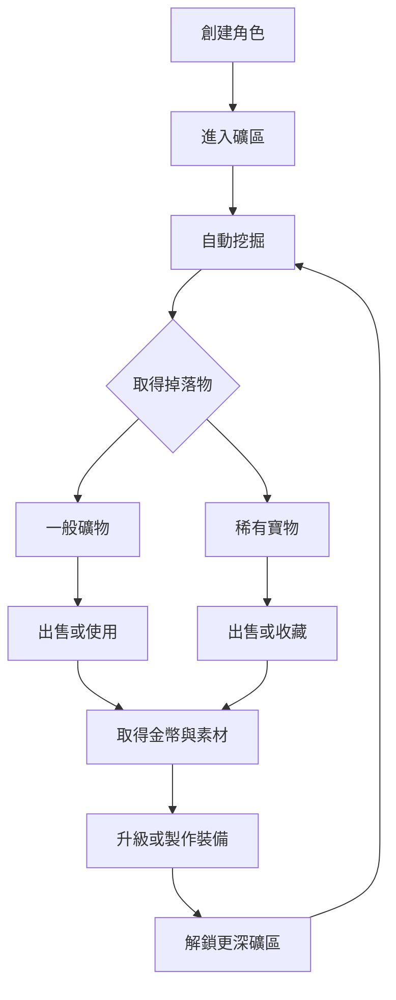
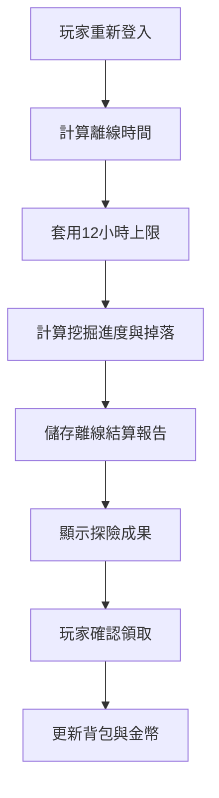

# 《挖礦探險隊》遊戲企劃書
**Game Design Document — Version 1.2**

| 版本 | 日期 | 變更 |
|---|---|---|
| v1.0 | 2026-11-13 | 初版 |
| v1.1 | 2026-11-13 | 依已確認決策 D1–D10 修正（見 `ANALYSIS_REPORT.md` §1）。詳細規則與數值見 `GBS.md`，技術規格見 `TECHNICAL_SPEC.md` |
| v1.2 | 2026-11-13 | 依 D11–D17 加入：回訪金幣與寶物倍率、只能回訪較淺礦區、重挖（防卡死）、首次寶物保護 |

| 項目 | 內容 |
|---|---|
| 遊戲名稱 | 挖礦探險隊 |
| 英文名稱 | Mining Expedition |
| 遊戲類型 | Idle / Incremental / Collection |
| 遊戲平台 | Web Browser |
| 美術風格 | 2D Pixel Art |
| 遊戲模式 | 單人、放置型 |
| 開發技術 | Next.js、React、TypeScript |
| 預計版本 | MVP v1.0 |
| 文件版本 | GDD v1.2 |

---

# 1. 遊戲概念

## 1.1 核心定位

《挖礦探險隊》是一款以挖礦、探索、收集與裝備成長為核心的輕量級放置遊戲。

玩家創建自己的礦工角色，裝備不同等級的十字鎬，前往未知礦區進行自動挖掘。

挖掘過程中會隨機獲得金幣、礦石、稀有水晶與古代寶物。玩家可以將資源出售換取金幣，也可以收藏具有升值潛力的珍稀寶物。

透過升級裝備、製作工具與解鎖新礦區，逐步探索更深層的地下世界。

**核心體驗：每一次挖掘，都有機會發現意想不到的寶物。**

## 1.2 四大設計支柱

| 設計支柱 | 說明 |
|---|---|
| Discovery 探索 | 挖掘未知區域，發現不同礦物與寶藏 |
| Progression 成長 | 升級裝備、提升挖掘效率、探索更深處 |
| Collection 收藏 | 收集稀有礦物、古代遺物與完整收藏套組 |
| Investment 投資 | 收藏寶物，觀察市場價格變化，選擇出售時機 |

## 1.3 目標玩家

- 喜歡放置、養成、收集類遊戲的玩家。
- 喜歡看到角色持續成長、裝備逐漸變強的玩家。
- 喜歡隨機掉落與稀有物品驚喜的玩家。
- 希望利用零碎時間遊玩的玩家。

遊戲不以高操作量或競技性為主要賣點，而是強調長期成長與探索的期待感。

---

# 2. 核心遊戲循環

## 2.1 Core Gameplay Loop

1. 創建礦工角色。
2. 裝備十字鎬（初始為木製十字鎬）。
3. 進入礦區自動挖掘。
4. 獲得礦石、金幣與隨機寶物。
5. 選擇出售資源或收藏寶物。
6. 使用金幣與素材升級裝備。
7. 解鎖更深層的礦區。
8. 重複探索，追求更稀有的收藏。

## 2.2 遊戲流程



---

# 3. 角色與挖掘系統

## 3.1 角色創建

玩家第一次進入遊戲時，需要創建礦工角色。

初版功能：
- 選擇角色外觀。
- 輸入角色名稱。
- 自動配備木製十字鎬（玩家初始只有木製十字鎬，不提供選擇）。【D10】
- 進入新手礦區。

角色外觀以像素風格呈現，初版不需要複雜的角色自訂系統。

## 3.2 挖掘機制

採用逐格向下挖掘的方式。1m = 10 個方塊，MVP 深度 0–300m 共 3,000 個方塊。【D1】

每個方塊都有自己的屬性：

| 屬性 | 說明 |
|---|---|
| Depth | 所在深度 |
| Hardness | 方塊硬度，決定挖掘時間 |
| RequiredPower | 最低 Mining Power 要求【D5】 |
| OreType | 礦物類型 |
| DropTable | 掉落物設定 |

玩家裝備影響三項核心數值：

| 屬性 | 功能 |
|---|---|
| Mining Power | 決定能否挖開方塊（需 ≥ RequiredPower），並影響挖掘時間 |
| Mining Speed | 影響挖掘所需時間 |
| Luck | 影響稀有物品的掉落機率 |

挖掘時間公式：

`Mining Time = Hardness / (Mining Power × Mining Speed)`

方塊具有最低 Mining Power 要求。Power 不足時：【D5】

- 停止挖掘。
- 顯示裝備不足的提示，引導玩家前往 Workshop 升級裝備。
- 離線挖掘遇到無法突破的方塊時也停止結算，已完成的成果保留。

Luck 不影響挖掘速度，只影響掉落機率。

## 3.3 礦區規劃

初版預計規劃三個礦區，每個礦區 1,000 個方塊：【D1】

| 礦區 | 深度 | 主要資源 |
|---|---|---|
| 新手礦坑 | 0–100m | 石頭、煤炭、銅礦、鐵礦 |
| 水晶洞窟 | 100–200m | 銀礦、紫水晶、藍寶石 |
| 古代遺跡 | 200–300m | 黃金、紅寶石、古代遺物 |

每個礦區擁有不同的：
- 礦物掉落表。
- 方塊硬度。
- 寶物種類。
- 稀有物品機率。

進入下一個礦區的條件：前線挖到目前礦區底部，並支付解鎖費用。【D10】

**回訪**：玩家可以返回比目前前線所在礦區更淺、且已解鎖的礦區；目前前線所在礦區不能一般回訪。回訪不改變最大深度，也不會取得首次探索獎勵。【D1、D8、D15】

- 回訪使用該礦區最深處的方塊硬度與 Power 要求。
- 普通礦物依照該礦區原始掉落表取得。
- 金幣收益 ×0.5，只作用於金幣，不影響礦物與寶物。【D12】
- Epic / Legendary 寶物機會 ×0.5（MVP 暫定）；不調整寶物權重，沒有回訪專屬保底或重複保護。【D14】
- 回訪主要用於補充素材與完成收藏，不得成為比前進新礦區更有效率的金幣來源。【D8、D12】

**重挖（防卡死）**：前線卡關（Power 不足或未付費解鎖）時，玩家可以重挖已探索的深度，取得製作必要裝備的材料。【D16】

- 第一個可回訪礦區解鎖之前也能使用。
- 重挖位置由伺服器決定：目前裝備能挖的最深已探索深度，玩家不能選擇淺層。
- 不改變最大深度，不取得首次探索獎勵。
- 不得成為比正常前進更有效率的金幣來源；金幣與寶物倍率與回訪相同（暫定）。
- 切換模式無法重新抽取隨機結果；遵守伺服器權威、時間計算與離線規則。
- 確保玩家在任何情況下都有有限時間內可取得的材料來源。

**金幣**：每 50m 門檻段的金幣金額遞增。【D13】詳細數值見 `GBS.md` §7.3。

未來可持續擴充更深層的地下世界。

---

# 4. 掉落與寶物系統

## 4.1 掉落物分類

| 類型 | 說明 | 主要用途 |
|---|---|---|
| Common | 普通礦物與素材 | 製作、升級、出售 |
| Rare | 稀有礦物、水晶 | 高階裝備材料 |
| Epic | 古代遺物、特殊寶藏 | 收藏、交易、套組 |
| Legendary | 傳說級寶物 | 稀有收藏、特殊加成 |

掉落採用混合式判定：【D7】

| 掉落 | 判定方式 |
|---|---|
| Common 普通資源 | 每個挖掘方塊進行判定 |
| Rare 稀有礦物 | 每個挖掘方塊依照礦區 Drop Table 判定 |
| Epic / Legendary 寶物 | 時間型掉落機會，控制高價值寶物的長期產出 |
| 金幣 | 特定方塊或獨立掉落判定 |

Luck 影響稀有物品的機率（`Final = Base × (1 + Luck)`），並正規化確保機率總和為 100%。【D2】

v1.0 的 75% / 20% / 4.5% / 0.5% 單一機率表已由上述規則取代；Epic : Legendary 維持 9 : 1。各層的分母、頻率與公式見 `GBS.md` §7。

**首次寶物保護**：【D17】

- 只有每個帳號的第一件寶物受到保護，之後完全隨機。
- 若已透過正常掉落取得第一件寶物，保護永久失效。
- 若有效挖掘時間達到門檻仍未取得任何寶物，系統安排一件固定的 Epic 寶物（不會是 Legendary）。
- 保護獎勵與正常掉落相同，記入背包、發現紀錄與收藏。
- 只能觸發一次；離線領取、重登入、切換模式、重試 API、出售該寶物都不會再次觸發。
- 有效挖掘時間由伺服器計算，不依賴 Client 計時；卡關、空等不累積。
- 不實作第二次保底、累積機率、隱藏幸運值或重複寶物保護。
- 觸發門檻**待確認**；模擬建議 4 小時（見 `GBS.md` §20）。

## 4.2 即時掉落呈現

玩家在線挖掘時，物品掉落後立即自動進入背包。由於掉落由伺服器結算（D4），畫面上可能有數秒延遲。

不要求玩家點擊物品才能取得。

不同稀有度採用不同呈現方式：

| 稀有度 | 畫面呈現 |
|---|---|
| Common | 一般掉落提示 |
| Rare | 顯示物品圖示與短暫閃光 |
| Epic | 特殊出現動畫與通知 |
| Legendary | 全螢幕揭曉動畫 |

畫面設置 Recent Loot 區域，顯示近期獲得的物品。

## 4.3 寶物收藏系統

寶物不只是普通素材，而是具有收藏與市場價值的特殊物品。

寶物資料：

> v1.1 註：資料結構建議改為「寶物定義」與「寶物實例」分開，並移除 `currentValue`、`isCollected`，見 `TECHNICAL_SPEC.md` §8.1（待審核）。

```ts
interface Artifact {
  id: string;
  name: string;
  rarity: "rare" | "epic" | "legendary";
  baseValue: number;
  currentValue: number;
  discoveredAt: number;
  depth: number;
  isCollected: boolean;
}
```

設計規則：
- 每件寶物有基礎估值。
- 市場價格會定期更新。
- 玩家可以選擇出售或收藏。
- 收藏寶物可以累積圖鑑進度。
- 實際持有完整收藏套組時提供加成。【D3】

收藏紀錄與實際持有物品需要分開管理，避免出售後遺失已發現的圖鑑紀錄。

## 4.4 收藏套組

例如：

**古代文明套組**
- 古代黃金徽章
- 遠古王者之戒
- 古代文明石板

完成整組收藏後可獲得：
- Luck +2%
- 挖掘速度 +3%

套組規則：【D3】

- 曾經發現的寶物永久保留圖鑑紀錄。
- 必須實際持有所有指定寶物才啟動。
- 出售其中一件寶物後，套組效果失效。
- 寶物可以重新取得；重新集滿後效果恢復。
- 「永久」指持有期間沒有時間限制。

---

# 5. 市場與經濟系統

## 5.1 金幣系統

金幣是遊戲主要貨幣。

取得方式：
- 出售礦物。
- 出售寶物。
- 挖掘過程中的金幣掉落。

消耗方式：
- 購買十字鎬（需金幣與指定素材）。【D10】
- 升級裝備。
- 解鎖新礦區。

## 5.2 寶物市場

寶物具有市場估值，玩家可以決定何時出售。

價格公式：

`Current Value = Base Value × Market Multiplier`

市場價格每 24 小時更新一次。

設計原則：
- 價格在合理範圍內波動。
- 不應出現極端暴漲暴跌。
- 不同寶物有不同的價格變動區間。
- 收藏品可以保留，不強迫出售。

初版不需要真正的玩家交易市場，價格由遊戲系統控制。

---

# 6. 裝備與製作系統

## 6.1 十字鎬等級

| 裝備 | Power | Speed | Luck |
|---|---:|---:|---:|
| 木製十字鎬 | 2 | 1.0 | 0% |
| 石製十字鎬 | 5 | 1.2 | 1% |
| 鐵製十字鎬 | 10 | 1.5 | 3% |
| 黃金十字鎬 | 18 | 1.8 | 7% |
| 鑽石十字鎬 | 30 | 2.2 | 12% |

以上數值為初始平衡參考。

取得規則：【D10】

- 玩家初始只有木製十字鎬。
- 依序購買石製、鐵製、黃金、鑽石十字鎬。
- 購買需要金幣與指定素材（見 `GBS.md` §10）。

## 6.2 裝備強化

裝備可以透過金幣與素材進行升級。

每件裝備分為 Lv.1–Lv.5。

升級後可提升：
- Mining Power
- Mining Speed
- Luck

## 6.3 製作系統

初版預計支援以下配方：

| 物品 | 配方 |
|---|---|
| 鐵錠 | 鐵礦 ×5 + 煤炭 ×2 |
| 強化石 | 石頭 ×20 + 鐵礦 ×5 |
| 精煉水晶 | 水晶 ×3（GBS 提案為紫水晶 ×3，待確認） |

製作素材用於購買十字鎬與強化裝備。未來可加入更複雜的高階裝備與特殊素材。

---

# 7. 離線挖掘系統

## 7.1 設計目的

離線挖掘是本遊戲的重要功能。

玩家關閉網頁後，角色仍會持續進行挖掘。

再次登入時，系統依照離線時間計算成果。

初版設定：
- 離線收益上限：12 小時；超過 12 小時不再產生額外收益。【D9】
- 離線效率：100%。【D9】
- 不因領取頻率不同而產生額外倍率。【D9】
- 使用與在線模式相同的掉落規則。
- 不需要逐秒模擬挖掘。

## 7.2 離線結算流程



## 7.3 離線探險報告

玩家回到遊戲時，不直接將所有獎勵塞進背包，而是先顯示一份探險成果報告。

報告內容：

- 離線時間。
- 本次挖掘深度。
- 挖掘方塊數量。
- 獲得金幣。
- 獲得礦物與素材。
- 發現的稀有寶物。

一般資源以統計數量呈現。

稀有寶物獨立展示，並依照稀有度播放不同動畫。

首次發現的寶物額外標記 NEW DISCOVERY。

## 7.4 離線成果呈現層級

| 稀有度 | 呈現方式 |
|---|---|
| Common | 合併統計數量 |
| Rare | 獨立列出物品與簡短特效 |
| Epic | 大圖展示與特殊動畫 |
| Legendary | 全螢幕寶物揭曉 |

玩家按下「領取探險成果」後，所有獎勵一次入帳。

不要求玩家逐個點擊寶物。

動畫只負責呈現驚喜，不影響實際領取。

## 7.5 防止離線作弊

MVP 即採用伺服器時間計算離線時長，並由伺服器負責所有遊戲結算。【D4】

必要機制：
- 不信任客戶端時間。
- 離線報告必須具備唯一識別碼。
- 同一份報告不可重複領取。
- 避免重複計算金幣與物品。
- 伺服器負責驗證經濟與掉落結果。

---

# 8. UI / UX 設計

## 8.1 美術風格

採用 2D Pixel Art 像素風格。

主要畫面以地下礦坑為背景，角色在畫面中央進行挖掘。

視覺方向：
- 復古 RPG 像素風。
- 地下礦坑環境。
- 十字鎬挖掘動畫。
- 礦石與寶物掉落動畫。
- 簡潔、易讀的資訊面板。

MVP 不需要導入完整 2D 遊戲引擎，使用 CSS Sprite 與簡單動畫即可完成。

## 8.2 主畫面

主畫面採用單頁 Dashboard。

主要區域：

1. Header：金幣、目前深度、幸運值。
2. Mining Scene：角色挖掘動畫。
3. Progress Bar：目前方塊挖掘進度。
4. Recent Loot：近期獲得的物品。
5. Bottom Navigation：主要功能入口。

## 8.3 導覽功能

| 頁面 | 功能 |
|---|---|
| Mine | 自動挖掘與進度 |
| Inventory | 查看背包與出售物品 |
| Workshop | 裝備升級與製作 |
| Collection | 寶物圖鑑與收藏套組 |

## 8.4 離線報告畫面

離線報告以獨立 Modal 或全頁結算畫面呈現。

設計重點：
- 先顯示探險時間與總成果。
- 一般資源簡潔統計。
- 稀有寶物獨立揭曉。
- 首次發現特別標記。
- 最後一次領取所有成果。

---

# 9. 技術架構

## 9.1 技術選型

| 技術 | 用途 |
|---|---|
| Next.js | Web Framework |
| React | UI |
| TypeScript | 型別系統 |
| Tailwind CSS | UI Styling |
| Zustand | Client State |
| Supabase Auth | 使用者登入 |
| Supabase PostgreSQL | 遊戲資料持久化 |
| Vitest | 單元測試 |
| Vercel | 部署 |

## 9.2 架構原則

核心遊戲邏輯與 UI 分離。

遊戲引擎使用純 TypeScript 實作，不依賴 React、Zustand 或 Next.js。

好處：
- 遊戲規則容易測試。
- 平衡數值容易調整。
- UI 可以獨立修改。
- 未來可以替換前端框架或增加其他平台。

## 9.3 專案結構

```text
src/
├── app/
│   ├── page.tsx
│   ├── mining/
│   ├── inventory/
│   ├── workshop/
│   └── collection/
│
├── features/
│   ├── character/
│   ├── mining/
│   ├── inventory/
│   ├── equipment/
│   ├── crafting/
│   ├── collection/
│   └── market/
│
├── game-engine/
│   ├── mining/
│   ├── drop/
│   ├── economy/
│   └── idle/
│
├── data/
│   ├── minerals/
│   ├── artifacts/
│   ├── equipment/
│   ├── recipes/
│   └── mines/
│
├── stores/
│   └── game-store.ts
│
└── lib/
    └── supabase/
```

## 9.4 遊戲資料模型

主要資料：

- Player：玩家資料。
- MiningState：挖掘狀態。
- Inventory：背包物品。
- Equipment：裝備資料。
- CollectionRecord：收藏紀錄。
- OfflineReport：離線結算報告。

遊戲引擎主要函式：

```ts
calculateMiningProgress()
calculateMiningTime()
generateDrop()
calculateOfflineRewards()
calculateArtifactValue()
upgradeEquipment()
craftEquipment()
```

所有隨機掉落應支援可注入的 Random Source，方便使用固定亂數進行單元測試。

MVP 起，挖掘結果、隨機掉落、金幣與物品入帳、離線時間驗證全部由伺服器負責；Client 只負責 UI、動畫與呈現。【D4】技術上優先使用 Supabase Database Function / Edge Function（見 `TECHNICAL_SPEC.md` §3）。

---

# 10. MVP 開發規劃

## Phase 1：核心挖掘

目標：完成最基本的挖礦體驗。

> v1.1 註：依 D4，伺服器結算（在線與離線共用）屬於核心挖掘的一部分，詳細順序見 `TECHNICAL_SPEC.md` §16。

- [ ] 角色創建
- [ ] 主畫面
- [ ] 像素角色挖掘動畫
- [ ] 自動挖掘機制
- [ ] 深度與礦區進度
- [ ] 基礎掉落系統
- [ ] 金幣累積

## Phase 2：裝備與資源

目標：讓玩家有明確的成長目標。

- [ ] 背包系統
- [ ] 礦物出售
- [ ] 十字鎬裝備
- [ ] 裝備升級
- [ ] 製作系統
- [ ] 新礦區解鎖
- [ ] 寶物收藏與出售

## Phase 3：離線與收藏

目標：完成放置遊戲的長期循環。

- [ ] 離線時間計算
- [ ] 離線獎勵結算
- [ ] 探險報告畫面
- [ ] 稀有寶物揭曉動畫
- [ ] 首次發現紀錄
- [ ] 收藏圖鑑
- [ ] 收藏套組
- [ ] 市場價格變化

## Phase 4：優化與發布

- [ ] 音效與動畫優化
- [ ] Responsive Web Design
- [ ] 遊戲存檔與同步
- [ ] 掉落機率平衡
- [ ] 離線時間作弊測試
- [ ] 重複領取防護
- [ ] Beta 測試與正式發布

---

# 11. MVP 功能優先級

| 系統 | 優先級 | 說明 |
|---|---|---|
| 角色創建 | P0 | 遊戲基本入口 |
| 自動挖掘 | P0 | 核心玩法 |
| 掉落系統 | P0 | 核心回饋 |
| 背包 | P0 | 管理獲得資源 |
| 裝備系統 | P0 | 玩家成長 |
| 寶物收藏 | P0 | 核心特色 |
| 製作系統 | P1 | 延伸成長 |
| 市場價格 | P1 | 收藏與投資玩法 |
| 離線結算 | P0 | 放置體驗；伺服器結算在線與離線共用（D4） |
| 收藏套組 | P1 | 長期目標 |

---

# 12. 暫不納入的功能

為避免 MVP 開發範圍過大，初版暫時不開發：

- 多人連線。
- 玩家間交易。
- 公會系統。
- 多角色礦工。
- 裝備隨機詞綴。
- 拍賣場。
- PvP。
- 付費抽卡。
- 真實貨幣兌換或贖回。

未來可以依照玩家回饋與遊戲數據再評估。

---

# 13. 成功指標與驗收條件

MVP 完成時，至少應符合以下條件：

### 核心玩法
- 玩家可以創建角色並開始挖掘。
- 角色可以自動完成挖掘循環。
- 挖掘過程可以獲得不同類型的物品。
- 玩家可以使用金幣與素材提升裝備。
- 裝備提升後能明確感受到挖掘效率改變。

### 收藏玩法
- 玩家可以發現並收藏寶物。
- 出售寶物不會刪除圖鑑發現紀錄。
- 收藏套組能正確提供加成。
- 首次寶物保護在達到門檻時發放一次，之後不再觸發。【D17】

### 離線玩法
- 關閉遊戲後能正確計算離線收益。
- 離線時間不超過 12 小時的收益正確。
- 超過 12 小時只計算上限。
- 離線報告能正確顯示物品與稀有度。
- 同一份報告不能重複領取。

### 系統穩定性
- 遊戲重新整理後資料不遺失。
- 遊戲引擎核心邏輯具有單元測試。
- 不會因客戶端修改時間而取得額外收益。
- 不會因重複請求產生重複獎勵。
- 玩家在任何進度出售全部可出售物品後，仍能透過重挖或回訪取得必要裝備，不會永久卡關。【D16】

---

# 14. 開發時程估計

以個人開發、搭配 AI Coding Assistant 為前提：

| 階段 | 預估時間 |
|---|---:|
| 核心挖掘 | 3–4 天 |
| 裝備與背包 | 2–3 天 |
| 寶物與收藏 | 2–3 天 |
| 離線系統 | 2 天 |
| UI 與遊戲體驗優化 | 2–5 天 |
| **合計** | **11–17 個工作天** |

此估算不包含大量客製像素美術、複雜角色動畫與長期數值平衡。

> v1.1 註：v1.0 的估算未包含 MVP 伺服器權威（D4）所需的工作：Supabase RLS、冪等 API、確定性亂數與測試。規格定案後需依 `TECHNICAL_SPEC.md` §16 重新估算。

---

# 15. 產品核心原則

《挖礦探險隊》不是一款要求玩家不斷點擊的遊戲。

它的核心是：

1. **挖掘本身要簡單**：玩家不需要持續操作。
2. **成長要有感**：裝備升級後，挖掘速度與深度應有明顯變化。
3. **掉落要有期待**：每次挖掘都可能發現珍貴物品。
4. **收藏要有價值**：寶物不只是出售換錢，也可以成為長期目標。
5. **離線也有樂趣**：玩家回來時，能享受一次探險成果揭曉的驚喜。

**最重要的產品定位：這是一款讓玩家期待「下一次會挖到什麼」的放置型探索遊戲。**