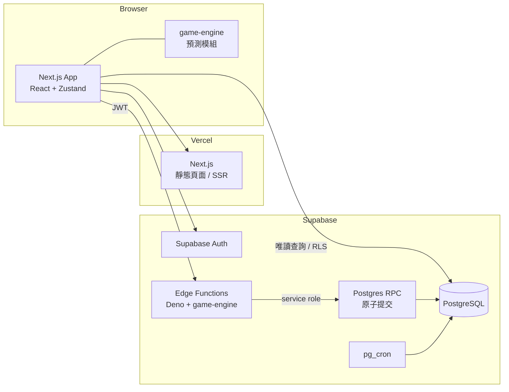
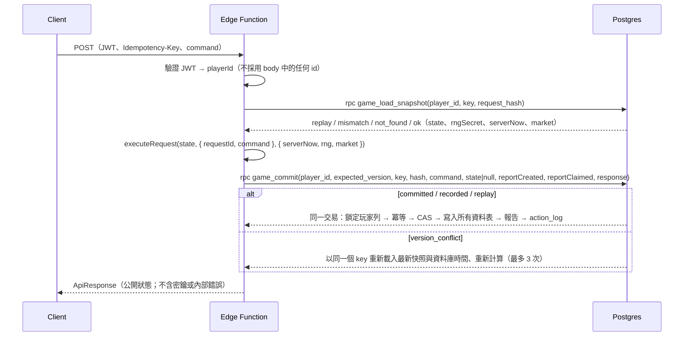
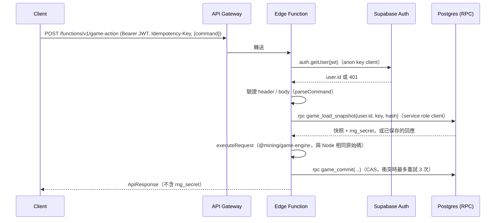
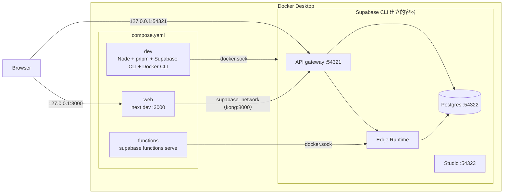

# 《挖礦探險隊》TECHNICAL_SPEC

**Version 1.6（MVP v1.0 基準）**

| 版本 | 變更 |
|---|---|
| v1.0 | 初版 |
| v1.1 | 四層混合式掉落（D7）、回訪規則（D8）、離線上限 12 小時（D9）、十字鎬與解鎖（D10）；新增 `scripts/balance-sim.ts` |
| v1.2 | 回訪金幣 ×0.5（D12）、金幣依門檻段（D13）、回訪寶物 ×0.5（D14）、只能回訪較淺礦區（D15）、重挖模式（D16）、首次寶物保護（D17） |
| v1.3 | 首次保護 4 小時（D18）；引擎規則測試對照（D19）；離線報告領取流程與防卡住（D20）；架構定案（D21）；Docker-first 開發環境（D22）；數值版本管理 |
| v1.4 | Game Engine Core：§5 補上整數取整與防溢位（BigInt）的精確定義；§6 定義 RNG_VERSION 1 的位元組順序、sfc32 初始化、拒絕取樣與各層區間；HMAC 使用 `@noble/hashes` 2.4.0（T4 定案，含實測與用途界線）；`rngSecret` 必須 32 bytes；GBS §2.3.1 邊界回訪；涵蓋率門檻（T11）；§3.4 依實作更新；§14 測試門檻與實作對齊；模擬器改用共用引擎（§14.4）。**遊戲規則與數值不變** |
| v1.5 | Settlement & Actions Core：§7 依實作更新（`settle` / `applyAction` / `executeRequest`）；§8.1 `PlayerGameState` 定案；新增 §10.6 冪等與原子提交；§14.1.2 測試對照；§14.6 結算 benchmark；決策 D23（空的離線報告不建立）、D24（待領取期間暫停、不補算）；`validateState` 接受不可信輸入。**數值與 RNG_VERSION 不變** |
| v1.7 | Supabase Integration（2/2）：§10.1 / §10.2 改為已實作的 3 個 Edge Function（取代原本一動作一端點的規劃）；新增 §10.7 身分驗證與 verify_jwt 決策、§10.8 Edge Runtime 實測效能。**遊戲規則、數值與 RNG_VERSION 不變** |
| v1.6 | Supabase Integration（1/2）：§8.2–§8.5 依實作的 schema 更新（與 v1.5 草稿的差異見 §8.6）；§10.4 RPC 名稱與流程；§10.6 回應保存規則；§14.5 真實 Supabase Local 整合測試。**遊戲規則、數值與 RNG_VERSION 不變** |

| 項目 | 內容 |
|---|---|
| 依據 | `docs/GDD.md` v1.3、`docs/GBS.md` v1.3.3、已確認決策 D1–D24 |
| 範圍 | MVP：架構、資料模型、API、伺服器結算、測試規範 |
| 標記 | 【決策 Dn】已確認；【GDD】來自企劃；【提案 Tx】技術提案，待審核 |

---

## 1. 原則

1. **伺服器權威**：挖掘、掉落、金幣、物品、離線時間全部由伺服器計算與入帳。Client 只負責 UI、動畫與呈現。【決策 D4】
2. **單一引擎**：遊戲規則只實作一次，以純 TypeScript 撰寫，不依賴 React / Zustand / Next.js。【GDD §9.2】伺服器用它結算，Client 用它的「無亂數部分」做進度預測。
3. **確定性**：同樣的狀態、時間、密鑰，一定得到同樣的結果。
4. **整數運算**：所有會影響結果的數值都用整數或定點數，避免浮點誤差。
5. **冪等**：所有會改變狀態的請求都可以安全重送。

---

## 2. 權威模型 【決策 D4】

| 職責 | Server | Client |
|---|---|---|
| 時間來源 | Postgres `now()` | 只用於顯示 |
| 挖掘進度與方塊完成 | ✅ | 預測顯示（不入帳） |
| 方塊內容（OreType）與掉落 | ✅ | ❌（無法預知） |
| 金幣、物品入帳 | ✅ | ❌ |
| 購買、強化、製作、出售、解鎖 | ✅ 驗證並執行 | 送出請求 |
| 離線時長與上限 | ✅ | ❌ |
| 離線報告產生與領取 | ✅ | 呈現與送出領取 |
| 動畫、音效、提示 | ❌ | ✅ |

Client 唯一能做的是「請伺服器結算到現在」以及「請伺服器執行某個動作」。Client 不傳任何時間、數量或結果。

---

## 3. 系統架構

### 3.1 部署



### 3.2 為什麼用 Edge Function + Database Function 【決策 D21】

依你的要求優先評估 Supabase Database Function 與 Edge Function：

| 方案 | 說明 | 評估 |
|---|---|---|
| 只用 Database Function（PL/pgSQL） | 規則全部寫在 SQL | ❌ 引擎要用 SQL 再寫一次，違反「單一引擎」，難以測試 |
| 只用 Edge Function | 引擎在 Deno 執行，以多次 API 呼叫寫入 | ❌ supabase-js 沒有多語句交易，無法保證原子性 |
| **Edge Function 計算 + Database Function 提交** | Edge Function 跑 TS 引擎算出結果；呼叫一個 RPC 在單一交易中檢查版本並寫入 | ✅ **採用** |
| Next.js Route Handler | 也能跑 TS 引擎 | 可作為備案；不需要另建後端 |

### 3.3 執行限制

依 Supabase 文件，Edge Function 每個請求的 CPU 時間上限為 2 秒，記憶體 256MB，閒置逾時 150 秒；但另一篇 Supabase 疑難排解文件寫的是 200 毫秒 CPU。**以較保守的 200 毫秒作為設計上限。**

最壞情況估算：離線 12 小時、最快方塊約 6.5 秒 → 約 6,650 個方塊。每個方塊一次 HMAC-SHA256 加數次亂數，預估遠低於 100 毫秒。Phase 1 必須加入效能基準測試（§14.6）。

### 3.4 Repo 結構 【決策 D21】

GDD §9.3 把 `game-engine` 放在 `src/` 內。由於 Edge Function（Deno）也要匯入引擎，改為 pnpm workspace monorepo：

```text
mining-expedition/
├── apps/web/                    # Next.js（GDD §9.3 的 src/ 內容移到這裡）
│   └── src/
│       ├── app/
│       ├── features/
│       ├── stores/
│       └── lib/supabase/
├── packages/
│   ├── game-engine/             # 純 TS，零框架依賴；唯一外部依賴 @noble/hashes
│   │   ├── src/
│   │   │   ├── fixed.ts         # 定點數工具（blockMs、mulDivFloor、BigInt 防溢位）     ✅ Engine Core
│   │   │   ├── rng/             # RandomSource、sfc32、HMAC（@noble/hashes）、逐方塊種子 ✅ Engine Core
│   │   │   ├── stats.ts         # 數值聚合、套組判定                                    ✅ Engine Core
│   │   │   ├── mining.ts        # 深度、門檻、前線 / 回訪 / 重挖位置、工作量            ✅ Engine Core
│   │   │   ├── drop.ts          # 四層掉落、機率（ppm）、期望值                         ✅ Engine Core
│   │   │   ├── protection.ts    # 首次寶物保護的純判定（狀態保存屬於 settle）           ✅ Engine Core
│   │   │   ├── settle/          # 結算（在線 / 離線）                                   Settlement 階段
│   │   │   ├── actions/         # 購買、強化、製作、出售、解鎖                          Actions 階段
│   │   │   ├── market/          # 倍率生成                                              Market 階段
│   │   │   └── collection/      # 圖鑑                                                  Collection 階段
│   │   └── test/                # Vitest；fixtures/golden-v1.json（Node / Deno 共用快照）
│   └── game-data/               # 靜態資料（GBS 數值表），附 DATA_VERSION / RNG_VERSION
├── supabase/
│   ├── migrations/              # SQL schema、RLS、RPC
│   ├── functions/               # Edge Functions
│   └── seed.sql
├── scripts/
│   ├── balance-sim.ts           # 平衡模擬（開發輔助工具，見 §14.4）
│   ├── env-sync.ts              # 從 supabase status 產生 apps/web/.env.local
│   └── verify-env.ts            # Web / Edge Functions / Postgres 連線驗證
├── docker/entrypoint.sh         # 開發容器入口（Docker socket 權限處理）
├── Dockerfile.dev               # 開發容器：Node、pnpm、Supabase CLI、Docker CLI
├── compose.yaml                 # 開發環境（§15）
└── docs/
```

Edge Function 以函式目錄內的 `deno.json` 對應 `@mining/game-engine` 到 `packages/game-engine/src`（相對路徑）。Supabase 自 2025 年起支援從 `supabase/` 以外匯入檔案；但本地 `functions serve` 曾有回報失敗的案例，**需要在 Docker 環境實測**（Phase 1 驗證項目）。若失敗，備案是建置步驟把引擎複製到 `supabase/functions/_shared/`。

- 引擎原始碼的 import 一律寫副檔名（`./fixed.ts`），讓 Node（Next.js、Vitest）與 Deno 都能直接讀取同一份檔案。
- 套件管理：pnpm workspace。【決策 D21】
- 引擎唯一的外部依賴：`@noble/hashes`，版本固定 **2.4.0**（Node 由 `packages/game-engine/package.json`、Deno 由各 `deno.json` 的 import map 對應 `npm:@noble/hashes@2.4.0/hmac.js`、`sha2.js`，兩邊必須同版）。【決策 T4 定案，PR #3】
  - 選擇理由：已有安全審查、持續維護、零依賴、同步 API，Node / Deno / 瀏覽器都能用。不用 Web Crypto，因為 `crypto.subtle` 只有非同步 API。
  - 實測（PR #3）：Node 每方塊（HMAC + 四層掉落）約 4 µs、Deno 約 5–6 µs；與自寫實作的輸出逐位元組相同，所以 RNG_VERSION 與確定性快照不變。12 小時離線結算的實際 CPU 成本在 Settlement 階段以 Edge Function 實測。
  - **用途界線**：只用於遊戲亂數的種子（逐方塊、市場），使結果可重現且 Client 無法預測。不用於簽章、身分驗證、密碼雜湊或金鑰派生。
  - 升級版本時必須：確認 golden 快照不變、Node 與 Deno 同步改版、在 PR 說明。

---

## 4. 靜態遊戲資料

- GBS 的所有數值表（礦區、硬度帶、OreType 權重、掉落表、物品、十字鎬、強化、配方、套組、市場參數）以 TS 常數放在 `packages/game-data`。
- 資料不放資料庫；資料庫只存玩家狀態與 ID 參照。
- `DATA_VERSION`（整數）每次調整數值時加 1。玩家狀態記錄最後一次結算使用的版本。
- 數值變更後，下一次結算直接使用新數值；已入帳的物品、已發現的紀錄不回溯調整。【決策 D19】
- 完整規則見 GBS §24：ID 不可刪除或重用、變更紀錄、模擬驗證。
- `RNG_VERSION`：亂數消耗順序的版本（MVP = 1）。只有改變 §6.2 順序時才加 1，並更新確定性測試快照；舊快照保留，確保舊版本的回放仍可驗證。

---

## 5. 數值表示（定點整數）【提案 T6】

| 數值 | 表示方式 | 範例 |
|---|---|---|
| Power | ×10 整數 `power10` | 木 2.0 → 20；需求 36 → 360 |
| Speed | ×1000 整數 `speed1000` | 1.2 → 1200 |
| Luck | ppm（×1,000,000） | 0.12 → 120,000 |
| 機率 | ppm | 0.5% → 5,000 |
| Hardness | 整數 | 32,500 |
| 時間 | 毫秒整數 | |
| 工作量 | `power10 × speed1000 × ms` | 方塊完成條件：`work ≥ Hardness × 10^7` |

計算規則：

```
levelStep   = Lv − 1
power10     = basePower10 × (100 + 10 × levelStep) / 100            // MVP 數值皆整除
speed1000   = floor( baseSpeed1000 × (100 + 5 × levelStep) / 100
                     × (100 + 3 × speedSetCount) / 100 )
luckPpm     = baseLuckPpm × (100 + 10 × levelStep) / 100 + 20,000 × luckSetCount
rate        = power10 × speed1000                                    // 每毫秒的工作量
blockMs     = ceil( Hardness × 10^7 / rate )
canMine     = power10 ≥ requiredPower10
```

四層掉落的 ppm 計算（GBS §7）：

```
// 第二層：礦物
rarePpm     = floor( rareBasePpm[zone] × (1,000,000 + luckPpm) / 1,000,000 )
bundlePpm   = 150,000
nonePpm     = 1,000,000 − bundlePpm − rarePpm                          // < 0 時拒絕（資料錯誤）

// 第三層：金幣（modeCoinPpm：前線 1,000,000、回訪 500,000【D12】、重挖 500,000【暫定】）
coinPpm     = 100,000
a           = coinAvgBySegment[seg] × modeCoinPpm                     // = Avg × 10^6
coinMin     = floor( (a + 1,000,000) / 2,000,000 )                    // = round(0.5 × Avg)，.5 進位
coinMax     = floor( (3a + 1,000,000) / 2,000,000 )                   // = round(1.5 × Avg)
amount      = coinMin + nextInt(coinMax − coinMin + 1)

// 第四層：寶物（treasurePerHourMilli：0.35/h → 350；modeTreasurePpm：前線 1,000,000、回訪 / 重挖 500,000）
chancePpm   = min( 500,000,
                   floor( treasurePerHourMilli × blockMs × modeTreasurePpm / 3,600,000,000 ) )
legPpm      = floor( chancePpm × 100,000 × (1,000,000 + luckPpm) / 10^12 )   // 單次取整
epicPpm     = floor( chancePpm × 900,000 × (1,000,000 + luckPpm) / 10^12 )
noTreasure  = 1,000,000 − legPpm − epicPpm                             // < 0 時拒絕
```

- **單次取整**：每個公式只在最後 `floor` 一次（先乘後除）。v1.3 的寫法 `chancePpm × 100,000 / 1,000,000 × …` 若逐步整數除法，會多一次取整；v1.4 明確定義為單次取整。
- **BigInt**：`epicPpm` 的中間值最大約 `500,000 × 900,000 × 1,208,000 ≈ 5.4 × 10^17`，超過 `2^53`。引擎以 `mulDivFloor` 計算：乘積 ≤ `2^53 − 1` 時用 Number（以餘數修正捨入，結果精確），否則改用 BigInt；結果超出 safe integer 時丟出錯誤。Postgres 端（若需要）使用 `numeric` 或 `bigint` 的同一順序。
- **blockMs**：第四層使用該方塊**實際的挖掘毫秒數**（換裝備時跨越不同速率的累加值，P5），不是以完成時的數值重算。
- **mode 倍率**以 ppm 表示（`COIN_MODE_MULTIPLIER_PPM`、`TREASURE_MODE_MULTIPLIER_PPM`，`packages/game-data`）。v1.3 的 `(frontier ? 2 : 1) / 2` 是同一個結果的特例寫法。

首次保護：

```
PROTECT_MS  = 14,400,000   // 4 小時有效挖掘時間【決策 D18】
```

> 驗算：`treasurePerHourMilli × blockMs / 3,600` 的單位是 ppm（0.35/h × 1 小時 = 350 × 3,600,000 / 3,600 = 350,000 ppm = 35%）。中間值最大約 `350 × 4×10^5 ≈ 1.4 × 10^8`，在安全整數範圍內。

- 最大值：`32,500 × 10^7 = 3.25 × 10^11`，在 JS 安全整數（2^53）與 Postgres `bigint` 範圍內。
- 強化倍率 `(100 + 10 × levelStep)` 套用在 MVP 的所有基礎值上都能整除；新增資料時需由單元測試保證（§14.1）。

---

## 6. 亂數 【GDD §9.4】【提案 T7】

### 6.1 介面

```ts
interface RandomSource {
  nextUint32(): number;
  /** 回傳 [0, n) 的均勻整數，使用拒絕取樣避免偏差 */
  nextInt(n: number): number;
}
```

引擎只依賴這個介面；測試可以注入固定序列（`SequenceSource`）。

`nextInt(n)`（RNG_VERSION 1）：`limit = 2^32 − (2^32 mod n)`；重複取 `x = nextUint32()` 直到 `x < limit`，回傳 `x mod n`。每次拒絕多消耗一個 uint32。`n` 必須是 1–2^32 的整數。

### 6.2 方塊亂數

每個完成的方塊各自建立一個 PRNG，不需要儲存 PRNG 狀態：

```
digest       = HMAC-SHA256( key = player.rngSecret, msg = UTF-8("block:" + digCounter 的十進位) )
(a, b, c, d) = digest[0..3], digest[4..7], digest[8..11], digest[12..15]，各為 big-endian uint32
rng          = sfc32(a, b, c, d)，先丟棄 12 個輸出（warm-up）
```

RNG_VERSION 1 的精確定義（`packages/game-engine/src/rng/`）：

- sfc32 每步：`t = a + b + d; d = d + 1; a = b ^ (b >>> 9); b = c + (c << 3); c = rotl(c, 21) + t; 輸出 t`（全部 mod 2^32）。
- 加權抽取：一次 `nextInt(Σweight)`，依資料表順序累加，落在 `[累積, 累積 + weight)` 的項目。
- 各層區間（`u = nextInt(1,000,000)`）：
  - 第二層：`[0, bundlePpm)` 礦石包；`[bundlePpm, bundlePpm + rarePpm)` Rare；其餘為無
  - 第三層：`u < coinPpm` 命中
  - 第四層：`[0, legPpm)` Legendary；`[legPpm, legPpm + epicPpm)` Epic；其餘為無
- 跨執行環境快照：`packages/game-engine/test/fixtures/golden-v1.json`。Vitest（Node）與 CI 的 Deno 都必須產生完全相同的結果（§14.2）。

- `digCounter`：玩家每完成一個方塊（前線或回訪）就加 1，只由伺服器遞增。
- `rngSecret`：每位玩家 32 bytes 隨機密鑰，存在 Client 無法讀取的 schema（§8.3）。`createBlockRng` 只接受剛好 32 bytes 的 `Uint8Array`，否則丟出錯誤（避免載入錯誤資料時悄悄產生「合法」的亂數）。
- 因為結果依方塊編號而定，放棄挖到一半的方塊或切換礦區都無法重新抽獎。
- 一個方塊內的亂數消耗順序固定（GBS §4.3、§7）：
  1. 第一層：OreType（1 次）
  2. 第二層：礦物判定（1 次）→ 若為礦石包，再抽 3 次 OreType；若為 Rare，再抽 1 次 Rare 表
  3. 第三層：金幣判定（1 次）→ 若命中，再抽 1 次金額
  4. 第四層：寶物機會（1 次）→ 若為 Epic，再抽 1 次哪一件
- 各層都使用 `nextInt(1,000,000)` 與 ppm 機率比較。
- 前線、回訪、重挖共用同一個 `digCounter`；切換模式只會放棄未完成方塊的進度，不會改變下一個方塊的亂數（D16）。
- 首次寶物保護（GBS §7.7）**不消耗亂數**：在第四層判定之後檢查，若發放就直接加入固定 Epic，所以之後所有方塊的結果與沒有保護時相同（D17）。

### 6.3 市場亂數

```
digest = HMAC-SHA256( key = MARKET_SECRET, msg = "market:" + date + ":" + artifactId )
```

`MARKET_SECRET` 是 Edge Function 的環境變數。

---

## 7. 結算演算法

實作：`packages/game-engine/src/settle.ts`、`actions.ts`、`request.ts`。全部是純函式：不讀時鐘、不連資料庫、不修改傳入的狀態；相同的（狀態, serverNow, 亂數）永遠得到相同結果。

### 7.1 引擎函式

```ts
// 結算到 serverNow（TECHNICAL_SPEC §7.2）
settle(state: PlayerGameState, ctx: {
  serverNow: number;                                   // Postgres now()，毫秒；唯一時間來源
  rng: (digCounter: number) => RandomSource;           // createBlockRng(rngSecret)；密鑰只在伺服器
  options?: SettleOptions;                             // 只供平衡模擬比較方案；正式結算不傳
}): { ok: true; state; changed; summary; events; report; blocks } | { ok: false; error };

// 套用一個玩家操作；state 必須已結算到現在
applyAction(state, action: GameAction, ctx: { marketMultiplierPpm? }): { ok: true; state; changed; events } | { ok: false; error };

// Edge Function 的唯一入口：先結算再操作，回傳 CAS 提交計畫
executeRequest(state, { requestId, command }, ctx): RequestResult;
```

`GameAction`：`purchase_pickaxe`、`equip_pickaxe`、`upgrade_pickaxe`、`craft`、`sell_items`、`sell_artifacts`、`unlock_zone`、`select_mining_mode`、`claim_report`。請求先經過 `parseAction` / `parseCommand`：只接受已知欄位與合法範圍，多餘欄位（例如成本、價格、深度）一律 `INVALID_REQUEST`。

靜態資料以模組匯入（`@mining/game-data`，綁定 `DATA_VERSION`），不以參數傳入。

### 7.2 流程

```
settle(state, serverNow):
  驗證狀態（validateState）、rngVersion、dataVersion ≤ 引擎版本
  if serverNow < lastSettledAt          → INVALID_TIME
  if pendingOfflineReport 存在          → REPORT_PENDING（待領取期間挖掘暫停，D24）
  elapsed = serverNow − lastSettledAt
  elapsed = 0                           → noop
  elapsed > 300,000（P28）              → 離線：simMs = min(elapsed, 12h)（D9），獎勵進報告
  否則                                   → 在線：simMs = elapsed，獎勵直接入帳

  t = 0
  while t < simMs:
      位置 = miningPosition(state)        // 前線：frontierBlock；回訪 / 重挖：該位置 RequiredPower
      if 不能挖 → stopReason = blocked_power | blocked_unlock | frontier_complete；break
      step = advanceWork(blockWork, hardness, rate, simMs − t)
      t += step.usedMs；blockMs += step.usedMs
      if 未完成 → 保留 blockWork / blockMs；break
      完成方塊（GBS §4.3）：
          drop = rollBlock(rng(digCounter), 位置, blockMs, luck)
          ft   = firstTreasureStep(...)      // 不消耗亂數
          寶物實例 ID = "d" + digCounter
          在線：入帳；套組可能改變 → 下一個方塊重新計算數值
          離線：加入報告；數值整段不變
      digCounter += 1；blockWork = blockMs = 0；前線模式 frontierBlockIndex += 1

  lastSettledAt = serverNow              // 超過 12 小時的部分捨棄
  離線且完成至少 1 個方塊 → pendingOfflineReport = { reportId: "r" + periodStart, ... }
  離線但沒有完成方塊      → 不建立報告，只推進時間（D23）

applyAction(claim_report, serverNow):
  入帳報告內容；lastSettledAt = serverNow     // D24：待領取期間暫停，等待時間不補算
```

```
executeRequest(state, { requestId, command }, ctx):
  claim_report → 不結算，直接 applyAction（領取時間成為新的結算基準，D24）
  其他         → settle → （settle 指令到此為止）→ applyAction（失敗時操作沒有任何效果）
  有變化       → commit = { state: stateVersion + 1, reportCreated, reportClaimed, actionApplied }
  expectedStateVersion = 原 stateVersion（CAS 條件）
```

### 7.3 要點

- **在線與離線共用同一個迴圈**，只差在獎勵入帳方式與 12 小時上限。
- 不因結算頻率產生額外倍率：結算只依實際經過時間（D9）。一次結算與切成多次在線結算的結果完全相同（測試）。
- 第四層使用方塊的**實際**挖掘毫秒（跨越換裝備的累加值，P5）。
- 前線卡關時結算只推進 `lastSettledAt`，沒有產出，也不累積有效挖掘時間。
- 首次保護的狀態變更與報告（或在線入帳）在同一個提交中寫入（§10.6）。離線發放時 `firstTreasure.reportId` 指向該報告，領取時清除；`validateState` 檢查「狀態已更新 ⇒ 寶物在背包或在該報告中」。
- 重挖深度帶依「目前 Power」計算：每個操作後重新確認；前線解除卡關時自動回到前線、深度帶改變時進度歸零（GBS §2.4）。
- 挖掘狀態（mining / blocked_power / blocked_unlock / frontier_complete）是衍生值（`miningPosition`），不儲存。
- `validateState` 接受任何輸入（不可信的資料庫快照）：先檢查每一層的型別與結構，再檢查遊戲不變式；不會丟出例外。結構錯誤時 `settle` / `applyAction` / `executeRequest` 回傳 `INVALID_STATE`。

---

## 8. 資料模型

### 8.1 玩家狀態型別

定義在 `packages/game-engine/src/state.ts`（`PlayerGameState`，`schemaVersion` 1）。只含可序列化的純資料，時間是伺服器毫秒整數，數量是 safe integer；**不含 rngSecret**，可以原樣回傳給玩家（`toPlayerView` 附上數值與挖掘狀態等衍生值）。

| 欄位 | 內容 |
|---|---|
| `playerId`、`schemaVersion`、`stateVersion`、`dataVersion`、`rngVersion` | 身分與版本；`stateVersion` 是樂觀鎖，每次提交 +1 |
| `createdAt`、`lastSettledAt` | 伺服器時間 |
| `coins`、`inventory` | 金幣；可堆疊物品（只存正數） |
| `equippedPickaxe`、`pickaxes` | 裝備中；已擁有（依序前綴）與等級 |
| `unlockedZone` | 已解鎖的最深礦區（0–2） |
| `mining` | `mode`、`revisitZone`、`reworkBand`、`frontierBlockIndex`、`digCounter`、`blockWork`、`blockMs` |
| `heldArtifacts` | 持有中的寶物實例：`instanceId`（`d<digCounter>`）、`artifactId`、`obtainedAt`、`mode`、`band`、`frontierBlockIndex`、`digCounter`、`source`（`drop` / `first_treasure_protection`） |
| `discoveredArtifacts` | 圖鑑：`firstDiscoveredAt`、`firstBand`、`totalFound`（永不刪除） |
| `firstTreasure` | `status`、`effectiveMiningMs`、`resolvedAt`、`artifactInstanceId`、`reportId`（第一件寶物還在待領取報告中時） |
| `pendingOfflineReport` | 待領取報告（完整內容，見下） |
| `lastClaimedReportId` | 重複領取時回傳 `REPORT_ALREADY_CLAIMED` |

`OfflineReport`：`reportId`（`r<periodStart>`）、`periodStart`、`periodEnd`、`simulatedMs`、`discardedMs`、`minedMs`、`idleMs`、`blocksMined`、`mode`、`frontierFrom/To`、`digCounterFrom/To`、`stopReason`、`rewards { coins, items, artifacts[] }`（每件附 `isNewDiscovery`）、`firstTreasureGranted`。

與 v1.4 草稿的差異：

- 寶物實例 ID 由方塊序號決定（`d<digCounter>`），不是 uuid：純函式不能產生亂數 ID，且同一個方塊重算得到同一個 ID（冪等）。資料表主鍵改為 `(player_id, instance_id)`。
- `unlockedZones: ZoneId[]` → `unlockedZone: 0 | 1 | 2`（解鎖必須依序，兩者等價）。
- `mining.status` 不儲存，由 `miningPosition` 計算。
- `depthBlockIndex` → `band` + `frontierBlockIndex`（回訪 / 重挖沒有單一 blockIndex）。
- `collection` → `discoveredArtifacts`；`pendingReportId` → `pendingOfflineReport`（完整報告）。

### 8.2 資料表（schema `public`，Client 只能讀自己的資料）

Migration：`supabase/migrations/20261114000000_player_schema.sql`（schema、約束、RLS）、`20261114000100_player_rpc.sql`（RPC）。

```text
auth.users ─1:1─ players ─1:1─ private.player_secrets
                    ├─1:1─ first_treasure
                    ├─1:N─ player_pickaxes        (players.equipped_pickaxe → player_pickaxes，deferrable FK)
                    ├─1:N─ player_inventory
                    ├─1:N─ artifact_instances     (held / sold)
                    ├─1:N─ artifact_discoveries
                    ├─1:N─ offline_reports        (每位玩家最多 1 份 pending)
                    └─1:N─ action_log             (unique player_id + idempotency_key)
market_prices（全域，依日期）
```

| 資料表 | 主鍵 | 主要欄位 | 約束 |
|---|---|---|---|
| `players` | `id`（= `auth.users.id`，on delete cascade） | `state_version`、`schema_version`、`data_version`、`rng_version`、`created_at_ms`、`last_settled_at_ms`、`coins`、`equipped_pickaxe`、`unlocked_zone`、`mining_mode`、`revisit_zone`、`rework_band`、`frontier_block_index`、`dig_counter`、`block_work`、`block_ms`、`last_claimed_report_id` | 模式與 `revisit_zone` / `rework_band` 一致；`dig_counter ≥ frontier_block_index`；前線不超過未解鎖礦區；`block_work` 與 `block_ms` 同時為 0 |
| `player_pickaxes` | `(player_id, pickaxe_id)` | `level` 1–5 | ID 清單 check；RPC 禁止刪除或降級 |
| `player_inventory` | `(player_id, item_id)` | `quantity` ≥ 1 | ID 清單 check；數量 0 時刪除列 |
| `artifact_instances` | `(player_id, instance_id)` | `artifact_id`、`obtained_at_ms`、`mode`、`band`、`frontier_block_index`、`dig_counter`、`source`、`status`（held / sold）、`sold_at_ms`、`source_report_id` | `instance_id = 'd' ‖ dig_counter`；已出售的實例保留，不能重新出現 |
| `artifact_discoveries` | `(player_id, artifact_id)` | `first_discovered_at_ms`、`first_band`、`total_found` | 永不刪除；首次紀錄不可變；`total_found` 不可減少（RPC 檢查） |
| `first_treasure` | `player_id` | `status`、`effective_mining_ms`、`resolved_at_ms`、`artifact_instance_id`、`report_id` | trigger：只能從 pending 轉出一次，之後結果不可變（`report_id` 只能清除）；有效時間不可減少 |
| `offline_reports` | `(player_id, report_id)` | `status`（pending / claimed）、`period_start_ms`、`period_end_ms`、`blocks_mined` ≥ 1（D23）、`coins`、`report jsonb`（完整 `OfflineReport`）、`claimed_at_ms` | 部分唯一索引 `(player_id) where status = 'pending'` |
| `action_log` | `id` | `player_id`、`idempotency_key uuid`、`request_hash`（SHA-256 hex）、`command`、`committed`、`state_version_after`、`response jsonb` | `unique (player_id, idempotency_key)` |
| `market_prices` | `(price_date, artifact_id)` | `multiplier_ppm` 700,000–1,500,000 | 每日排程在之後的 PR |

### 8.3 私有資料與權限

| 對象 | 權限 |
|---|---|
| `private.player_secrets`（`rng_secret bytea`，長度 32） | anon / authenticated / **service_role 都沒有權限**；`private` schema 不在 PostgREST 公開清單中。只有 `game_load_snapshot`（security definer）讀取；密鑰在 `game_create_player` 內以 `extensions.gen_random_bytes(32)` 產生，不經過應用程式 |
| 玩家資料表（`players` 等 7 張） | authenticated：只有 SELECT，RLS `player_id = auth.uid()`；anon：沒有權限；任何 Client 都不能 INSERT / UPDATE / DELETE |
| `action_log` | Client 沒有權限（回應快照只由 API 回傳） |
| `market_prices` | authenticated：SELECT 全部 |
| RPC `game_create_player`、`game_load_snapshot`、`game_commit` | 只有 service_role 可以 EXECUTE（收回 Supabase 預設給 public / anon / authenticated 的權限） |
| `private.*` 函式 | 沒有任何角色可直接呼叫 |

### 8.4 約束

- 所有數量 / 時間 / 工作量欄位為 `bigint`，並以 check 限制在 `0 … 2^53 − 1`；超出、小數、錯型別的值在寫入時被拒絕，整個交易 rollback。
- 遊戲 ID 以 check 清單限制（GBS §24：只能新增；新增 ID 需要新的 migration）。`packages/game-server/test/schema-ids.test.ts` 檢查清單與 `@mining/game-data` 一致。
- 每位玩家最多一份 pending 報告；`action_log` 的 `(player_id, idempotency_key)` 唯一；寶物實例 `(player_id, instance_id)` 唯一。

### 8.5 bigint / JSONB / TypeScript 數值轉換

| 路徑 | 策略 |
|---|---|
| TS → DB | 引擎只產生 safe integer（`validateState`）；RPC 以 `(jsonb ->> 'x')::bigint` 轉換，小數或超過 bigint 會直接錯誤，超過 `2^53 − 1` 會被 check 拒絕 |
| DB → TS | RPC 以 `jsonb_build_object` 組出 `PlayerGameState`；`bigint` 轉成 JSON number。因為 check 保證 ≤ `2^53 − 1`，`JSON.parse` 一定精確 |
| 時間 | 遊戲時間存毫秒 `bigint`（`*_at_ms`），不經過 `timestamptz` 的微秒換算；`timestamptz` 欄位只作稽核 |
| 直接 SQL（pg driver） | `bigint` 會回傳字串；只有測試與維運腳本使用，遊戲路徑一律經由 RPC 的 JSON |
| 往返測試 | 整合測試：所有操作後「資料庫載入的狀態 = 引擎提交的狀態」；`2^53 − 1` 可往返；`2^53`、小數、負數被拒絕且 rollback |

### 8.6 與 v1.5 草稿的差異

| v1.5 草稿 | 實作 | 原因 |
|---|---|---|
| `mining_state` 獨立資料表 | 併入 `players` | 一對一、每次提交都會改；少一個 join 與一列鎖 |
| `pending_report_id` 欄位 | 由 `offline_reports` 的部分唯一索引決定 | 避免兩個來源不一致 |
| `zone_unlocks` 資料表 | `players.unlocked_zone` | 解鎖必須依序（D10），單一數字即可表示 |
| `inventory_items` / `collection_records` | `player_inventory` / `artifact_discoveries` | 依本階段需求命名 |
| `artifact_instances` 出售即刪除、主鍵 uuid | 保留並標記 `sold`、主鍵 `(player_id, instance_id)` | 防止同一個 ID 被重新建立；實例 ID 由方塊序號決定（§8.1） |
| `load_player_snapshot` / `commit_player_state` | `game_load_snapshot` / `game_commit`（另有 `game_create_player`） | 以 `game_` 前綴區分遊戲 RPC |
| 密鑰由 Edge Function 產生 | 資料庫 `gen_random_bytes(32)` 產生 | 密鑰不經過應用程式 |
| `players.name` / `appearance` | 尚未加入 | 角色名稱規則待確認（C-3），不影響遊戲狀態；UI 階段加入 |
| `timestamptz` 時間 | 毫秒 `bigint` | 與引擎時間完全相同，不需換算 |

---

## 9. 寶物市場實作 【提案 T8】

- 價格依 GBS §13 逐日遞推。
- **延遲生成**：讀取價格時，若某日尚未生成，從最後一筆生成到今天，並 `insert ... on conflict do nothing`。
- `pg_cron` 每日 Asia/Taipei 00:00（UTC 16:00）預先生成，作為優化；沒跑到也不影響正確性。
- 出售寶物時，使用伺服器當下日期的倍率。

---

## 10. API

### 10.1 共通規則

- 所有 API 都是 Supabase Edge Function，需要 `Authorization: Bearer <Supabase Auth access token>`（以及 gateway 需要的 `apikey: <anon key>`）。
- 玩家身分**只**來自函式內以 `auth.getUser(jwt)` 驗證後的 user id；body / query 不接受 `playerId`，多出的欄位一律 `400 INVALID_REQUEST`。
- 改變狀態的請求（`game-action`）必須帶 `Idempotency-Key: <uuid>` header；冪等由資料庫 `action_log (player_id, idempotency_key)` 保證，不依賴前端。
- 回應即 `@mining/game-server` 的 `ApiResponse`（成功：`{ ok: true, requestId, command, state: PlayerView, events, settlement, report, ... }`；失敗：`{ ok: false, requestId, command, error: { code, message }, state? }`）。HTTP 狀態由 `httpStatus()` 決定（200 / 201 / 400 / 401 / 404 / 405 / 409 / 422 / 500 / 503）。
- 每個回應都有 `X-Engine-Version`；`game-action` 另有 `Idempotent-Replayed: true|false`。
- **每個動作都先結算到現在**（伺服器時間 = 資料庫 `now()`），再執行動作，並在同一次 `game_commit` 交易中寫入。
- 有待領取的離線報告時，除了 `claim_report`，其他改變狀態的指令都回傳 `REPORT_PENDING`（D24）。
- 錯誤訊息是固定的通用文字；SQL 錯誤、資料表名稱、堆疊、金鑰都只寫入伺服器 log。

### 10.2 端點

| 端點 | 方法 | 請求 | 說明 |
|---|---|---|---|
| `character-create` | `POST` | 空 body 或 `{}` | 建立初始狀態（木製十字鎬 Lv1，D10）與 `rng_secret`；`201`，已存在則 `409 CHARACTER_EXISTS`。角色名稱 / 外觀不在本階段範圍 |
| `game-state` | `GET` | 不接受任何 query | **唯讀**，不結算、不寫入；未建立角色 `404 PLAYER_NOT_FOUND`。要結算請送 `settle` 指令 |
| `game-action` | `POST` | header `Idempotency-Key`；body 必須恰好是 `{ "command": GameCommand }` | 所有改變狀態的操作：`settle`、`claim_report`、`select_mining_mode`、`unlock_zone`、`purchase_pickaxe`、`equip_pickaxe`、`upgrade_pickaxe`、`craft`、`sell_items`、`sell_artifacts`。指令格式由引擎 `parseCommand` 嚴格驗證（不接受價格、深度、時間等欄位） |
| （所有端點） | `OPTIONS` | — | CORS preflight；其他方法 `405` |

原 v1.6 以前「一個動作一個端點」的規劃（`state-get`、`mining-settle`、`report-claim`、`pickaxe-buy`…）改為單一 `game-action` + 指令型別：驗證、冪等、CAS 重試與回應保存只需實作一次，指令集與引擎 `GameCommand` 一一對應。`market-get` 屬市場排程，不在本階段範圍。

### 10.3 錯誤碼

| 代碼 | 意義 |
|---|---|
| `UNAUTHORIZED` | 未登入 |
| `CHARACTER_NOT_FOUND` / `CHARACTER_EXISTS` | 角色不存在 / 已存在 |
| `REPORT_PENDING` | 有待領取的報告 |
| `REPORT_NOT_FOUND` / `REPORT_ALREADY_CLAIMED` | 報告不存在 / 已領取 |
| `INSUFFICIENT_COINS` / `INSUFFICIENT_ITEMS` | 金幣 / 素材不足 |
| `PREREQUISITE_MISSING` | 未擁有前一階十字鎬、礦區未到達等 |
| `MAX_LEVEL` | 已達 Lv5 |
| `ZONE_LOCKED` | 礦區未解鎖 |
| `INVALID_REQUEST` | 參數錯誤 |
| `IDEMPOTENCY_MISMATCH` | 同一個 key 對應不同內容 |
| `VERSION_CONFLICT` | 重試三次後仍衝突 |
| `RATE_LIMITED` | 結算請求間隔少於 2 秒 |

### 10.4 提交流程

協調層：`packages/game-server` 的 `handleGameRequest(db, { playerId, requestId, command })`（Node 與 Deno 共用）。



- `game_*` RPC 都是 `security definer`、`search_path = ''`，只授權給 `service_role`。
- `serverNow` 取自 Postgres `now()`（毫秒），是唯一時間來源。
- `game_commit` 先 `select … for update` 鎖定玩家列：同一位玩家的提交依序執行，同一個 key 並行送出時，後到的請求會看到先到的紀錄並回傳同一個回應。
- 交易中任何一步失敗（型別、約束、報告不是 pending、狀態與報告表不一致）都會整個 rollback，也不會留下 `action_log`。

### 10.5 離線報告領取流程 【決策 D20】

玩家有待領取的報告時，必須先領取才能進行其他遊戲操作。

**伺服器端**

| 規則 | 實作 |
|---|---|
| 待領取期間 | 挖掘暫停；領取時以 `server_now` 為新的 `lastSettledAt`，等待的時間不補算，所以領取後不會再立刻產生另一份報告（D24） |
| 空報告 | 離線期間沒有完成任何方塊時不建立報告（D23） |
| 阻擋其他操作 | 所有改變狀態的 API（除了 `report-claim`）在 `pending_report_id` 不為空時回傳 `REPORT_PENDING`。`state-get`、`market-get` 等唯讀 API 照常可用 |
| 原子領取 | `commit_player_state` 以 `select … for update` 鎖定報告列；只有 `status = 'pending'` 才寫入獎勵並改為 `claimed`，同一交易清除 `pending_report_id` |
| 重送同一個 key | 回傳 `action_log` 中儲存的回應，不再入帳 |
| 其他分頁 / 裝置用不同 key 領取 | 第二個請求看到 `claimed`，回傳 `REPORT_ALREADY_CLAIMED` 與目前狀態；不會再次入帳 |
| 同時只有一份報告 | 部分唯一索引：每位玩家最多一筆 `pending`（§8.4） |
| 領取不可能因遊戲規則失敗 | 領取只做加法（沒有背包上限或其他檢查）；獎勵在產生報告時就已確定。可能失敗的只有網路或基礎設施 |
| 數值版本變更 | 報告保存具體的物品 ID 與數量；ID 不可刪除（GBS §24），所以任何版本都能領取 |
| 不受頻率限制 | `report-claim` 不套用結算的 2 秒頻率限制 |
| 資料異常 | 若報告內容違反不變式（理論上不會發生），回傳 `REPORT_INVALID` 並記錄錯誤；只有 `service_role` 可用的修復函式能處理，Client 不能自行跳過 |

**Client 端**

| 情況 | 行為 |
|---|---|
| 進入遊戲時有待領取報告 | 顯示探險成果畫面；其他操作停用 |
| 按下「領取」 | 產生一個 Idempotency-Key，**重試時沿用同一個 key** |
| 網路或 API 失敗 | 自動重試（1、2、4、8 秒…最多間隔 30 秒），並顯示「重新嘗試」按鈕與連線狀態；不會永久停在畫面上 |
| 收到 `REPORT_ALREADY_CLAIMED` | 視為成功：重新讀取狀態並關閉畫面（另一個分頁或裝置已領取） |
| 其他分頁在報告產生後送出操作 | 收到 `REPORT_PENDING`，該分頁也顯示探險成果畫面 |
| 重新整理 / 重開瀏覽器 | `state-get` 回傳待領取報告或已領取後的狀態，畫面依此顯示 |

---

### 10.6 冪等與原子提交 【Settlement & Actions Core】

純函式不處理鎖或交易，但回傳的資料足以讓 Supabase Integration 階段實作：

| 項目 | 定義 |
|---|---|
| 請求識別 | 每個改變狀態的請求帶 `requestId`（= `Idempotency-Key`，Client 產生 uuid，重試沿用）。`canonicalCommandJson(command)` 產生 `request_hash`；同一個 key 對應不同內容 → `IDEMPOTENCY_MISMATCH` |
| stateVersion | 載入時的版本 = `expectedStateVersion`；提交時 `update … where version = expected`，成功後為 +1。不符 → `VERSION_CONFLICT`，從載入重新執行 `executeRequest`（最多 3 次） |
| 不需要提交 | `commit = null`（沒有變化或請求無效）：不寫入，但仍寫入 `action_log` 讓重送得到相同回應 |
| 報告識別 | `reportId = "r" + periodStart`；每位玩家唯一（`lastSettledAt` 只會遞增）。部分唯一索引保證最多一份 `pending` |
| 報告建立 | `commit.reportCreated`：同一交易寫入 `offline_reports`（pending）、`pending_report_id`、挖掘狀態、首次保護狀態 |
| 報告領取 | `commit.reportClaimed`：同一交易鎖定報告列，只有 `pending` 才改為 `claimed` 並寫入獎勵、清除 `pending_report_id` |
| 必須原子提交 | 金幣、物品、寶物實例（新增 / 出售刪除）、圖鑑、十字鎬、礦區、挖掘狀態（含 `digCounter`、`lastSettledAt`）、首次保護、報告狀態、`action_log`、`version` |
| 操作失敗 | 操作沒有任何效果；若結算有變化（例如剛產生報告）`commit.actionApplied = false`，結算結果仍提交 |
| 回應保存（實作） | `commit ≠ null`：狀態與回應同一交易提交（`committed = true`）。`commit = null`（無變化、或遊戲規則拒絕且結算沒有變化）：只保存回應（`committed = false`），保存前同樣做 CAS，確保回應根據最新狀態計算。**不保存**：`IDEMPOTENCY_MISMATCH`、`VERSION_CONFLICT`（重試用盡）、資料庫錯誤、伺服器狀態異常，Client 可以用同一個 key 重試 |
| 寶物實例 | 主鍵 `(player_id, instance_id)`；`instance_id = "d" + digCounter`，同一方塊不會產生兩個實例 |


### 10.7 身分驗證與 Service Role 【Supabase Integration 2/2】



- **Service Role Key** 只在 Edge Function 內以 `SUPABASE_SERVICE_ROLE_KEY`（Supabase 自動注入）建立 client，只用來呼叫三個 `game_*` RPC；不出現在任何回應、`NEXT_PUBLIC_*` 或瀏覽器。一定先完成 `getUser` 才建立。
- **`verify_jwt = false`**（`supabase/config.toml`）：gateway 的 JWT 檢查會擋掉不帶 `Authorization` 的瀏覽器 preflight，因此由函式內 `getUser` 驗證每個請求（`OPTIONS` 除外，它不讀寫任何資料）。`getUser` 會向 Auth 伺服器確認 token，已登出 / 被刪除的使用者也會被拒絕。
- `GAME_API_ALLOWED_ORIGIN`（選填）：CORS 允許的來源；未設定時為 `*`（API 本身靠 Bearer token，不依賴 cookie）。
- `EDGE_DIAGNOSTICS=true`（只在本機 `[edge_runtime.secrets]`）：回應加上 `Server-Timing` 與 `X-Diagnostics-Memory`，供 §10.8 測量；正式環境不設定。

### 10.8 Edge Runtime 實測效能

在 CI 的真實 Supabase Local（Edge Runtime、Deno）上，經由 gateway 以 HTTP 呼叫 `game-action`，最壞情境：回訪 zone1、鑽石十字鎬 Lv5、三套套組（9 件寶物）、前線 3000、離線 18 小時 → 模擬上限 12 小時、3,384 個方塊。數值與測量方式見 PR 說明；CPU 以「函式內總時間 − Auth − DB」的純計算時間近似（計算是同步 CPU 工作，不含 I/O 等待），這是 wall time 的上限估計，不是 runtime 回報的 CPU 計數。

## 11. 安全

| 項目 | 規則 |
|---|---|
| RLS | `public` 所有遊戲資料表：`authenticated` 只能 `select` 自己的資料（`player_id = auth.uid()`）；沒有任何 `insert / update / delete` 權限 |
| 私有資料 | `private` schema 不對 `anon` / `authenticated` 開放 |
| RPC | `load_player_snapshot`、`commit_player_state` 只授權 `service_role` |
| 時間 | 不接受 Client 傳入的任何時間 |
| 數量 | 只接受 Client 指定「要做什麼」，所有數量與結果由伺服器計算 |
| 頻率 | 結算請求每位玩家最少間隔 2 秒 |
| 名稱 | 長度、字元集與過濾規則：待確認 C-3 |
| 密鑰 | `MARKET_SECRET`、service role key 只存在 Edge Function 環境變數 |

---

## 12. Client 架構

### 12.1 狀態（Zustand）

```ts
interface GameStore {
  server: PlayerStateView | null;  // 最後一次伺服器回傳的權威狀態
  receivedAt: number;              // 收到時的本機時間（僅用於預測）
  eventQueue: GameEvent[];         // 待播放的掉落動畫
  pendingReport: OfflineReportView | null;
  ui: { tab: "mine" | "inventory" | "workshop" | "collection"; ... };
}
```

- 不在 Client 保存任何會入帳的計算結果。
- 伺服器回應永遠覆蓋本機狀態。

### 12.2 進度預測

- 引擎提供 `predictBlockProgress(state, elapsedMs)`，只用 Hardness、裝備與工作量，不用亂數。
- 進度條依預測顯示；方塊的 OreType 在伺服器結算前顯示為未知。
- 預測與伺服器結果不一致時，以伺服器為準，進度條直接校正。

### 12.3 結算排程 【提案 T9】

| 觸發 | 規則 |
|---|---|
| 預測方塊完成 | 預測完成時間 + 300ms 後呼叫 `mining-settle` |
| 心跳 | 最長 60 秒一定呼叫一次（維持「在線」狀態，GBS §15 的 300 秒門檻） |
| 最短間隔 | 5 秒（前期方塊約 6.5 秒，不會頻繁觸發） |
| 分頁回到前景 | `visibilitychange` 時立即呼叫 |
| 背景分頁 | 瀏覽器會延遲計時器；若間隔超過 300 秒，伺服器會產生離線報告，這是預期行為 |

### 12.4 路由 【提案 T10】

GDD §8.2 寫單頁 Dashboard，§9.3 寫多頁路由。建議：

- `/`：遊戲主畫面，以 Tab 切換 Mine / Inventory / Workshop / Collection（狀態在 store，切換不中斷挖掘預測）。
- `/create`：角色建立。
- `/login`：登入。

此項與待確認 UI-1 相關。

### 12.5 動畫佇列

- 在線事件依方塊完成順序排入佇列。
- Common 合併顯示在 Recent Loot；Rare 短暫閃光；Epic 通知；Legendary 全螢幕。【GDD §4.2】
- Legendary 播放期間，後續事件繼續排隊。
- 動畫只負責呈現，獎勵在伺服器回應時就已入帳。【GDD §7.4】

---

## 13. 存檔與版本

| 項目 | 規則 |
|---|---|
| 存檔 | 每次 API 呼叫都在伺服器寫入，Client 不需要手動存檔 |
| 重新整理 | 重新整理後呼叫 `state-get`，資料不遺失【GDD §13】 |
| Schema 變更 | 使用 `supabase/migrations`，只能新增，不改寫已發布的 migration |
| 遊戲數值變更 | 改 `game-data` 並將 `DATA_VERSION` 加 1；依 GBS §24 記錄並執行模擬；不回溯既有玩家資料（D19） |
| 亂數順序變更 | `RNG_VERSION` 加 1，保留舊快照（§4） |
| 多分頁 / 多裝置 | 由樂觀鎖與伺服器權威處理；任一分頁的結果都以伺服器為準 |

---

## 14. 測試規範

### 14.1 單元測試（Vitest）【GDD】

引擎每個模組都要有單元測試，涵蓋率門檻：`game-engine` lines / statements / functions ≥ 90%、branches ≥ 85%（`packages/game-engine/vitest.config.ts`，CI 執行 `pnpm --filter @mining/game-engine coverage`）。【T11】

必要案例：

| 模組 | 案例 |
|---|---|
| fixed | 所有十字鎬 × 等級的 `power10` 都能整除；鑽石 Lv3 的 power10 = 360 ≥ 360 |
| stats | GBS §10 的數值表全部相符；套組加成相加規則 |
| mining | `blockMs` 與 GBS §5 表格相符；換裝後工作量保留；Power 不足時停止 |
| drop | 每一層的分布總和 = 1,000,000 ppm；Luck 只放大 Rare / Epic / Legendary |
| drop | Luck 0.12 時：zone1 Rare = 28,000 ppm；寶物 Legendary = `Chance × 0.1 × 1.12` |
| drop | 回訪：寶物 Chance ×0.5、金幣金額 ×0.5；礦物表不變 |
| drop | 同一位置只改變強化等級：寶物每小時期望值只隨 Luck 改變（GBS §7.6） |
| drop | 寶物機會上限 500,000 ppm（GBS P37）；最大 Luck 下 `legPpm + epicPpm ≤ 1,000,000` |
| settle | 300 秒以內入帳；超過 300 秒產生報告；12 小時上限；超過部分捨棄 |
| settle | 回訪模式使用該礦區最深深度帶的 Hardness 與 RequiredPower；不改變 `frontierBlockIndex` |
| settle | 前線到礦區底部且未付費解鎖時停止（D10） |
| settle | 遇到門檻停止且保留成果；遇到未解鎖礦區停止 |
| settle | 有待領取報告時拒絕結算 |
| collection | 出售後圖鑑紀錄保留；套組在持有時啟動、出售後失效、重新取得後啟動 |
| rework | 只在前線卡關時可用；深度帶 = 最後挖完方塊所在帶往上第一個 Req ≤ Power 的帶；不改變 `frontierBlockIndex` |
| rework | 金幣 ×0.5、寶物 ×0.5（暫定）；礦物表不變；前線解除卡關後不可再進入 |
| first-treasure | 正常掉落第一件寶物 → `obtained`，之後永不發放 |
| first-treasure | 有效時間達門檻且該方塊無寶物 → 發放固定 Epic、`granted`；不消耗亂數（保護前後的 golden 結果除了該件 Epic 外完全相同） |
| first-treasure | 卡關、超過 12 小時上限、切換模式放棄的未完成方塊都不累積有效時間 |
| first-treasure | 出售保護寶物後不會再次發放 |
| actions | 每個動作的成功與各種失敗條件 |
| market | 倍率永遠在 Min–Max 範圍內 |

### 14.1.1 MVP v1.0 引擎規則與測試對照 【決策 D18、D19、D20】

| 規則 | 測試案例 |
|---|---|
| P2 回訪無限循環 | 回訪 N 個方塊後 `frontierBlockIndex` 不變，`digCounter` 增加 N |
| P3 切換模式進度歸零 | 切換後 `blockWork`、`blockMs` 為 0；`digCounter` 不變，下一個方塊結果與未切換時相同 |
| P5 工作量 | 挖到一半換十字鎬，已累積的工作量保留；`blockMs` 與 GBS §5 計算一致 |
| P6 門檻用 `≥` | `power10 = requiredPower10` 可以挖；少 1 不能挖（含鑽石 Lv3 = 360） |
| P7 結算順序 | 記錄每方塊的亂數消耗序列，與快照一致（§6.2） |
| P8 基礎產出 | 每個完成的方塊恰好產出 1 個 OreType 礦物 |
| P13 稀有度分類 | 寶物定義只有 `epic` / `legendary`；方塊礦物為 Common、寶石為 Rare |
| P21 十字鎬 | 依序購買；購買後自動裝備；切換保留等級；出售十字鎬被拒絕 |
| P22 製作 | 一次 N 份、素材不足全部失敗；購買或強化不會自動製作 |
| P28 在線 / 離線 | 間隔 300,000 ms 直接入帳；300,001 ms 產生報告 |
| P39 固定保護寶物 | 保護發放 `a_z1_lantern` |
| D18 門檻 | 有效時間 14,399,999 ms 不發放；≥ 14,400,000 ms 且該方塊無寶物時發放；該方塊有寶物則改為 `obtained` |
| D20 報告 | 見 §14.5 |

### 14.1.2 Settlement & Actions 測試對照

| 規則 | 測試（`packages/game-engine/test/`） |
|---|---|
| 一次結算 = 分段在線結算（含套組變化、未完成方塊） | `settle.test.ts` |
| P5 換裝備保留工作量 | `settle.test.ts` |
| D5 Power 不足 / D10 未解鎖 / 主線完成：停止且沒有額外掉落 | `settle.test.ts` |
| 回訪 / 重挖不增加最大深度 | `settle.test.ts` |
| D9 12 小時上限、超過部分不再結算 | `settle.test.ts` |
| P28 300,000 ms 在線、300,001 ms 離線 | `settle.test.ts` |
| D17 / D18 首次保護：最多一次、不消耗亂數、離線發放與報告一致、出售後不再發放 | `settle.test.ts` |
| D23 沒有完成方塊時不建立報告；D24 待領取期間暫停、領取時更新基準、不連續產生報告 | `settle.test.ts`、`request.test.ts` |
| 不可信快照（缺欄位、null、錯型別）回傳 INVALID_STATE、不丟例外 | `request.test.ts` |
| D20 報告未領取時背包不可用、一般操作拒絕、重複領取不重複入帳 | `settle.test.ts`、`actions.test.ts`、`request.test.ts` |
| P20 在線入帳後下一方塊套組生效、領取後套組生效、出售後失效（圖鑑保留） | `settle.test.ts`、`actions.test.ts` |
| D10 / P21 / P22 購買、強化、製作、出售、解鎖：足夠 / 不足、不部分扣除、非法數量 | `actions.test.ts` |
| D15 / D16 / P3 模式切換、重挖深度帶、自動回到前線 | `actions.test.ts` |
| 狀態驗證、序列化、不含密鑰、cloneState 不共用物件 | `request.test.ts` |
| stateVersion、提交計畫、操作失敗時的提交 | `request.test.ts` |

### 14.2 確定性測試

- 固定 `rngSecret` + 固定狀態 + 固定時間 → 結果與快照（golden file）完全一致。
  - Engine Core：`test/golden.ts` 產生逐方塊亂數與六種位置 × 2,000 方塊的掉落；`fixtures/golden-v1.json` 由 Vitest 比對，CI 另以 `node` 與 `deno` 執行 `test/golden-cli.ts` 並與同一份 fixture 比對。
  - 結算層的快照（固定狀態 + 時間）在 Settlement 階段加入。
- 同一段時間「一次結算」和「切成多次結算」的結果必須一致（在線模式、沒有套組變化時）。
- 改變亂數消耗順序的修改必須更新快照，並在 PR 中說明。

### 14.3 統計測試

- 每一層抽樣 10^6 次，各結果頻率與理論值誤差在 ±3 個標準差內。密鑰固定，所以測試是確定性的。
- 物品權重表抽樣驗證。

### 14.4 平衡模擬

- `scripts/balance-sim.ts` 是**開發輔助工具**，不是遊戲實作。玩家狀態是正式的 `PlayerGameState`；時間推進用 `settle`（在線每次 ≤ 300 秒、離線在登入時一次結算並領取報告），購買 / 強化 / 製作 / 出售 / 解鎖 / 切換模式 / 領取都用 `applyAction`。腳本只保留參考玩家策略（何時做什麼）、登入排程、Monte Carlo 與報表。
- 執行與參數見檔案開頭說明與 GBS §23（Node 22.18+，先 `pnpm install`）。可切換：首次保護門檻、回訪 / 重挖的金幣與寶物倍率、D13 前後的金幣表、是否啟用重挖、出售策略。非預設方案經由引擎的 `DropRules` 參數與 `firstTreasureStep` 的門檻參數傳入，正式結算一律使用預設值。
- 輸出：玩家類型完成時間（平均、P10、P50、P90、P99）、裝備購買時間點、回訪 / 重挖 vs 前線收益表、Mining Speed 驗證、首次保護 A / B / C、主線後補齊收藏、防卡死壓力測試、D12–D16 前後比較。
- 模擬器與正式引擎的已知差異列在 GBS §23.2。
- 結果必須符合 GBS §18 的標準，納入 CI。

### 14.5 整合測試（本機 Supabase）

| 案例 | 預期 |
|---|---|
| 同一個 Idempotency-Key 送兩次 | 只執行一次，兩次回應相同 |
| 同一個 key、不同內容 | `IDEMPOTENCY_MISMATCH` |
| 同時送出兩個購買請求 | 一個成功，另一個重試後依結果成功或 `INSUFFICIENT_COINS`，金幣不會變負 |
| 同時領取同一份報告兩次 | 只入帳一次 |
| Client 修改本機時間 | 收益不變（伺服器不接受 Client 時間） |
| 離線 11 小時 / 12 小時 / 16 小時 | 收益分別對應 11 / 12 / 12 小時 |
| 每 6 小時領取 vs 每 12 小時領取（總時間相同、沒有卡關） | 期望收益相同（D9） |
| 首次保護：同一份離線報告重送領取 / 重登入 / 同時兩個結算請求 | 保護寶物只發放一次 |
| 報告：兩個分頁同時用不同 key 領取 | 一個成功，另一個 `REPORT_ALREADY_CLAIMED`；只入帳一次 |
| 報告：領取成功但回應遺失，Client 以同一個 key 重送 | 回傳原回應，不重複入帳 |
| 報告：有待領取報告時呼叫購買 / 出售 / 切換模式 | `REPORT_PENDING`，狀態不變 |
| 報告：產生報告後 `DATA_VERSION` 加 1 再領取 | 依報告內容入帳成功 |
| 首次保護：Client 修改本機時間、長時間卡關空等 | 有效時間不增加 |
| 重挖：Client 指定 `reworkBand` | 忽略，由伺服器計算 |
| 防卡死：金幣 0、背包全空的帳號在每個門檻 | 都能透過重挖或回訪恢復（對應 GBS §21） |
| RLS | `authenticated` 無法寫入任何遊戲資料表、無法讀取他人資料、無法讀取 `private` |

時間：**不在 RPC 加入任何時間覆寫參數**（T12 改為下列做法）。測試以 postgres superuser 把玩家的時間基準往前移（`created_at_ms`、`last_settled_at_ms`，等同玩家離開了一段時間），正式程式碼沒有任何可以改時間的路徑。有待領取報告時不倒轉時間（報告內容固定），D24 的等待以實際等待驗證。

實作（PR #5）：`tests/integration/`，在 CI 的 docker job 中於真正啟動的 Supabase Local（PostgREST + PostgreSQL 17 + Auth）上執行；同一組情境也在本機以 PGlite 執行（`packages/game-server/test/`，單一連線、不含並行）。

| 分類 | 測試 |
|---|---|
| Auth / RLS（真實 JWT 經 PostgREST） | anon 讀不到任何玩家資料；A 只讀得到自己、讀不到 B；Client 不能改金幣 / 物品 / 深度 / 裝備 / 報告 / 首次保護 / 市場價格、也不能改別人的資料；讀不到密鑰（service_role 經 PostgREST 也讀不到）與 action_log；anon / authenticated 不能呼叫 `game_*` RPC；回應與 action_log 不含密鑰 |
| 冪等 / CAS | 同 key 同指令只套用一次；同 key 不同指令 `IDEMPOTENCY_MISMATCH`；遊戲規則拒絕也保存回應；`commit = null` 只保存回應；注入競爭提交 → 重試 1 次後成功；持續競爭 → 3 次後 `VERSION_CONFLICT` 且不保存，同一個 key 再試成功 |
| 交易 | 約束違反時整個 rollback（狀態、寶物、action_log 都沒有變化）；已出售實例不能重新出現；圖鑑不能刪除或減少 |
| 並行（多連線） | 同一個 key 同時 8 次只套用一次；兩個裝置同時操作沒有遺失更新；10 個請求同時湧入 + Client 以同一 key 重送 → 每個只套用一次；同時領取同一份報告只入帳一次；逾時重送、回應遺失後重送 |
| 遊戲邏輯 | 初始角色；完整往返（結算、報告、購買、製作、強化、出售、裝備）；safe integer 邊界；與 golden fixture 一致；伺服器結果 = 相同快照的純引擎計算；12 小時離線（30 小時 → 模擬 12 小時）；D23；D24；解鎖與模式切換持久化；重新載入後一致 |

尚未涵蓋（下一個 PR：Edge Functions）：HTTP 層（JWT 驗證、Idempotency-Key header、錯誤碼對應）、Edge Runtime 實測效能、`DATA_VERSION` 升版後領取報告。

### 14.6 效能基準

12 小時離線結算最壞情境（`packages/game-engine/bench/settle-bench.ts`，Node 與 Deno 共用）：窮舉所有合法「位置 × 十字鎬 × 等級 × 套組」後，最多方塊的是「主線完成後回訪 zone1、鑽石 Lv5、三套套組」，12 小時 3,384 個方塊。數值見 PR #4；Edge Function 的實際 CPU / 記憶體在 Supabase Integration 階段量測。

### 14.6.1 目標

- 最壞情況（離線 12 小時、最快方塊）的 `settle` 在 Node 上 < 50ms。
- 部署後在 Edge Function 上量測實際 CPU 時間。

### 14.7 E2E

GDD 只列 Vitest。是否加入 Playwright 做 E2E 測試，待確認。【提案 T13】

---

## 15. 環境與部署

### 15.1 本機開發：Docker-first 【決策 D22】

本機只需要 Docker Desktop、Git 與編輯器。Node.js、pnpm、Supabase CLI 都在開發容器內執行；Supabase 的服務（Postgres、Auth、PostgREST、Edge Runtime、Studio）由容器內的官方 CLI 透過 Docker 啟動。不使用 Supabase Self-hosting。



| 項目 | 設計 |
|---|---|
| 開發容器 | `Dockerfile.dev`：Node 22、pnpm（corepack）、Supabase CLI v2.122.1、Docker CLI |
| Docker 存取 | Docker-outside-of-Docker：掛載 `/var/run/docker.sock`，Supabase CLI 在宿主的 Docker 上建立容器 |
| 路徑 | Repo 以**與宿主相同的絕對路徑**掛載到容器（`${PROJECT_ROOT}:${PROJECT_ROOT}`）。Supabase CLI 傳給 Docker 的 bind mount 路徑因此在宿主上也成立 |
| 容器間網路 | `web` 加入 Supabase CLI 建立的 `supabase_network_<project_id>`，以 `http://supabase_kong_<project_id>:8000` 存取 API gateway；`dev`、`functions` 使用 host network；瀏覽器使用 `127.0.0.1` |
| Hot Reload | `web`：Next.js dev server 監看 bind mount（必要時設 `WATCHPACK_POLLING=true`）；Edge Runtime：`[edge_runtime] policy = "oneshot"`，每個請求重新載入。CLI 把被匯入的 `packages/` 檔案逐一掛載，**新增檔案後需重新 `supabase start`**（見 `docs/PHASE1_ACCEPTANCE.md`） |
| 環境變數 | `.env`（compose 用，由 `.env.example` 複製）；`apps/web/.env.local` 由 `pnpm env:sync` 從 `supabase status` 產生；兩者都不進版控 |
| 資料持久化 | Postgres 資料在 Supabase CLI 建立的 Docker volume；`supabase stop` 保留資料，`supabase stop --no-backup` 才刪除。pnpm store 在 named volume |
| 連線驗證 | `pnpm verify:env`：Web → Edge Function → Postgres、Web → PostgREST → Postgres |
| 指令 | 見 README |

### 15.2 本機安全性

| 風險 | 處理 |
|---|---|
| Docker socket 等同宿主的 root 權限 | 只掛載到需要的服務（`dev`、`functions`）；`web` 不掛載；不在容器內執行來源不明的程式碼 |
| 容器內以 root 執行 | 入口腳本偵測 socket 的群組 ID，把 `node` 使用者加入該群組後以 `node` 執行 |
| 埠暴露到區網 | 全部只綁定 `127.0.0.1`。`web` 由 compose 指定；Supabase CLI 發布埠時不指定 IP（預設 `0.0.0.0`），因此 Supabase 網路由 compose 建立並設定 `com.docker.network.bridge.host_binding_ipv4=127.0.0.1`，CLI 沿用此網路。`pnpm verify:env` 檢查綁定位址並從非 loopback 介面實際連線驗證 |
| 本地金鑰 | Supabase 本地金鑰只用於開發；`.env`、`.env.local` 列在 `.gitignore`；正式金鑰只存在 Vercel / Supabase secrets |
| 版本漂移 | Supabase CLI、pnpm、Docker CLI 版本固定在 `Dockerfile.dev` 的 build args |

### 15.3 部署環境

| 環境 | Next.js | Supabase |
|---|---|---|
| local | 開發容器內 `next dev` | 開發容器內 `supabase start` |
| preview | Vercel Preview | 獨立 Supabase 專案（staging） |
| production | Vercel Production | 正式 Supabase 專案 |

| 變數 | 位置 |
|---|---|
| `NEXT_PUBLIC_SUPABASE_URL`、`NEXT_PUBLIC_SUPABASE_ANON_KEY` | Vercel |
| `SUPABASE_SERVICE_ROLE_KEY`、`MARKET_SECRET` | Supabase Edge Function secrets |

---

## 16. 開發順序（更新 ANALYSIS_REPORT 附錄 A5）

| 階段 | 內容 | 完成條件 |
|---|---|---|
| 0 | 規格確認 | 本文件與 GBS 審核完成 |
| 1 | Monorepo 骨架；驗證 Edge Function 能匯入 `packages/game-engine` | 一個 hello 函式能呼叫引擎 |
| 2 | 引擎：fixed、rng、stats、mining、drop | §14.1 對應案例通過 |
| 3 | 引擎：settle、actions、collection、market | §14.1–14.3 全部通過；平衡模擬符合 GBS §18 |
| 4 | Supabase：schema、RLS、RPC、Edge Functions | §14.5 全部通過 |
| 5 | Client：登入、角色建立、主畫面、預測、結算排程 | 可玩到 50m |
| 6 | Client：Inventory、Workshop、Collection、離線報告與動畫 | 完整主線可玩 |
| 7 | 市場、動畫音效、RWD、Beta | GDD §13 驗收條件 |

---

## 17. 待確認的技術項目

| # | 項目 |
|---|---|
| T6–T8 | 定點數、亂數、市場實作細節（依本文件實作，測試時確認） |
| T9 | 結算排程參數（5 秒 / 60 秒 / 300 秒） |
| T10 | 單頁 Tab 路由 |
| T12 | ~~測試環境可注入伺服器時間~~ → 改為測試中倒轉玩家的時間基準，正式程式碼不提供時間覆寫（§14.5，PR #5），待審核 |
| T13 | 是否加入 Playwright E2E |
| T14 | Supabase CLI 是否升級到 v3（目前固定 v2.122.1，§15.1） |
| T15 | Edge Function 匯入 `packages/`：Linux（CI）上 `supabase start` 已確認可行；Docker Desktop 待驗證（`docs/PHASE1_ACCEPTANCE.md`） |
| — | 是否需要訪客模式（C-4）。本規格假設**必須登入**，因為伺服器權威需要身分 |
| — | 首次保護以帳號為單位：每個 `auth.uid()` 只能建立一個角色（`character-create` 只能一次）；多帳號不在 MVP 防範範圍內 |

已定案：T1、T2（D21）、T3 pnpm（D21）、T4 `@noble/hashes` 2.4.0（§3.4，PR #3）、T5 不回溯（D19）、首次保護門檻（D18）、T11 涵蓋率門檻（§14.1，CI 強制）。
