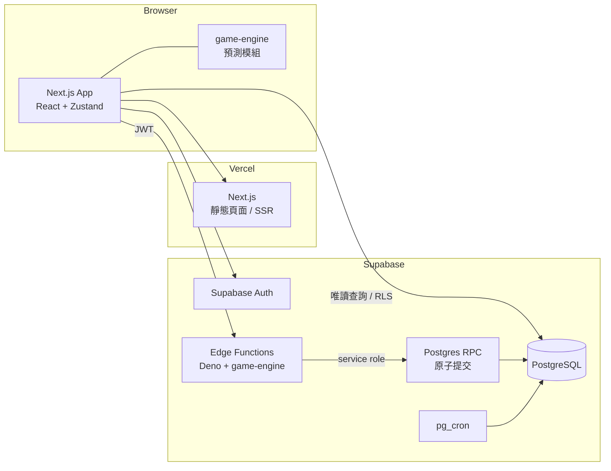
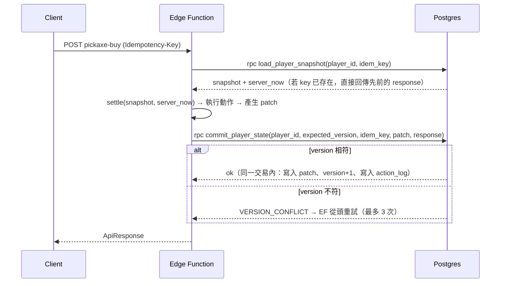

# 《挖礦探險隊》TECHNICAL_SPEC

**Version 1.0（草案，待審核）**

| 項目 | 內容 |
|---|---|
| 依據 | `docs/GDD.md` v1.0、`docs/GBS.md` v1.0、已確認決策 D1–D6 |
| 範圍 | MVP：架構、資料模型、API、伺服器結算、測試規範 |
| 標記 | 【決策 Dn】已確認；【GDD】來自企劃；【提案 Tx】技術提案，待審核 |

---

## 1. 原則

1. **伺服器權威**：挖掘、掉落、金幣、物品、離線時間全部由伺服器計算與入帳。Client 只負責 UI、動畫與呈現。【決策 D4】
2. **單一引擎**：遊戲規則只實作一次，以純 TypeScript 撰寫，不依賴 React / Zustand / Next.js。【GDD §9.2】伺服器用它結算，Client 用它的「無亂數部分」做進度預測。
3. **確定性**：同樣的狀態、時間、密鑰，一定得到同樣的結果。
4. **整數運算**：所有會影響結果的數值都用整數或定點數，避免浮點誤差。
5. **冪等**：所有會改變狀態的請求都可以安全重送。

---

## 2. 權威模型 【決策 D4】

| 職責 | Server | Client |
|---|---|---|
| 時間來源 | Postgres `now()` | 只用於顯示 |
| 挖掘進度與方塊完成 | ✅ | 預測顯示（不入帳） |
| 方塊內容（OreType）與掉落 | ✅ | ❌（無法預知） |
| 金幣、物品入帳 | ✅ | ❌ |
| 購買、強化、製作、出售、解鎖 | ✅ 驗證並執行 | 送出請求 |
| 離線時長與上限 | ✅ | ❌ |
| 離線報告產生與領取 | ✅ | 呈現與送出領取 |
| 動畫、音效、提示 | ❌ | ✅ |

Client 唯一能做的是「請伺服器結算到現在」以及「請伺服器執行某個動作」。Client 不傳任何時間、數量或結果。

---

## 3. 系統架構

### 3.1 部署



### 3.2 為什麼用 Edge Function + Database Function 【提案 T1】

依你的要求優先評估 Supabase Database Function 與 Edge Function：

| 方案 | 說明 | 評估 |
|---|---|---|
| 只用 Database Function（PL/pgSQL） | 規則全部寫在 SQL | ❌ 引擎要用 SQL 再寫一次，違反「單一引擎」，難以測試 |
| 只用 Edge Function | 引擎在 Deno 執行，以多次 API 呼叫寫入 | ❌ supabase-js 沒有多語句交易，無法保證原子性 |
| **Edge Function 計算 + Database Function 提交** | Edge Function 跑 TS 引擎算出結果；呼叫一個 RPC 在單一交易中檢查版本並寫入 | ✅ **採用** |
| Next.js Route Handler | 也能跑 TS 引擎 | 可作為備案；不需要另建後端 |

### 3.3 執行限制

依 Supabase 文件，Edge Function 每個請求的 CPU 時間上限為 2 秒，記憶體 256MB，閒置逾時 150 秒；但另一篇 Supabase 疑難排解文件寫的是 200 毫秒 CPU。**以較保守的 200 毫秒作為設計上限。**

最壞情況估算：離線 8 小時、最快方塊約 6.5 秒 → 約 4,430 個方塊。每個方塊一次 HMAC-SHA256 加數次亂數，預估遠低於 100 毫秒。Phase 1 必須加入效能基準測試（§14.6）。

### 3.4 Repo 結構 【提案 T2】

GDD §9.3 把 `game-engine` 放在 `src/` 內。由於 Edge Function（Deno）也要匯入引擎，建議改為獨立 package：

```text
mining-expedition/
├── apps/web/                    # Next.js（GDD §9.3 的 src/ 內容移到這裡）
│   └── src/
│       ├── app/
│       ├── features/
│       ├── stores/
│       └── lib/supabase/
├── packages/
│   ├── game-engine/             # 純 TS，零框架依賴
│   │   ├── src/
│   │   │   ├── fixed/           # 定點數工具
│   │   │   ├── rng/             # RandomSource、sfc32、HMAC 種子
│   │   │   ├── stats/           # 數值聚合
│   │   │   ├── mining/          # 工作量、門檻、預測
│   │   │   ├── drop/            # 三層掉落
│   │   │   ├── settle/          # 結算（在線 / 離線）
│   │   │   ├── actions/         # 購買、強化、製作、出售、解鎖
│   │   │   ├── market/          # 倍率生成
│   │   │   └── collection/      # 圖鑑、套組判定
│   │   └── test/
│   └── game-data/               # 靜態資料（GBS 數值表），附 DATA_VERSION
├── supabase/
│   ├── migrations/              # SQL schema、RLS、RPC
│   ├── functions/               # Edge Functions
│   └── seed.sql
├── scripts/balance-sim.ts       # 平衡模擬（GBS §18）
└── docs/
```

> 待驗證：Supabase CLI 打包 Edge Function 時，能否從 `supabase/functions/` 之外的相對路徑匯入 `packages/`。若不行，改用建置步驟把引擎打包進 functions 目錄。Phase 1 第一件事就要確認。

- 套件管理：pnpm workspace。【提案 T3】
- 引擎唯一的外部依賴：`@noble/hashes`（同步的 HMAC-SHA256，Node / Deno / 瀏覽器都能用）。【提案 T4】

---

## 4. 靜態遊戲資料

- GBS 的所有數值表（礦區、硬度帶、OreType 權重、掉落表、物品、十字鎬、強化、配方、套組、市場參數）以 TS 常數放在 `packages/game-data`。
- 資料不放資料庫；資料庫只存玩家狀態與 ID 參照。
- `DATA_VERSION`（整數）每次調整數值時加 1。玩家狀態記錄最後一次結算使用的版本。
- 數值變更後，下一次結算直接使用新數值；已入帳的物品、已發現的紀錄不回溯調整。【提案 T5】

---

## 5. 數值表示（定點整數）【提案 T6】

| 數值 | 表示方式 | 範例 |
|---|---|---|
| Power | ×10 整數 `power10` | 木 2.0 → 20；需求 36 → 360 |
| Speed | ×1000 整數 `speed1000` | 1.2 → 1200 |
| Luck | ppm（×1,000,000） | 0.12 → 120,000 |
| 機率 | ppm | 0.5% → 5,000 |
| Hardness | 整數 | 32,500 |
| 時間 | 毫秒整數 | |
| 工作量 | `power10 × speed1000 × ms` | 方塊完成條件：`work ≥ Hardness × 10^7` |

計算規則：

```
levelStep   = Lv − 1
power10     = basePower10 × (100 + 10 × levelStep) / 100            // MVP 數值皆整除
speed1000   = floor( baseSpeed1000 × (100 + 5 × levelStep) / 100
                     × (100 + 3 × speedSetCount) / 100 )
luckPpm     = baseLuckPpm × (100 + 10 × levelStep) / 100 + 20,000 × luckSetCount
rate        = power10 × speed1000                                    // 每毫秒的工作量
blockMs     = ceil( Hardness × 10^7 / rate )
canMine     = power10 ≥ requiredPower10
```

- 最大值：`32,500 × 10^7 = 3.25 × 10^11`，在 JS 安全整數（2^53）與 Postgres `bigint` 範圍內。
- 強化倍率 `(100 + 10 × levelStep)` 套用在 MVP 的所有基礎值上都能整除；新增資料時需由單元測試保證（§14.1）。

---

## 6. 亂數 【GDD §9.4】【提案 T7】

### 6.1 介面

```ts
interface RandomSource {
  nextUint32(): number;
  /** 回傳 [0, n) 的均勻整數，使用拒絕取樣避免偏差 */
  nextInt(n: number): number;
}
```

引擎只依賴這個介面；測試可以注入固定序列。

### 6.2 方塊亂數

每個完成的方塊各自建立一個 PRNG，不需要儲存 PRNG 狀態：

```
digest = HMAC-SHA256( key = player.rngSecret, msg = "block:" + digCounter )
rng    = sfc32( digest[0..15] 拆成 4 個 uint32 )
```

- `digCounter`：玩家每完成一個方塊（前線或回訪）就加 1，只由伺服器遞增。
- `rngSecret`：每位玩家 32 bytes 隨機密鑰，存在 Client 無法讀取的 schema（§8.3）。
- 因為結果依方塊編號而定，放棄挖到一半的方塊或切換礦區都無法重新抽獎。
- 一個方塊內的亂數消耗順序固定（GBS §4.3）：
  1. OreType
  2. 觸發判定
  3. 稀有度
  4. 物品
  5. 數量（金幣袋金額；礦石包再抽 3 次 OreType）

### 6.3 市場亂數

```
digest = HMAC-SHA256( key = MARKET_SECRET, msg = "market:" + date + ":" + artifactId )
```

`MARKET_SECRET` 是 Edge Function 的環境變數。

---

## 7. 結算演算法

### 7.1 引擎函式

```ts
settle(input: {
  state: PlayerGameState;      // 從資料庫載入的快照
  serverNow: number;           // Postgres now()，毫秒
  rngFactory: (digCounter: number) => RandomSource;
  data: GameData;
}): SettleResult;
```

`SettleResult` 包含新狀態、在線事件或離線報告草稿。

### 7.2 流程

```
elapsed = serverNow − state.lastSettledAt

if state.pendingReportId 存在 → 回傳錯誤 REPORT_PENDING（GBS §15）
if elapsed > 300,000 ms     → mode = offline，simMs = min(elapsed, 8h)
else                        → mode = online， simMs = elapsed

t = 0
while t < simMs and state.status == "mining":
    rate      = 依目前裝備與「目前持有」的套組計算
    needWork  = Hardness × 10^7 − state.blockWork
    needMs    = ceil(needWork / rate)
    if t + needMs > simMs:
        state.blockWork += rate × (simMs − t)
        state.blockMs   += simMs − t
        break
    t += needMs
    完成方塊（GBS §4.3）：亂數 = rngFactory(state.digCounter)
    state.digCounter += 1；state.blockWork = 0；state.blockMs = 0
    if mode == online: 獎勵直接入帳（套組可能立即改變 rate）
    else:              獎勵累加到報告草稿（不入帳，rate 不變）
    推進到下一方塊；若 Power 不足 → status = "blocked_power"
                 若到礦區底部且下一礦區未解鎖 → status = "blocked_unlock"
                 若完成 blockIndex 2999 → status = "frontier_complete"

state.lastSettledAt = serverNow          // 超過 8 小時的部分捨棄（GBS §15）
```

### 7.3 要點

- **在線與離線共用同一段程式**，只差在獎勵入帳方式與 8 小時上限。
- 方塊完成時記錄 `blockMs`（實際挖掘毫秒），作為觸發機率的輸入（GBS §7.1）。
- 結算中途不會發生購買或強化，所以離線期間 rate 只在套組變化時改變；離線獎勵未入帳，所以 rate 在離線中不變。
- `status` 為 blocked 時，結算只推進 `lastSettledAt`，沒有產出。

---

## 8. 資料模型

### 8.1 玩家狀態型別

```ts
interface PlayerGameState {
  playerId: string;
  version: number;               // 樂觀鎖
  dataVersion: number;

  coins: number;                 // bigint
  equippedPickaxe: PickaxeId;
  pickaxes: Record<PickaxeId, { level: 1 | 2 | 3 | 4 | 5 }>;
  unlockedZones: ZoneId[];

  mining: {
    mode: "frontier" | "revisit";
    zone: ZoneId;
    frontierBlockIndex: number;  // 0–3000；最大深度 = frontierBlockIndex / 10
    digCounter: number;
    blockWork: number;           // 目前方塊已累積的工作量
    blockMs: number;             // 目前方塊已花費的毫秒
    status: "mining" | "blocked_power" | "blocked_unlock" | "frontier_complete";
    lastSettledAt: number;
  };

  inventory: Record<ItemId, number>;           // 可堆疊物品
  artifacts: ArtifactInstance[];               // 目前持有的寶物實例
  collection: Record<ArtifactId, CollectionRecord>;
  pendingReportId: string | null;
}

interface ArtifactInstance {     // 取代 GDD §4.3 的 Artifact 介面
  id: string;                    // uuid
  artifactId: ArtifactId;        // 參照靜態定義（name、rarity、baseValue）
  discoveredAt: number;
  depthBlockIndex: number;
}

interface CollectionRecord {
  artifactId: ArtifactId;
  firstDiscoveredAt: number;
  firstDepthBlockIndex: number;
  totalFound: number;
}
```

與 GDD §4.3 `Artifact` 介面的差異：

- `name`、`rarity`、`baseValue` 移到靜態定義，以 `artifactId` 參照。
- `currentValue` 不儲存，每次讀取時用 Base Value × 當日倍率計算。
- `isCollected` 拿掉：「持有」由實例是否存在決定，「發現過」由 `CollectionRecord` 決定。

### 8.2 資料表（schema `public`，Client 唯讀）

| 資料表 | 主鍵 | 主要欄位 | 備註 |
|---|---|---|---|
| `players` | `id`（= `auth.uid()`） | `name`、`appearance`、`coins bigint`、`equipped_pickaxe`、`version int`、`data_version int`、`created_at` | `name` 唯一性：待確認 C-3 |
| `mining_state` | `player_id` | 對應 `PlayerGameState.mining` 的各欄位、`pending_report_id` | 一對一 |
| `player_pickaxes` | `(player_id, pickaxe_id)` | `level smallint` | |
| `zone_unlocks` | `(player_id, zone_id)` | `unlocked_at` | |
| `inventory_items` | `(player_id, item_id)` | `quantity bigint check ≥ 0` | |
| `artifact_instances` | `id uuid` | `player_id`、`artifact_id`、`discovered_at`、`depth_block_index`、`source_report_id` | 出售即刪除；出售紀錄寫入 `action_log` |
| `collection_records` | `(player_id, artifact_id)` | `first_discovered_at`、`first_depth_block_index`、`total_found` | 永不刪除 |
| `offline_reports` | `id uuid` | `player_id`、`period_start`、`period_end`、`simulated_ms`、`discarded_ms`、`depth_from`、`depth_to`、`blocks_mined`、`stop_reason`、`rewards jsonb`、`status`（`pending` / `claimed`）、`created_at`、`claimed_at` | 部分唯一索引：每位玩家最多一筆 `pending` |
| `action_log` | `id bigserial` | `player_id`、`idempotency_key uuid`、`kind`、`request_hash`、`response jsonb`、`created_at` | `unique (player_id, idempotency_key)` |
| `market_prices` | `(price_date, artifact_id)` | `multiplier_ppm int` | 每日一筆 |

### 8.3 私有資料（schema `private`，Client 無權存取）

| 資料表 | 欄位 |
|---|---|
| `private.player_secrets` | `player_id`、`rng_secret bytea` |

### 8.4 約束

- 所有數量欄位 `check (>= 0)`，作為最後防線。
- `offline_reports`：`create unique index on offline_reports(player_id) where status = 'pending'`。
- `action_log`：`unique (player_id, idempotency_key)`。

---

## 9. 寶物市場實作 【提案 T8】

- 價格依 GBS §13.2 逐日遞推。
- **延遲生成**：讀取價格時，若某日尚未生成，從最後一筆生成到今天，並 `insert ... on conflict do nothing`。
- `pg_cron` 每日 Asia/Taipei 00:00（UTC 16:00）預先生成，作為優化；沒跑到也不影響正確性。
- 出售寶物時，使用伺服器當下日期的倍率。

---

## 10. API

### 10.1 共通規則

- 所有 API 都是 Supabase Edge Function，`POST`，需要 Supabase Auth JWT。
- 所有改變狀態的請求都必須帶 `Idempotency-Key: <uuid>` header。
- 回應格式：

```ts
type ApiResponse<T> =
  | { ok: true; state: PlayerStateView; data: T; events?: GameEvent[] }
  | { ok: false; error: { code: ErrorCode; message: string }; state?: PlayerStateView };
```

- **每個動作都先結算到現在**，再執行動作，並在同一次提交中寫入。這保證「購買」發生在確定的時間點。
- 有待領取的離線報告時，除了 `report-claim`，其他改變狀態的 API 都回傳 `REPORT_PENDING`。

### 10.2 端點

| 端點 | 請求 | 說明 |
|---|---|---|
| `character-create` | `{ name, appearance }` | 建立角色、初始狀態與 `rng_secret`；只能一次 |
| `state-get` | `{}` | 結算到現在並回傳完整狀態（登入時呼叫；可能產生離線報告） |
| `mining-settle` | `{}` | 結算到現在；回傳在線事件或離線報告 |
| `report-claim` | `{ reportId }` | 領取報告，一次入帳 |
| `mining-select` | `{ mode, zone }` | 切換前線 / 回訪礦區（GBS §2.4） |
| `zone-unlock` | `{ zone }` | 解鎖礦區（GBS §12） |
| `pickaxe-buy` | `{ pickaxeId }` | 購買十字鎬（GBS §10.2） |
| `pickaxe-equip` | `{ pickaxeId }` | 切換已擁有的十字鎬 |
| `pickaxe-upgrade` | `{ pickaxeId }` | 強化一級 |
| `craft` | `{ recipeId, times }` | 製作（GBS §11） |
| `item-sell` | `{ itemId, quantity }` | 出售可堆疊物品 |
| `artifact-sell` | `{ instanceIds: string[] }` | 出售寶物實例 |
| `market-get` | `{ days?: number }` | 今日價格與最近 7 天走勢 |

### 10.3 錯誤碼

| 代碼 | 意義 |
|---|---|
| `UNAUTHORIZED` | 未登入 |
| `CHARACTER_NOT_FOUND` / `CHARACTER_EXISTS` | 角色不存在 / 已存在 |
| `REPORT_PENDING` | 有待領取的報告 |
| `REPORT_NOT_FOUND` / `REPORT_ALREADY_CLAIMED` | 報告不存在 / 已領取 |
| `INSUFFICIENT_COINS` / `INSUFFICIENT_ITEMS` | 金幣 / 素材不足 |
| `PREREQUISITE_MISSING` | 未擁有前一階十字鎬、礦區未到達等 |
| `MAX_LEVEL` | 已達 Lv5 |
| `ZONE_LOCKED` | 礦區未解鎖 |
| `INVALID_REQUEST` | 參數錯誤 |
| `IDEMPOTENCY_MISMATCH` | 同一個 key 對應不同內容 |
| `VERSION_CONFLICT` | 重試三次後仍衝突 |
| `RATE_LIMITED` | 結算請求間隔少於 2 秒 |

### 10.4 提交流程



- `load_player_snapshot` 與 `commit_player_state` 都是 `security definer`，只授權給 `service_role`。
- `server_now` 取自 Postgres `now()`，作為唯一時間來源。
- 同一個 `Idempotency-Key` 重送時，回傳 `action_log` 中儲存的回應，不再執行。
- 領取報告時，在同一交易中：檢查 `status = 'pending'` → 改為 `claimed` → 寫入獎勵 → 清除 `pending_report_id`。

---

## 11. 安全

| 項目 | 規則 |
|---|---|
| RLS | `public` 所有遊戲資料表：`authenticated` 只能 `select` 自己的資料（`player_id = auth.uid()`）；沒有任何 `insert / update / delete` 權限 |
| 私有資料 | `private` schema 不對 `anon` / `authenticated` 開放 |
| RPC | `load_player_snapshot`、`commit_player_state` 只授權 `service_role` |
| 時間 | 不接受 Client 傳入的任何時間 |
| 數量 | 只接受 Client 指定「要做什麼」，所有數量與結果由伺服器計算 |
| 頻率 | 結算請求每位玩家最少間隔 2 秒 |
| 名稱 | 長度、字元集與過濾規則：待確認 C-3 |
| 密鑰 | `MARKET_SECRET`、service role key 只存在 Edge Function 環境變數 |

---

## 12. Client 架構

### 12.1 狀態（Zustand）

```ts
interface GameStore {
  server: PlayerStateView | null;  // 最後一次伺服器回傳的權威狀態
  receivedAt: number;              // 收到時的本機時間（僅用於預測）
  eventQueue: GameEvent[];         // 待播放的掉落動畫
  pendingReport: OfflineReportView | null;
  ui: { tab: "mine" | "inventory" | "workshop" | "collection"; ... };
}
```

- 不在 Client 保存任何會入帳的計算結果。
- 伺服器回應永遠覆蓋本機狀態。

### 12.2 進度預測

- 引擎提供 `predictBlockProgress(state, elapsedMs)`，只用 Hardness、裝備與工作量，不用亂數。
- 進度條依預測顯示；方塊的 OreType 在伺服器結算前顯示為未知。
- 預測與伺服器結果不一致時，以伺服器為準，進度條直接校正。

### 12.3 結算排程 【提案 T9】

| 觸發 | 規則 |
|---|---|
| 預測方塊完成 | 預測完成時間 + 300ms 後呼叫 `mining-settle` |
| 心跳 | 最長 60 秒一定呼叫一次（維持「在線」狀態，GBS §15 的 300 秒門檻） |
| 最短間隔 | 5 秒（前期方塊約 6.5 秒，不會頻繁觸發） |
| 分頁回到前景 | `visibilitychange` 時立即呼叫 |
| 背景分頁 | 瀏覽器會延遲計時器；若間隔超過 300 秒，伺服器會產生離線報告，這是預期行為 |

### 12.4 路由 【提案 T10】

GDD §8.2 寫單頁 Dashboard，§9.3 寫多頁路由。建議：

- `/`：遊戲主畫面，以 Tab 切換 Mine / Inventory / Workshop / Collection（狀態在 store，切換不中斷挖掘預測）。
- `/create`：角色建立。
- `/login`：登入。

此項與待確認 UI-1 相關。

### 12.5 動畫佇列

- 在線事件依方塊完成順序排入佇列。
- Common 合併顯示在 Recent Loot；Rare 短暫閃光；Epic 通知；Legendary 全螢幕。【GDD §4.2】
- Legendary 播放期間，後續事件繼續排隊。
- 動畫只負責呈現，獎勵在伺服器回應時就已入帳。【GDD §7.4】

---

## 13. 存檔與版本

| 項目 | 規則 |
|---|---|
| 存檔 | 每次 API 呼叫都在伺服器寫入，Client 不需要手動存檔 |
| 重新整理 | 重新整理後呼叫 `state-get`，資料不遺失【GDD §13】 |
| Schema 變更 | 使用 `supabase/migrations`，只能新增，不改寫已發布的 migration |
| 遊戲數值變更 | 改 `game-data` 並將 `DATA_VERSION` 加 1；見 §4 |
| 多分頁 / 多裝置 | 由樂觀鎖與伺服器權威處理；任一分頁的結果都以伺服器為準 |

---

## 14. 測試規範

### 14.1 單元測試（Vitest）【GDD】

引擎每個模組都要有單元測試，涵蓋率目標：`game-engine` 行涵蓋率 ≥ 90%。【提案 T11】

必要案例：

| 模組 | 案例 |
|---|---|
| fixed | 所有十字鎬 × 等級的 `power10` 都能整除；鑽石 Lv3 的 power10 = 360 ≥ 360 |
| stats | GBS §10.4 的數值表全部相符；套組加成相加規則 |
| mining | `blockMs` 與 GBS §5 表格相符；換裝後工作量保留；Power 不足時停止 |
| drop | 稀有度正規化後總和 = 1,000,000 ppm；Luck 0.12 時 Legendary = 5,600 ppm |
| drop | 觸發機率上限為 1,000,000 ppm |
| settle | 300 秒以內入帳；超過 300 秒產生報告；8 小時上限；超過部分捨棄 |
| settle | 遇到門檻停止且保留成果；遇到未解鎖礦區停止 |
| settle | 有待領取報告時拒絕結算 |
| collection | 出售後圖鑑紀錄保留；套組在持有時啟動、出售後失效、重新取得後啟動 |
| actions | 每個動作的成功與各種失敗條件 |
| market | 倍率永遠在 Min–Max 範圍內 |

### 14.2 確定性測試

- 固定 `rngSecret` + 固定狀態 + 固定時間 → 結果與快照（golden file）完全一致。
- 同一段時間「一次結算」和「切成多次結算」的結果必須一致（在線模式、沒有套組變化時）。
- 改變亂數消耗順序的修改必須更新快照，並在 PR 中說明。

### 14.3 統計測試

- 稀有度抽樣 10^6 次，各稀有度頻率與理論值誤差在 ±3 個標準差內。
- 物品權重表抽樣驗證。

### 14.4 平衡模擬

- `scripts/balance-sim.ts` 使用正式引擎與 `game-data`，以參考玩家策略跑 0–300m。
- 結果必須符合 GBS §18 的容許範圍，納入 CI。

### 14.5 整合測試（本機 Supabase）

| 案例 | 預期 |
|---|---|
| 同一個 Idempotency-Key 送兩次 | 只執行一次，兩次回應相同 |
| 同一個 key、不同內容 | `IDEMPOTENCY_MISMATCH` |
| 同時送出兩個購買請求 | 一個成功，另一個重試後依結果成功或 `INSUFFICIENT_COINS`，金幣不會變負 |
| 同時領取同一份報告兩次 | 只入帳一次 |
| Client 修改本機時間 | 收益不變（伺服器不接受 Client 時間） |
| 離線 7 小時 / 8 小時 / 12 小時 | 收益分別對應 7 / 8 / 8 小時 |
| RLS | `authenticated` 無法寫入任何遊戲資料表、無法讀取他人資料、無法讀取 `private` |

整合測試需要能注入伺服器時間：僅在測試環境中，RPC 接受 `p_now_override` 參數；正式環境禁用。【提案 T12】

### 14.6 效能基準

- 最壞情況（離線 8 小時、最快方塊）的 `settle` 在 Node 上 < 50ms。
- 部署後在 Edge Function 上量測實際 CPU 時間。

### 14.7 E2E

GDD 只列 Vitest。是否加入 Playwright 做 E2E 測試，待確認。【提案 T13】

---

## 15. 環境與部署

| 環境 | Next.js | Supabase |
|---|---|---|
| local | `next dev` | `supabase start`（本機 Docker） |
| preview | Vercel Preview | 獨立 Supabase 專案（staging） |
| production | Vercel Production | 正式 Supabase 專案 |

環境變數：

| 變數 | 位置 |
|---|---|
| `NEXT_PUBLIC_SUPABASE_URL`、`NEXT_PUBLIC_SUPABASE_ANON_KEY` | Vercel |
| `SUPABASE_SERVICE_ROLE_KEY`、`MARKET_SECRET` | Supabase Edge Function secrets |

---

## 16. 開發順序（更新 ANALYSIS_REPORT 附錄 A5）

| 階段 | 內容 | 完成條件 |
|---|---|---|
| 0 | 規格確認 | 本文件與 GBS 審核完成 |
| 1 | Monorepo 骨架；驗證 Edge Function 能匯入 `packages/game-engine` | 一個 hello 函式能呼叫引擎 |
| 2 | 引擎：fixed、rng、stats、mining、drop | §14.1 對應案例通過 |
| 3 | 引擎：settle、actions、collection、market | §14.1–14.3 全部通過；平衡模擬符合 GBS §18 |
| 4 | Supabase：schema、RLS、RPC、Edge Functions | §14.5 全部通過 |
| 5 | Client：登入、角色建立、主畫面、預測、結算排程 | 可玩到 50m |
| 6 | Client：Inventory、Workshop、Collection、離線報告與動畫 | 完整主線可玩 |
| 7 | 市場、動畫音效、RWD、Beta | GDD §13 驗收條件 |

---

## 17. 待確認的技術項目

| # | 項目 |
|---|---|
| T1 | 採用 Edge Function + Database Function（§3.2） |
| T2 | Repo 改為 monorepo（§3.4），與 GDD §9.3 不同 |
| T3 | 使用 pnpm workspace |
| T4 | 引擎依賴 `@noble/hashes` |
| T5 | 數值變更不回溯已入帳的物品 |
| T9 | 結算排程參數（5 秒 / 60 秒 / 300 秒） |
| T10 | 單頁 Tab 路由 |
| T12 | 測試環境可注入伺服器時間 |
| T13 | 是否加入 Playwright E2E |
| — | 是否需要訪客模式（C-4）。本規格假設**必須登入**，因為伺服器權威需要身分 |
