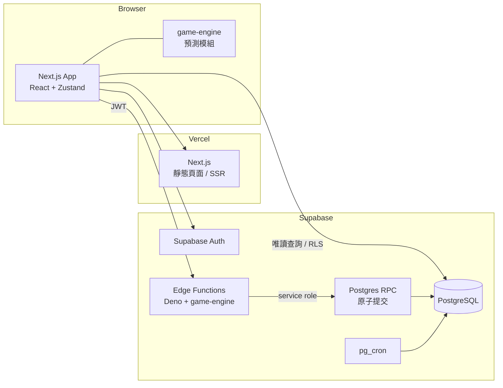
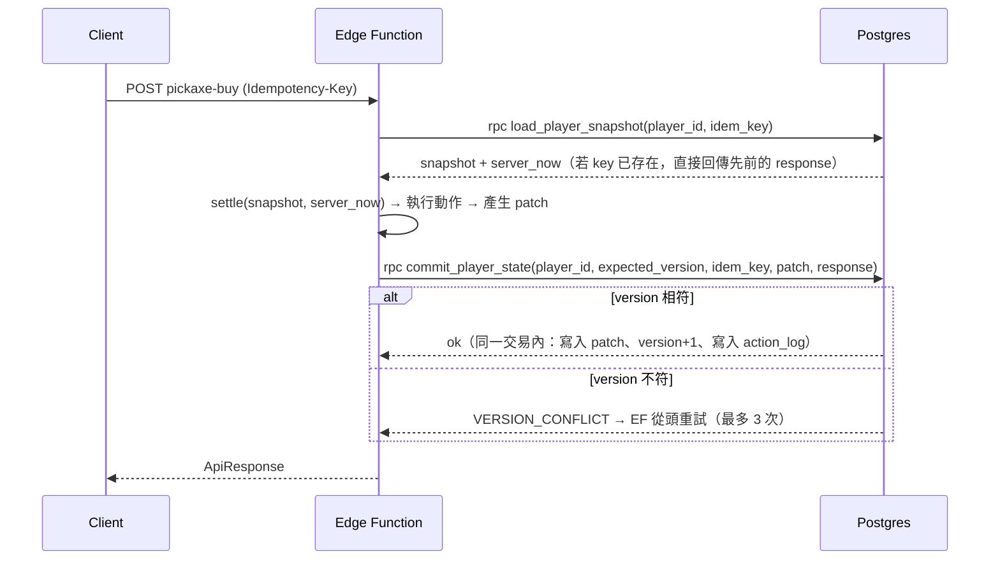
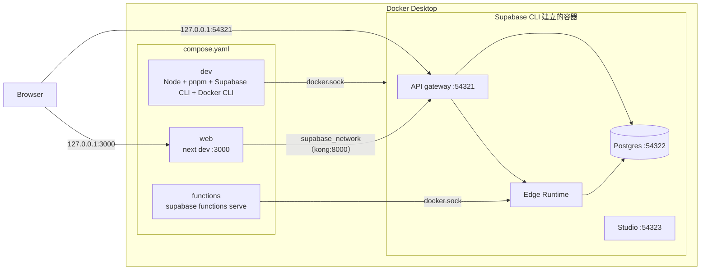

# 《挖礦探險隊》TECHNICAL_SPEC

**Version 1.3（MVP v1.0 基準）**

| 版本 | 變更 |
|---|---|
| v1.0 | 初版 |
| v1.1 | 四層混合式掉落（D7）、回訪規則（D8）、離線上限 12 小時（D9）、十字鎬與解鎖（D10）；新增 `scripts/balance-sim.ts` |
| v1.2 | 回訪金幣 ×0.5（D12）、金幣依門檻段（D13）、回訪寶物 ×0.5（D14）、只能回訪較淺礦區（D15）、重挖模式（D16）、首次寶物保護（D17） |
| v1.3 | 首次保護 4 小時（D18）；引擎規則測試對照（D19）；離線報告領取流程與防卡住（D20）；架構定案（D21）；Docker-first 開發環境（D22）；數值版本管理 |

| 項目 | 內容 |
|---|---|
| 依據 | `docs/GDD.md` v1.3、`docs/GBS.md` v1.3、已確認決策 D1–D22 |
| 範圍 | MVP：架構、資料模型、API、伺服器結算、測試規範 |
| 標記 | 【決策 Dn】已確認；【GDD】來自企劃；【提案 Tx】技術提案，待審核 |

---

## 1. 原則

1. **伺服器權威**：挖掘、掉落、金幣、物品、離線時間全部由伺服器計算與入帳。Client 只負責 UI、動畫與呈現。【決策 D4】
2. **單一引擎**：遊戲規則只實作一次，以純 TypeScript 撰寫，不依賴 React / Zustand / Next.js。【GDD §9.2】伺服器用它結算，Client 用它的「無亂數部分」做進度預測。
3. **確定性**：同樣的狀態、時間、密鑰，一定得到同樣的結果。
4. **整數運算**：所有會影響結果的數值都用整數或定點數，避免浮點誤差。
5. **冪等**：所有會改變狀態的請求都可以安全重送。

---

## 2. 權威模型 【決策 D4】

| 職責 | Server | Client |
|---|---|---|
| 時間來源 | Postgres `now()` | 只用於顯示 |
| 挖掘進度與方塊完成 | ✅ | 預測顯示（不入帳） |
| 方塊內容（OreType）與掉落 | ✅ | ❌（無法預知） |
| 金幣、物品入帳 | ✅ | ❌ |
| 購買、強化、製作、出售、解鎖 | ✅ 驗證並執行 | 送出請求 |
| 離線時長與上限 | ✅ | ❌ |
| 離線報告產生與領取 | ✅ | 呈現與送出領取 |
| 動畫、音效、提示 | ❌ | ✅ |

Client 唯一能做的是「請伺服器結算到現在」以及「請伺服器執行某個動作」。Client 不傳任何時間、數量或結果。

---

## 3. 系統架構

### 3.1 部署



### 3.2 為什麼用 Edge Function + Database Function 【決策 D21】

依你的要求優先評估 Supabase Database Function 與 Edge Function：

| 方案 | 說明 | 評估 |
|---|---|---|
| 只用 Database Function（PL/pgSQL） | 規則全部寫在 SQL | ❌ 引擎要用 SQL 再寫一次，違反「單一引擎」，難以測試 |
| 只用 Edge Function | 引擎在 Deno 執行，以多次 API 呼叫寫入 | ❌ supabase-js 沒有多語句交易，無法保證原子性 |
| **Edge Function 計算 + Database Function 提交** | Edge Function 跑 TS 引擎算出結果；呼叫一個 RPC 在單一交易中檢查版本並寫入 | ✅ **採用** |
| Next.js Route Handler | 也能跑 TS 引擎 | 可作為備案；不需要另建後端 |

### 3.3 執行限制

依 Supabase 文件，Edge Function 每個請求的 CPU 時間上限為 2 秒，記憶體 256MB，閒置逾時 150 秒；但另一篇 Supabase 疑難排解文件寫的是 200 毫秒 CPU。**以較保守的 200 毫秒作為設計上限。**

最壞情況估算：離線 12 小時、最快方塊約 6.5 秒 → 約 6,650 個方塊。每個方塊一次 HMAC-SHA256 加數次亂數，預估遠低於 100 毫秒。Phase 1 必須加入效能基準測試（§14.6）。

### 3.4 Repo 結構 【決策 D21】

GDD §9.3 把 `game-engine` 放在 `src/` 內。由於 Edge Function（Deno）也要匯入引擎，改為 pnpm workspace monorepo：

```text
mining-expedition/
├── apps/web/                    # Next.js（GDD §9.3 的 src/ 內容移到這裡）
│   └── src/
│       ├── app/
│       ├── features/
│       ├── stores/
│       └── lib/supabase/
├── packages/
│   ├── game-engine/             # 純 TS，零框架依賴
│   │   ├── src/
│   │   │   ├── fixed/           # 定點數工具
│   │   │   ├── rng/             # RandomSource、sfc32、HMAC 種子
│   │   │   ├── stats/           # 數值聚合
│   │   │   ├── mining/          # 工作量、門檻、預測
│   │   │   ├── drop/            # 三層掉落
│   │   │   ├── settle/          # 結算（在線 / 離線）
│   │   │   ├── actions/         # 購買、強化、製作、出售、解鎖
│   │   │   ├── market/          # 倍率生成
│   │   │   └── collection/      # 圖鑑、套組判定
│   │   └── test/
│   └── game-data/               # 靜態資料（GBS 數值表），附 DATA_VERSION
├── supabase/
│   ├── migrations/              # SQL schema、RLS、RPC
│   ├── functions/               # Edge Functions
│   └── seed.sql
├── scripts/
│   ├── balance-sim.ts           # 平衡模擬（開發輔助工具，見 §14.4）
│   ├── env-sync.ts              # 從 supabase status 產生 apps/web/.env.local
│   └── verify-env.ts            # Web / Edge Functions / Postgres 連線驗證
├── docker/entrypoint.sh         # 開發容器入口（Docker socket 權限處理）
├── Dockerfile.dev               # 開發容器：Node、pnpm、Supabase CLI、Docker CLI
├── compose.yaml                 # 開發環境（§15）
└── docs/
```

Edge Function 以函式目錄內的 `deno.json` 對應 `@mining/game-engine` 到 `packages/game-engine/src`（相對路徑）。Supabase 自 2025 年起支援從 `supabase/` 以外匯入檔案；但本地 `functions serve` 曾有回報失敗的案例，**需要在 Docker 環境實測**（Phase 1 驗證項目）。若失敗，備案是建置步驟把引擎複製到 `supabase/functions/_shared/`。

- 引擎原始碼的 import 一律寫副檔名（`./fixed.ts`），讓 Node（Next.js、Vitest）與 Deno 都能直接讀取同一份檔案。
- 套件管理：pnpm workspace。【決策 D21】
- 引擎唯一的外部依賴：`@noble/hashes`（同步的 HMAC-SHA256，Node / Deno / 瀏覽器都能用）。【提案 T4】

---

## 4. 靜態遊戲資料

- GBS 的所有數值表（礦區、硬度帶、OreType 權重、掉落表、物品、十字鎬、強化、配方、套組、市場參數）以 TS 常數放在 `packages/game-data`。
- 資料不放資料庫；資料庫只存玩家狀態與 ID 參照。
- `DATA_VERSION`（整數）每次調整數值時加 1。玩家狀態記錄最後一次結算使用的版本。
- 數值變更後，下一次結算直接使用新數值；已入帳的物品、已發現的紀錄不回溯調整。【決策 D19】
- 完整規則見 GBS §24：ID 不可刪除或重用、變更紀錄、模擬驗證。
- `RNG_VERSION`：亂數消耗順序的版本（MVP = 1）。只有改變 §6.2 順序時才加 1，並更新確定性測試快照；舊快照保留，確保舊版本的回放仍可驗證。

---

## 5. 數值表示（定點整數）【提案 T6】

| 數值 | 表示方式 | 範例 |
|---|---|---|
| Power | ×10 整數 `power10` | 木 2.0 → 20；需求 36 → 360 |
| Speed | ×1000 整數 `speed1000` | 1.2 → 1200 |
| Luck | ppm（×1,000,000） | 0.12 → 120,000 |
| 機率 | ppm | 0.5% → 5,000 |
| Hardness | 整數 | 32,500 |
| 時間 | 毫秒整數 | |
| 工作量 | `power10 × speed1000 × ms` | 方塊完成條件：`work ≥ Hardness × 10^7` |

計算規則：

```
levelStep   = Lv − 1
power10     = basePower10 × (100 + 10 × levelStep) / 100            // MVP 數值皆整除
speed1000   = floor( baseSpeed1000 × (100 + 5 × levelStep) / 100
                     × (100 + 3 × speedSetCount) / 100 )
luckPpm     = baseLuckPpm × (100 + 10 × levelStep) / 100 + 20,000 × luckSetCount
rate        = power10 × speed1000                                    // 每毫秒的工作量
blockMs     = ceil( Hardness × 10^7 / rate )
canMine     = power10 ≥ requiredPower10
```

四層掉落的 ppm 計算（GBS §7）：

```
// 第二層：礦物
rarePpm     = floor( rareBasePpm[zone] × (1,000,000 + luckPpm) / 1,000,000 )
bundlePpm   = 150,000
nonePpm     = 1,000,000 − bundlePpm − rarePpm

// 第三層：金幣
coinPpm     = 100,000
coinAvg     = coinAvgBySegment[seg] × (frontier ? 2 : 1) / 2          // 回訪 ×0.5（D12）、重挖 ×0.5（暫定）

// 第四層：寶物（treasurePerHourMilli：0.35/h → 350）
chancePpm   = min( 500,000,
                   floor( treasurePerHourMilli × blockMs × (frontier ? 2 : 1) / (2 × 3,600) ) )   // 回訪 / 重挖 ×0.5
legPpm      = floor( chancePpm × 100,000 / 1,000,000 × (1,000,000 + luckPpm) / 1,000,000 )
epicPpm     = floor( chancePpm × 900,000 / 1,000,000 × (1,000,000 + luckPpm) / 1,000,000 )
```

首次保護：

```
PROTECT_MS  = 14,400,000   // 4 小時有效挖掘時間【決策 D18】
```

> 驗算：`treasurePerHourMilli × blockMs / 3,600` 的單位是 ppm（0.35/h × 1 小時 = 350 × 3,600,000 / 3,600 = 350,000 ppm = 35%）。中間值最大約 `350 × 4×10^5 ≈ 1.4 × 10^8`，在安全整數範圍內。

- 最大值：`32,500 × 10^7 = 3.25 × 10^11`，在 JS 安全整數（2^53）與 Postgres `bigint` 範圍內。
- 強化倍率 `(100 + 10 × levelStep)` 套用在 MVP 的所有基礎值上都能整除；新增資料時需由單元測試保證（§14.1）。

---

## 6. 亂數 【GDD §9.4】【提案 T7】

### 6.1 介面

```ts
interface RandomSource {
  nextUint32(): number;
  /** 回傳 [0, n) 的均勻整數，使用拒絕取樣避免偏差 */
  nextInt(n: number): number;
}
```

引擎只依賴這個介面；測試可以注入固定序列。

### 6.2 方塊亂數

每個完成的方塊各自建立一個 PRNG，不需要儲存 PRNG 狀態：

```
digest = HMAC-SHA256( key = player.rngSecret, msg = "block:" + digCounter )
rng    = sfc32( digest[0..15] 拆成 4 個 uint32 )
```

- `digCounter`：玩家每完成一個方塊（前線或回訪）就加 1，只由伺服器遞增。
- `rngSecret`：每位玩家 32 bytes 隨機密鑰，存在 Client 無法讀取的 schema（§8.3）。
- 因為結果依方塊編號而定，放棄挖到一半的方塊或切換礦區都無法重新抽獎。
- 一個方塊內的亂數消耗順序固定（GBS §4.3、§7）：
  1. 第一層：OreType（1 次）
  2. 第二層：礦物判定（1 次）→ 若為礦石包，再抽 3 次 OreType；若為 Rare，再抽 1 次 Rare 表
  3. 第三層：金幣判定（1 次）→ 若命中，再抽 1 次金額
  4. 第四層：寶物機會（1 次）→ 若為 Epic，再抽 1 次哪一件
- 各層都使用 `nextInt(1,000,000)` 與 ppm 機率比較。
- 前線、回訪、重挖共用同一個 `digCounter`；切換模式只會放棄未完成方塊的進度，不會改變下一個方塊的亂數（D16）。
- 首次寶物保護（GBS §7.7）**不消耗亂數**：在第四層判定之後檢查，若發放就直接加入固定 Epic，所以之後所有方塊的結果與沒有保護時相同（D17）。

### 6.3 市場亂數

```
digest = HMAC-SHA256( key = MARKET_SECRET, msg = "market:" + date + ":" + artifactId )
```

`MARKET_SECRET` 是 Edge Function 的環境變數。

---

## 7. 結算演算法

### 7.1 引擎函式

```ts
settle(input: {
  state: PlayerGameState;      // 從資料庫載入的快照
  serverNow: number;           // Postgres now()，毫秒
  rngFactory: (digCounter: number) => RandomSource;
  data: GameData;
}): SettleResult;
```

`SettleResult` 包含新狀態、在線事件或離線報告草稿。

### 7.2 流程

```
elapsed = serverNow − state.lastSettledAt

if state.pendingReportId 存在 → 回傳錯誤 REPORT_PENDING（GBS §15）
if elapsed > 300,000 ms     → mode = offline，simMs = min(elapsed, 12h)   // D9
else                        → mode = online， simMs = elapsed

t = 0
while t < simMs and canMine(state):          // 前線：未卡關；回訪 / 重挖：Power ≥ 該位置 RequiredPower
    spot      = 前線方塊 | 回訪礦區最深帶 | 重挖深度帶（GBS §2.2）
    rate      = 依目前裝備與「目前持有」的套組計算
    needWork  = Hardness × 10^7 − state.blockWork
    needMs    = ceil(needWork / rate)
    if t + needMs > simMs:
        state.blockWork += rate × (simMs − t)
        state.blockMs   += simMs − t
        break
    t += needMs
    完成方塊（GBS §4.3）：亂數 = rngFactory(state.digCounter)；金幣與寶物倍率依模式（GBS §2.2）
    首次保護（GBS §7.7）：
        effectiveMiningMs += blockMs
        if firstTreasure == "pending":
            if 本方塊有寶物 → firstTreasure = "obtained"
            elif effectiveMiningMs ≥ PROTECT_MS → 加入固定 Epic；firstTreasure = "granted"
    state.digCounter += 1；state.blockWork = 0；state.blockMs = 0
    if mode == online: 獎勵直接入帳（套組可能立即改變 rate）
    else:              獎勵累加到報告草稿（不入帳，rate 不變）
    只有前線模式推進 frontierBlockIndex；
    前線：若 Power 不足 → status = "blocked_power"
          若到礦區底部且下一礦區未解鎖 → status = "blocked_unlock"
          若完成 blockIndex 2999 → status = "frontier_complete"
    回訪 / 重挖：不改變 frontierBlockIndex 與 status，持續循環（離線也一樣）

state.lastSettledAt = serverNow          // 超過 12 小時的部分捨棄（D9）
```

### 7.3 要點

- **在線與離線共用同一段程式**，只差在獎勵入帳方式與 12 小時上限。
- 不因領取頻率產生額外倍率：結算只依實際經過時間，沒有任何與呼叫次數相關的加成（D9）。
- 方塊完成時記錄 `blockMs`（實際挖掘毫秒），作為觸發機率的輸入（GBS §7.1）。
- 結算中途不會發生購買或強化，所以離線期間 rate 只在套組變化時改變；離線獎勵未入帳，所以 rate 在離線中不變。
- 前線 `status` 為 blocked 且模式為前線時，結算只推進 `lastSettledAt`，沒有產出，也不累積有效挖掘時間。
- 首次保護的狀態變更與報告（或在線入帳）在同一次 `commit_player_state` 交易中寫入；重送請求、重登入、重複領取都不會再次發放（§10.4）。

---

## 8. 資料模型

### 8.1 玩家狀態型別

```ts
interface PlayerGameState {
  playerId: string;
  version: number;               // 樂觀鎖
  dataVersion: number;

  coins: number;                 // bigint
  equippedPickaxe: PickaxeId;
  pickaxes: Record<PickaxeId, { level: 1 | 2 | 3 | 4 | 5 }>;
  unlockedZones: ZoneId[];

  mining: {
    mode: "frontier" | "revisit" | "rework";
    zone: ZoneId;                // 回訪礦區
    reworkBand: number | null;   // 重挖深度帶，由伺服器計算（GBS §2.4）
    frontierBlockIndex: number;  // 0–3000；最大深度 = frontierBlockIndex / 10
    digCounter: number;
    blockWork: number;           // 目前方塊已累積的工作量
    blockMs: number;             // 目前方塊已花費的毫秒
    status: "mining" | "blocked_power" | "blocked_unlock" | "frontier_complete";
    lastSettledAt: number;
  };

  inventory: Record<ItemId, number>;           // 可堆疊物品
  artifacts: ArtifactInstance[];               // 目前持有的寶物實例
  collection: Record<ArtifactId, CollectionRecord>;
  pendingReportId: string | null;

  firstTreasure: {               // GBS §7.7（D17）
    status: "pending" | "obtained" | "granted";
    effectiveMiningMs: number;   // 只累積已完成方塊的 blockMs
    resolvedAt: number | null;
    artifactInstanceId: string | null;  // 保護發放時的實例
  };
}

interface ArtifactInstance {     // 取代 GDD §4.3 的 Artifact 介面
  id: string;                    // uuid
  artifactId: ArtifactId;        // 參照靜態定義（name、rarity、baseValue）
  discoveredAt: number;
  depthBlockIndex: number;
}

interface CollectionRecord {
  artifactId: ArtifactId;
  firstDiscoveredAt: number;
  firstDepthBlockIndex: number;
  totalFound: number;
}
```

與 GDD §4.3 `Artifact` 介面的差異：

- `name`、`rarity`、`baseValue` 移到靜態定義，以 `artifactId` 參照。
- `currentValue` 不儲存，每次讀取時用 Base Value × 當日倍率計算。
- `isCollected` 拿掉：「持有」由實例是否存在決定，「發現過」由 `CollectionRecord` 決定。

### 8.2 資料表（schema `public`，Client 唯讀）

| 資料表 | 主鍵 | 主要欄位 | 備註 |
|---|---|---|---|
| `players` | `id`（= `auth.uid()`） | `name`、`appearance`、`coins bigint`、`equipped_pickaxe`、`version int`、`data_version int`、`created_at` | `name` 唯一性：待確認 C-3 |
| `mining_state` | `player_id` | 對應 `PlayerGameState.mining` 的各欄位（含 `mode`、`rework_band`）、`pending_report_id` | 一對一 |
| `first_treasure` | `player_id` | `status`（check in pending / obtained / granted）、`effective_mining_ms bigint`、`resolved_at`、`artifact_instance_id` | 一對一；`status` 只能從 `pending` 轉出一次（RPC 檢查 + trigger 禁止改回） |
| `player_pickaxes` | `(player_id, pickaxe_id)` | `level smallint` | |
| `zone_unlocks` | `(player_id, zone_id)` | `unlocked_at` | |
| `inventory_items` | `(player_id, item_id)` | `quantity bigint check ≥ 0` | |
| `artifact_instances` | `id uuid` | `player_id`、`artifact_id`、`discovered_at`、`depth_block_index`、`source_report_id` | 出售即刪除；出售紀錄寫入 `action_log` |
| `collection_records` | `(player_id, artifact_id)` | `first_discovered_at`、`first_depth_block_index`、`total_found` | 永不刪除 |
| `offline_reports` | `id uuid` | `player_id`、`period_start`、`period_end`、`simulated_ms`、`discarded_ms`、`depth_from`、`depth_to`、`blocks_mined`、`stop_reason`、`rewards jsonb`、`status`（`pending` / `claimed`）、`created_at`、`claimed_at` | 部分唯一索引：每位玩家最多一筆 `pending` |
| `action_log` | `id bigserial` | `player_id`、`idempotency_key uuid`、`kind`、`request_hash`、`response jsonb`、`created_at` | `unique (player_id, idempotency_key)` |
| `market_prices` | `(price_date, artifact_id)` | `multiplier_ppm int` | 每日一筆 |

### 8.3 私有資料（schema `private`，Client 無權存取）

| 資料表 | 欄位 |
|---|---|
| `private.player_secrets` | `player_id`、`rng_secret bytea` |

### 8.4 約束

- 所有數量欄位 `check (>= 0)`，作為最後防線。
- `offline_reports`：`create unique index on offline_reports(player_id) where status = 'pending'`。
- `action_log`：`unique (player_id, idempotency_key)`。

---

## 9. 寶物市場實作 【提案 T8】

- 價格依 GBS §13 逐日遞推。
- **延遲生成**：讀取價格時，若某日尚未生成，從最後一筆生成到今天，並 `insert ... on conflict do nothing`。
- `pg_cron` 每日 Asia/Taipei 00:00（UTC 16:00）預先生成，作為優化；沒跑到也不影響正確性。
- 出售寶物時，使用伺服器當下日期的倍率。

---

## 10. API

### 10.1 共通規則

- 所有 API 都是 Supabase Edge Function，`POST`，需要 Supabase Auth JWT。
- 所有改變狀態的請求都必須帶 `Idempotency-Key: <uuid>` header。
- 回應格式：

```ts
type ApiResponse<T> =
  | { ok: true; state: PlayerStateView; data: T; events?: GameEvent[] }
  | { ok: false; error: { code: ErrorCode; message: string }; state?: PlayerStateView };
```

- **每個動作都先結算到現在**，再執行動作，並在同一次提交中寫入。這保證「購買」發生在確定的時間點。
- 有待領取的離線報告時，除了 `report-claim`，其他改變狀態的 API 都回傳 `REPORT_PENDING`。

### 10.2 端點

| 端點 | 請求 | 說明 |
|---|---|---|
| `character-create` | `{ name, appearance }` | 建立角色、初始狀態（木製十字鎬 Lv1，D10）與 `rng_secret`；只能一次 |
| `state-get` | `{}` | 結算到現在並回傳完整狀態（登入時呼叫；可能產生離線報告） |
| `mining-settle` | `{}` | 結算到現在；回傳在線事件或離線報告 |
| `report-claim` | `{ reportId }` | 領取報告，一次入帳 |
| `mining-select` | `{ mode, zone? }` | 切換前線 / 回訪 / 重挖。回訪的 zone 必須已解鎖且比前線所在礦區淺，主線完成後可選全部（D15）；重挖只在前線卡關時可用，深度帶由伺服器計算，不接受 Client 指定（D16） |
| `zone-unlock` | `{ zone }` | 前線已挖完上一區底部時，付費解鎖（D10、GBS §12） |
| `pickaxe-buy` | `{ pickaxeId }` | 購買下一階十字鎬，必須依序（D10、GBS §10） |
| `pickaxe-equip` | `{ pickaxeId }` | 切換已擁有的十字鎬 |
| `pickaxe-upgrade` | `{ pickaxeId }` | 強化一級 |
| `craft` | `{ recipeId, times }` | 製作（GBS §11） |
| `item-sell` | `{ itemId, quantity }` | 出售可堆疊物品 |
| `artifact-sell` | `{ instanceIds: string[] }` | 出售寶物實例 |
| `market-get` | `{ days?: number }` | 今日價格與最近 7 天走勢 |

### 10.3 錯誤碼

| 代碼 | 意義 |
|---|---|
| `UNAUTHORIZED` | 未登入 |
| `CHARACTER_NOT_FOUND` / `CHARACTER_EXISTS` | 角色不存在 / 已存在 |
| `REPORT_PENDING` | 有待領取的報告 |
| `REPORT_NOT_FOUND` / `REPORT_ALREADY_CLAIMED` | 報告不存在 / 已領取 |
| `INSUFFICIENT_COINS` / `INSUFFICIENT_ITEMS` | 金幣 / 素材不足 |
| `PREREQUISITE_MISSING` | 未擁有前一階十字鎬、礦區未到達等 |
| `MAX_LEVEL` | 已達 Lv5 |
| `ZONE_LOCKED` | 礦區未解鎖 |
| `INVALID_REQUEST` | 參數錯誤 |
| `IDEMPOTENCY_MISMATCH` | 同一個 key 對應不同內容 |
| `VERSION_CONFLICT` | 重試三次後仍衝突 |
| `RATE_LIMITED` | 結算請求間隔少於 2 秒 |

### 10.4 提交流程



- `load_player_snapshot` 與 `commit_player_state` 都是 `security definer`，只授權給 `service_role`。
- `server_now` 取自 Postgres `now()`，作為唯一時間來源。
- 同一個 `Idempotency-Key` 重送時，回傳 `action_log` 中儲存的回應，不再執行。
- 領取報告時，在同一交易中：檢查 `status = 'pending'` → 改為 `claimed` → 寫入獎勵 → 清除 `pending_report_id`。

### 10.5 離線報告領取流程 【決策 D20】

玩家有待領取的報告時，必須先領取才能進行其他遊戲操作。

**伺服器端**

| 規則 | 實作 |
|---|---|
| 阻擋其他操作 | 所有改變狀態的 API（除了 `report-claim`）在 `pending_report_id` 不為空時回傳 `REPORT_PENDING`。`state-get`、`market-get` 等唯讀 API 照常可用 |
| 原子領取 | `commit_player_state` 以 `select … for update` 鎖定報告列；只有 `status = 'pending'` 才寫入獎勵並改為 `claimed`，同一交易清除 `pending_report_id` |
| 重送同一個 key | 回傳 `action_log` 中儲存的回應，不再入帳 |
| 其他分頁 / 裝置用不同 key 領取 | 第二個請求看到 `claimed`，回傳 `REPORT_ALREADY_CLAIMED` 與目前狀態；不會再次入帳 |
| 同時只有一份報告 | 部分唯一索引：每位玩家最多一筆 `pending`（§8.4） |
| 領取不可能因遊戲規則失敗 | 領取只做加法（沒有背包上限或其他檢查）；獎勵在產生報告時就已確定。可能失敗的只有網路或基礎設施 |
| 數值版本變更 | 報告保存具體的物品 ID 與數量；ID 不可刪除（GBS §24），所以任何版本都能領取 |
| 不受頻率限制 | `report-claim` 不套用結算的 2 秒頻率限制 |
| 資料異常 | 若報告內容違反不變式（理論上不會發生），回傳 `REPORT_INVALID` 並記錄錯誤；只有 `service_role` 可用的修復函式能處理，Client 不能自行跳過 |

**Client 端**

| 情況 | 行為 |
|---|---|
| 進入遊戲時有待領取報告 | 顯示探險成果畫面；其他操作停用 |
| 按下「領取」 | 產生一個 Idempotency-Key，**重試時沿用同一個 key** |
| 網路或 API 失敗 | 自動重試（1、2、4、8 秒…最多間隔 30 秒），並顯示「重新嘗試」按鈕與連線狀態；不會永久停在畫面上 |
| 收到 `REPORT_ALREADY_CLAIMED` | 視為成功：重新讀取狀態並關閉畫面（另一個分頁或裝置已領取） |
| 其他分頁在報告產生後送出操作 | 收到 `REPORT_PENDING`，該分頁也顯示探險成果畫面 |
| 重新整理 / 重開瀏覽器 | `state-get` 回傳待領取報告或已領取後的狀態，畫面依此顯示 |

---

## 11. 安全

| 項目 | 規則 |
|---|---|
| RLS | `public` 所有遊戲資料表：`authenticated` 只能 `select` 自己的資料（`player_id = auth.uid()`）；沒有任何 `insert / update / delete` 權限 |
| 私有資料 | `private` schema 不對 `anon` / `authenticated` 開放 |
| RPC | `load_player_snapshot`、`commit_player_state` 只授權 `service_role` |
| 時間 | 不接受 Client 傳入的任何時間 |
| 數量 | 只接受 Client 指定「要做什麼」，所有數量與結果由伺服器計算 |
| 頻率 | 結算請求每位玩家最少間隔 2 秒 |
| 名稱 | 長度、字元集與過濾規則：待確認 C-3 |
| 密鑰 | `MARKET_SECRET`、service role key 只存在 Edge Function 環境變數 |

---

## 12. Client 架構

### 12.1 狀態（Zustand）

```ts
interface GameStore {
  server: PlayerStateView | null;  // 最後一次伺服器回傳的權威狀態
  receivedAt: number;              // 收到時的本機時間（僅用於預測）
  eventQueue: GameEvent[];         // 待播放的掉落動畫
  pendingReport: OfflineReportView | null;
  ui: { tab: "mine" | "inventory" | "workshop" | "collection"; ... };
}
```

- 不在 Client 保存任何會入帳的計算結果。
- 伺服器回應永遠覆蓋本機狀態。

### 12.2 進度預測

- 引擎提供 `predictBlockProgress(state, elapsedMs)`，只用 Hardness、裝備與工作量，不用亂數。
- 進度條依預測顯示；方塊的 OreType 在伺服器結算前顯示為未知。
- 預測與伺服器結果不一致時，以伺服器為準，進度條直接校正。

### 12.3 結算排程 【提案 T9】

| 觸發 | 規則 |
|---|---|
| 預測方塊完成 | 預測完成時間 + 300ms 後呼叫 `mining-settle` |
| 心跳 | 最長 60 秒一定呼叫一次（維持「在線」狀態，GBS §15 的 300 秒門檻） |
| 最短間隔 | 5 秒（前期方塊約 6.5 秒，不會頻繁觸發） |
| 分頁回到前景 | `visibilitychange` 時立即呼叫 |
| 背景分頁 | 瀏覽器會延遲計時器；若間隔超過 300 秒，伺服器會產生離線報告，這是預期行為 |

### 12.4 路由 【提案 T10】

GDD §8.2 寫單頁 Dashboard，§9.3 寫多頁路由。建議：

- `/`：遊戲主畫面，以 Tab 切換 Mine / Inventory / Workshop / Collection（狀態在 store，切換不中斷挖掘預測）。
- `/create`：角色建立。
- `/login`：登入。

此項與待確認 UI-1 相關。

### 12.5 動畫佇列

- 在線事件依方塊完成順序排入佇列。
- Common 合併顯示在 Recent Loot；Rare 短暫閃光；Epic 通知；Legendary 全螢幕。【GDD §4.2】
- Legendary 播放期間，後續事件繼續排隊。
- 動畫只負責呈現，獎勵在伺服器回應時就已入帳。【GDD §7.4】

---

## 13. 存檔與版本

| 項目 | 規則 |
|---|---|
| 存檔 | 每次 API 呼叫都在伺服器寫入，Client 不需要手動存檔 |
| 重新整理 | 重新整理後呼叫 `state-get`，資料不遺失【GDD §13】 |
| Schema 變更 | 使用 `supabase/migrations`，只能新增，不改寫已發布的 migration |
| 遊戲數值變更 | 改 `game-data` 並將 `DATA_VERSION` 加 1；依 GBS §24 記錄並執行模擬；不回溯既有玩家資料（D19） |
| 亂數順序變更 | `RNG_VERSION` 加 1，保留舊快照（§4） |
| 多分頁 / 多裝置 | 由樂觀鎖與伺服器權威處理；任一分頁的結果都以伺服器為準 |

---

## 14. 測試規範

### 14.1 單元測試（Vitest）【GDD】

引擎每個模組都要有單元測試，涵蓋率目標：`game-engine` 行涵蓋率 ≥ 90%。【提案 T11】

必要案例：

| 模組 | 案例 |
|---|---|
| fixed | 所有十字鎬 × 等級的 `power10` 都能整除；鑽石 Lv3 的 power10 = 360 ≥ 360 |
| stats | GBS §10 的數值表全部相符；套組加成相加規則 |
| mining | `blockMs` 與 GBS §5 表格相符；換裝後工作量保留；Power 不足時停止 |
| drop | 每一層的分布總和 = 1,000,000 ppm；Luck 只放大 Rare / Epic / Legendary |
| drop | Luck 0.12 時：zone1 Rare = 28,000 ppm；寶物 Legendary = `Chance × 0.1 × 1.12` |
| drop | 回訪：寶物 Chance ×0.5、金幣金額 ×0.5；礦物表不變 |
| drop | 同一位置只改變強化等級：寶物每小時期望值只隨 Luck 改變（GBS §7.6） |
| drop | 觸發機率上限為 1,000,000 ppm |
| settle | 300 秒以內入帳；超過 300 秒產生報告；12 小時上限；超過部分捨棄 |
| settle | 回訪模式使用該礦區最深深度帶的 Hardness 與 RequiredPower；不改變 `frontierBlockIndex` |
| settle | 前線到礦區底部且未付費解鎖時停止（D10） |
| settle | 遇到門檻停止且保留成果；遇到未解鎖礦區停止 |
| settle | 有待領取報告時拒絕結算 |
| collection | 出售後圖鑑紀錄保留；套組在持有時啟動、出售後失效、重新取得後啟動 |
| rework | 只在前線卡關時可用；深度帶 = 最後挖完方塊所在帶往上第一個 Req ≤ Power 的帶；不改變 `frontierBlockIndex` |
| rework | 金幣 ×0.5、寶物 ×0.5（暫定）；礦物表不變；前線解除卡關後不可再進入 |
| first-treasure | 正常掉落第一件寶物 → `obtained`，之後永不發放 |
| first-treasure | 有效時間達門檻且該方塊無寶物 → 發放固定 Epic、`granted`；不消耗亂數（保護前後的 golden 結果除了該件 Epic 外完全相同） |
| first-treasure | 卡關、超過 12 小時上限、切換模式放棄的未完成方塊都不累積有效時間 |
| first-treasure | 出售保護寶物後不會再次發放 |
| actions | 每個動作的成功與各種失敗條件 |
| market | 倍率永遠在 Min–Max 範圍內 |

### 14.1.1 MVP v1.0 引擎規則與測試對照 【決策 D18、D19、D20】

| 規則 | 測試案例 |
|---|---|
| P2 回訪無限循環 | 回訪 N 個方塊後 `frontierBlockIndex` 不變，`digCounter` 增加 N |
| P3 切換模式進度歸零 | 切換後 `blockWork`、`blockMs` 為 0；`digCounter` 不變，下一個方塊結果與未切換時相同 |
| P5 工作量 | 挖到一半換十字鎬，已累積的工作量保留；`blockMs` 與 GBS §5 計算一致 |
| P6 門檻用 `≥` | `power10 = requiredPower10` 可以挖；少 1 不能挖（含鑽石 Lv3 = 360） |
| P7 結算順序 | 記錄每方塊的亂數消耗序列，與快照一致（§6.2） |
| P8 基礎產出 | 每個完成的方塊恰好產出 1 個 OreType 礦物 |
| P13 稀有度分類 | 寶物定義只有 `epic` / `legendary`；方塊礦物為 Common、寶石為 Rare |
| P21 十字鎬 | 依序購買；購買後自動裝備；切換保留等級；出售十字鎬被拒絕 |
| P22 製作 | 一次 N 份、素材不足全部失敗；購買或強化不會自動製作 |
| P28 在線 / 離線 | 間隔 300,000 ms 直接入帳；300,001 ms 產生報告 |
| P39 固定保護寶物 | 保護發放 `a_z1_lantern` |
| D18 門檻 | 有效時間 14,399,999 ms 不發放；≥ 14,400,000 ms 且該方塊無寶物時發放；該方塊有寶物則改為 `obtained` |
| D20 報告 | 見 §14.5 |

### 14.2 確定性測試

- 固定 `rngSecret` + 固定狀態 + 固定時間 → 結果與快照（golden file）完全一致。
- 同一段時間「一次結算」和「切成多次結算」的結果必須一致（在線模式、沒有套組變化時）。
- 改變亂數消耗順序的修改必須更新快照，並在 PR 中說明。

### 14.3 統計測試

- 每一層抽樣 10^6 次，各結果頻率與理論值誤差在 ±3 個標準差內。
- 物品權重表抽樣驗證。

### 14.4 平衡模擬

- `scripts/balance-sim.ts` 是**開發輔助工具**，不是遊戲實作。目前內含 GBS v1.2 數值的副本與參考玩家策略。
- 執行與參數見檔案開頭說明與 GBS §23（Node 22.18+ 可直接執行 TypeScript，不需安裝套件）。可切換：首次保護門檻、回訪 / 重挖的金幣與寶物倍率、D13 前後的金幣表、是否啟用重挖、出售策略。
- 輸出：玩家類型完成時間（平均、P10、P50、P90、P99）、裝備購買時間點、回訪 / 重挖 vs 前線收益表、Mining Speed 驗證、首次保護 A / B / C、主線後補齊收藏、防卡死壓力測試、D12–D16 前後比較。
- 模擬器與正式引擎的已知差異列在 GBS §23.2。
- 引擎完成後，腳本改為匯入 `packages/game-data` 與 `packages/game-engine`，刪除內含的資料副本，避免兩份規則不同步。
- 結果必須符合 GBS §18 的標準，納入 CI。

### 14.5 整合測試（本機 Supabase）

| 案例 | 預期 |
|---|---|
| 同一個 Idempotency-Key 送兩次 | 只執行一次，兩次回應相同 |
| 同一個 key、不同內容 | `IDEMPOTENCY_MISMATCH` |
| 同時送出兩個購買請求 | 一個成功，另一個重試後依結果成功或 `INSUFFICIENT_COINS`，金幣不會變負 |
| 同時領取同一份報告兩次 | 只入帳一次 |
| Client 修改本機時間 | 收益不變（伺服器不接受 Client 時間） |
| 離線 11 小時 / 12 小時 / 16 小時 | 收益分別對應 11 / 12 / 12 小時 |
| 每 6 小時領取 vs 每 12 小時領取（總時間相同、沒有卡關） | 期望收益相同（D9） |
| 首次保護：同一份離線報告重送領取 / 重登入 / 同時兩個結算請求 | 保護寶物只發放一次 |
| 報告：兩個分頁同時用不同 key 領取 | 一個成功，另一個 `REPORT_ALREADY_CLAIMED`；只入帳一次 |
| 報告：領取成功但回應遺失，Client 以同一個 key 重送 | 回傳原回應，不重複入帳 |
| 報告：有待領取報告時呼叫購買 / 出售 / 切換模式 | `REPORT_PENDING`，狀態不變 |
| 報告：產生報告後 `DATA_VERSION` 加 1 再領取 | 依報告內容入帳成功 |
| 首次保護：Client 修改本機時間、長時間卡關空等 | 有效時間不增加 |
| 重挖：Client 指定 `reworkBand` | 忽略，由伺服器計算 |
| 防卡死：金幣 0、背包全空的帳號在每個門檻 | 都能透過重挖或回訪恢復（對應 GBS §21） |
| RLS | `authenticated` 無法寫入任何遊戲資料表、無法讀取他人資料、無法讀取 `private` |

整合測試需要能注入伺服器時間：僅在測試環境中，RPC 接受 `p_now_override` 參數；正式環境禁用。【提案 T12】

### 14.6 效能基準

- 最壞情況（離線 12 小時、最快方塊）的 `settle` 在 Node 上 < 50ms。
- 部署後在 Edge Function 上量測實際 CPU 時間。

### 14.7 E2E

GDD 只列 Vitest。是否加入 Playwright 做 E2E 測試，待確認。【提案 T13】

---

## 15. 環境與部署

### 15.1 本機開發：Docker-first 【決策 D22】

本機只需要 Docker Desktop、Git 與編輯器。Node.js、pnpm、Supabase CLI 都在開發容器內執行；Supabase 的服務（Postgres、Auth、PostgREST、Edge Runtime、Studio）由容器內的官方 CLI 透過 Docker 啟動。不使用 Supabase Self-hosting。



| 項目 | 設計 |
|---|---|
| 開發容器 | `Dockerfile.dev`：Node 22、pnpm（corepack）、Supabase CLI v2.122.1、Docker CLI |
| Docker 存取 | Docker-outside-of-Docker：掛載 `/var/run/docker.sock`，Supabase CLI 在宿主的 Docker 上建立容器 |
| 路徑 | Repo 以**與宿主相同的絕對路徑**掛載到容器（`${PROJECT_ROOT}:${PROJECT_ROOT}`）。Supabase CLI 傳給 Docker 的 bind mount 路徑因此在宿主上也成立 |
| 容器間網路 | `web` 加入 Supabase CLI 建立的 `supabase_network_<project_id>`，以 `http://supabase_kong_<project_id>:8000` 存取 API gateway；`dev`、`functions` 使用 host network；瀏覽器使用 `127.0.0.1` |
| Hot Reload | `web`：Next.js dev server 監看 bind mount（必要時設 `WATCHPACK_POLLING=true`）；Edge Runtime：`[edge_runtime] policy = "oneshot"`，每個請求重新載入。CLI 把被匯入的 `packages/` 檔案逐一掛載，**新增檔案後需重新 `supabase start`**（見 `docs/PHASE1_ACCEPTANCE.md`） |
| 環境變數 | `.env`（compose 用，由 `.env.example` 複製）；`apps/web/.env.local` 由 `pnpm env:sync` 從 `supabase status` 產生；兩者都不進版控 |
| 資料持久化 | Postgres 資料在 Supabase CLI 建立的 Docker volume；`supabase stop` 保留資料，`supabase stop --no-backup` 才刪除。pnpm store 在 named volume |
| 連線驗證 | `pnpm verify:env`：Web → Edge Function → Postgres、Web → PostgREST → Postgres |
| 指令 | 見 README |

### 15.2 本機安全性

| 風險 | 處理 |
|---|---|
| Docker socket 等同宿主的 root 權限 | 只掛載到需要的服務（`dev`、`functions`）；`web` 不掛載；不在容器內執行來源不明的程式碼 |
| 容器內以 root 執行 | 入口腳本偵測 socket 的群組 ID，把 `node` 使用者加入該群組後以 `node` 執行 |
| 埠暴露到區網 | compose 發布的 `web` 埠綁定 `127.0.0.1`。**Supabase CLI 發布的埠綁定 `0.0.0.0`**（CI 實測），區網可連到本地 Supabase：在不信任的網路請啟用防火牆或停止 Supabase |
| 本地金鑰 | Supabase 本地金鑰只用於開發；`.env`、`.env.local` 列在 `.gitignore`；正式金鑰只存在 Vercel / Supabase secrets |
| 版本漂移 | Supabase CLI、pnpm、Docker CLI 版本固定在 `Dockerfile.dev` 的 build args |

### 15.3 部署環境

| 環境 | Next.js | Supabase |
|---|---|---|
| local | 開發容器內 `next dev` | 開發容器內 `supabase start` |
| preview | Vercel Preview | 獨立 Supabase 專案（staging） |
| production | Vercel Production | 正式 Supabase 專案 |

| 變數 | 位置 |
|---|---|
| `NEXT_PUBLIC_SUPABASE_URL`、`NEXT_PUBLIC_SUPABASE_ANON_KEY` | Vercel |
| `SUPABASE_SERVICE_ROLE_KEY`、`MARKET_SECRET` | Supabase Edge Function secrets |

---

## 16. 開發順序（更新 ANALYSIS_REPORT 附錄 A5）

| 階段 | 內容 | 完成條件 |
|---|---|---|
| 0 | 規格確認 | 本文件與 GBS 審核完成 |
| 1 | Monorepo 骨架；驗證 Edge Function 能匯入 `packages/game-engine` | 一個 hello 函式能呼叫引擎 |
| 2 | 引擎：fixed、rng、stats、mining、drop | §14.1 對應案例通過 |
| 3 | 引擎：settle、actions、collection、market | §14.1–14.3 全部通過；平衡模擬符合 GBS §18 |
| 4 | Supabase：schema、RLS、RPC、Edge Functions | §14.5 全部通過 |
| 5 | Client：登入、角色建立、主畫面、預測、結算排程 | 可玩到 50m |
| 6 | Client：Inventory、Workshop、Collection、離線報告與動畫 | 完整主線可玩 |
| 7 | 市場、動畫音效、RWD、Beta | GDD §13 驗收條件 |

---

## 17. 待確認的技術項目

| # | 項目 |
|---|---|
| T4 | 引擎依賴 `@noble/hashes` |
| T6–T8 | 定點數、亂數、市場實作細節（依本文件實作，測試時確認） |
| T9 | 結算排程參數（5 秒 / 60 秒 / 300 秒） |
| T10 | 單頁 Tab 路由 |
| T12 | 測試環境可注入伺服器時間 |
| T13 | 是否加入 Playwright E2E |
| T14 | Supabase CLI 是否升級到 v3（目前固定 v2.122.1，§15.1） |
| T15 | Edge Function 匯入 `packages/`：Linux（CI）上 `supabase start` 已確認可行；Docker Desktop 待驗證（`docs/PHASE1_ACCEPTANCE.md`） |
| — | 是否需要訪客模式（C-4）。本規格假設**必須登入**，因為伺服器權威需要身分 |
| — | 首次保護以帳號為單位：每個 `auth.uid()` 只能建立一個角色（`character-create` 只能一次）；多帳號不在 MVP 防範範圍內 |

已定案：T1、T2（D21）、T3 pnpm（D21）、T5 不回溯（D19）、首次保護門檻（D18）。
